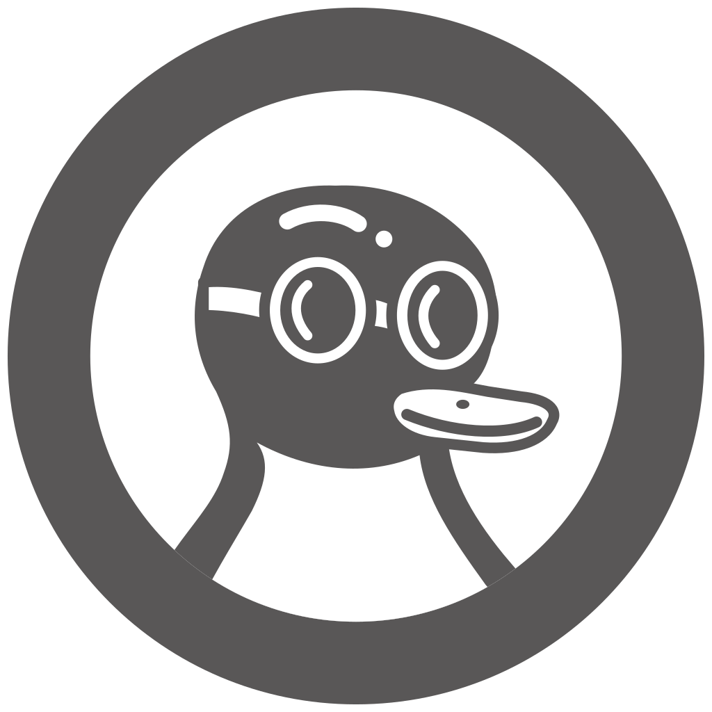
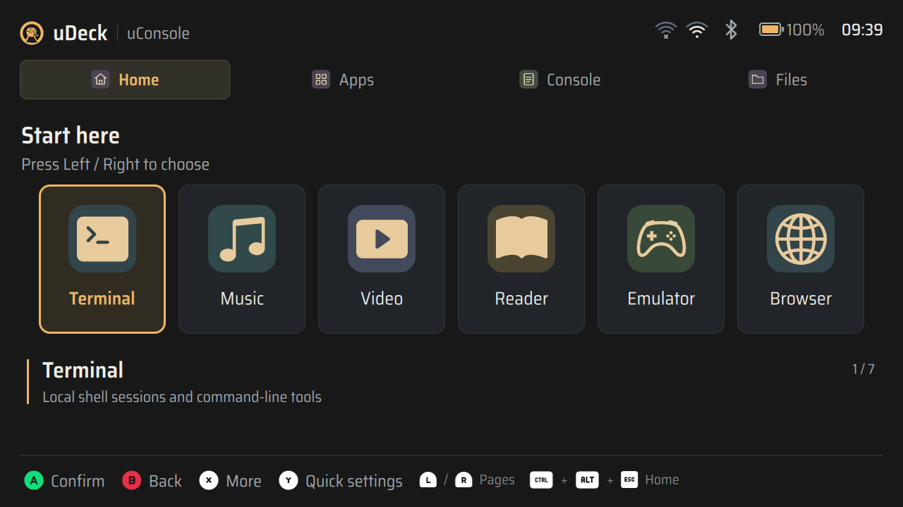
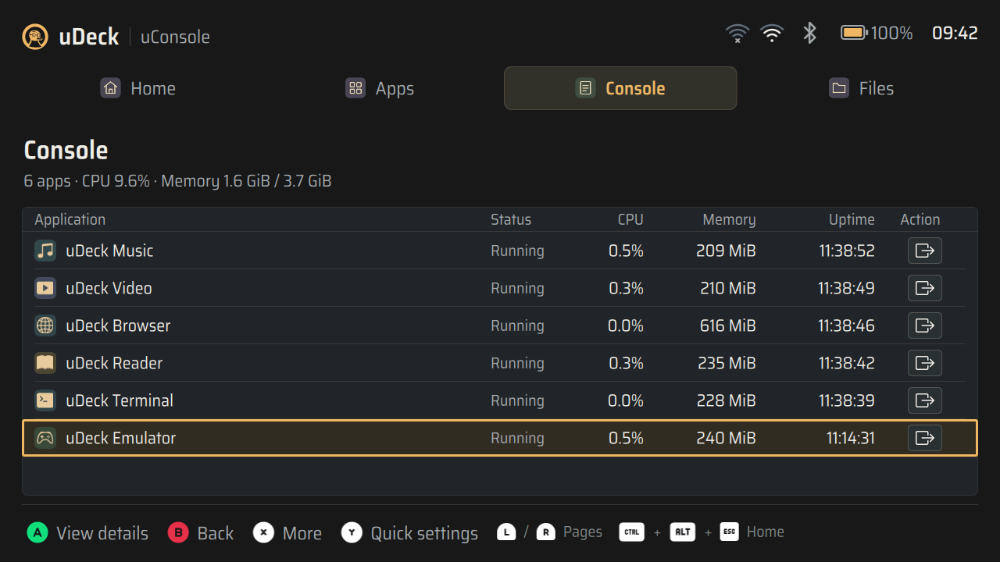
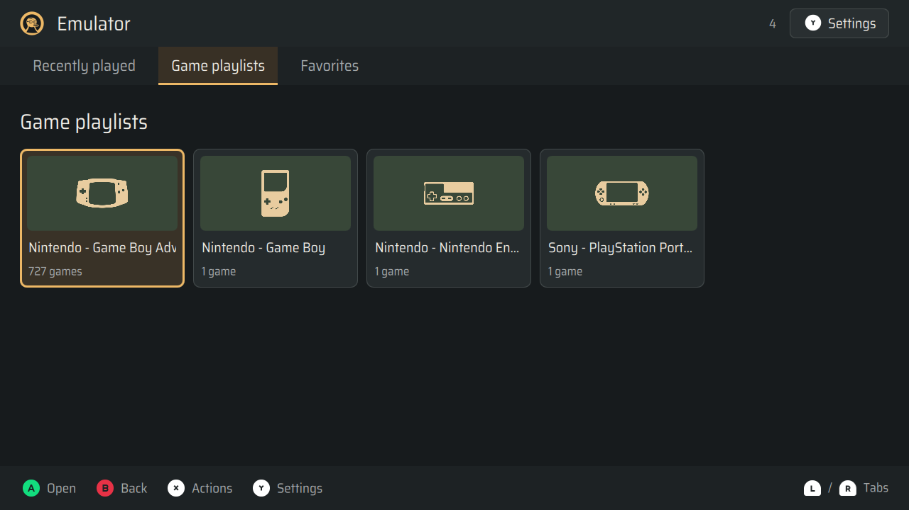

<p align="center">
  
</p>

<h1 align="center">uDeck</h1>

<p align="center">A native desktop for ClockworkPi uConsole.</p>
<p align="center">Debian 13 · Wayland · Qt Quick</p>

<p align="center">
  <a href="https://github.com/zhubby/uDeck/releases">Download</a> ·
  <a href="#installation">Install</a> ·
  <a href="docs/udeck/README.zh-CN.md">User guide</a>
</p>



- Navigate with physical buttons, a keyboard, or the trackball.
- Open Terminal, Music, Video, Browser, Reader, Emulator, and Agent from one desktop.
- Browse files, share folders, and configure Wi-Fi, Bluetooth, audio, and display settings.
- Inspect app resources in Console; pause games and save progress through RetroArch.

| Console | Emulator |
| :---: | :---: |
| [](docs/readme/console.png) | [](docs/readme/emulator.png) |

Captured on uConsole CM4 at 1280 × 720.

## Installation

Target: uConsole CM4, official v3.1 image, Debian 13, arm64.

Download, verify, and extract the [release bundle](https://github.com/zhubby/uDeck/releases), then run:

```sh
python3 ./udeck-preflight --json
sh ./install.sh
```

Choose **uDeck** at login, or run `udeck --windowed` inside labwc.
Installation preserves your desktop and login settings, and sets uDeck Terminal as default.
See the [installation guide](docs/udeck/debian-distribution.md) for requirements and recovery.

## Usage

| Control | Action |
| --- | --- |
| D-pad | Navigate |
| A / B | Confirm / Back |
| X / Y | Actions / Quick settings |
| L / R | Switch pages |
| `Ctrl+Alt+Esc` | Home |
| `Ctrl+Alt+Tab` | Console |
| `Ctrl+Alt+M` | Pause game |

Bring your own games and firmware for RetroArch.

## Contributing

Use uv 0.13.7 and the pinned Python version for a local preview:

```sh
uv python install
uv sync --locked --extra dev
uv run --locked --extra dev udeck --mock --windowed
```

See [development and testing](docs/udeck/development.md) for the complete workflow.

## Documentation

- [Documentation index (Chinese)](docs/README.md)
- [User guide (Chinese)](docs/udeck/README.zh-CN.md)
- [Native applications](docs/apps/README.md)
- [Console](docs/console/README.md)
- [Architecture (Chinese)](docs/udeck/architecture.md)
- [Hardware references (Chinese)](docs/uconsole/资料索引.md)

## License

[GPL-2.0-or-later](LICENSE). Bundled components retain their own licenses.
