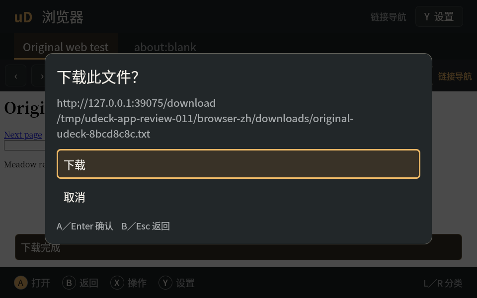

# 原生应用二次代码审查与修复

审查日期：2026-11-07。对象为已交付的 Music、Video、Browser、Reader、Games 实现（功能提交 `8375eb1`，交付记录提交 `4abcd0e`），本次修复从 `4abcd0e` 开始。原有 [review.md](review.md) 和 [verification.md](verification.md) 保留为上一轮记录。

按用户要求在主线程串行审查，使用 ce:review 的正确性、异步界面、测试、可靠性、安全、Python 与可维护性视角，没有使用子代理。只纳入已复现的问题；没有把未基准测试的性能推测列为缺陷。

## 已修复的 P1 问题

| # | 文件 | 触发与影响 | 修复及回归证据 | 置信度 / 路由 |
| --- | --- | --- | --- | --- |
| R1 | `apps/main.py` | 再次点击已运行应用的启动器时，默认 `command=null` 被单实例 IPC 拒绝，窗口无法正常唤起。 | 接收旧版 null/缺省命令，新启动器发送空字符串，仍拒绝非字符串参数；`test_normal_second_launcher_request_presents_existing_app`。 | 1.0 / safe_auto，已修复 |
| R3 | `apps/games.py` | 游戏运行时打开另一个文件，会先覆盖前端当前游戏身份；后续菜单、时长和存档目录可能属于错误游戏。 | 修改身份前拒绝操作；`test_new_open_request_cannot_replace_identity_of_running_game` 验证原身份保留。 | 1.0 / safe_auto，已修复 |
| R4 | `apps/games.py` | 手动存档途中再点“保存并返回”，失败仍留下退出标志，原存档完成后会退出；自动存档中“不保存退出”也会把标志留给下一局。 | 仅在自动保存请求成功后记录退出意图，并在游戏退出时清理；两个针对拒绝请求和退出生命周期的回归测试先失败后通过。 | 1.0 / safe_auto，已修复 |
| R6 | `apps/web.py`、`apps/qml/BrowserSurface.qml` | Qt Quick 下载对象无法转换为 Python 参数，下载确认不会出现；原异步确认也超出请求有效期，Qt 会在信号返回后删除未接受的对象。 | 下载对象留在 QML，Python 只处理基本类型；现有确认菜单通过局部 Qt 事件循环等待选择，接受/取消均在下载信号返回前完成。真实 QtWebEngine 验证取消零写入、确认后原始字节、重复下载保留旧文件，以及按返回键取消。 | 1.0 / safe_auto，已修复 |

## 已修复的 P2 问题

| # | 文件 | 触发与影响 | 修复及回归证据 | 置信度 / 路由 |
| --- | --- | --- | --- | --- |
| R2 | `apps/web.py`、`apps/qml/BrowserSurface.qml` | 阅读提取或链接导航的 JavaScript 回调晚到，可覆盖已切换的模式/标签/页面，或在新页面执行旧点击。 | 按当前标签和递增 generation 核对回调，导航、返回、刷新、模式切换均使旧请求失效；五类取消场景、有效新结果和重复回调均有断言。 | 1.0 / safe_auto，已修复 |
| R5 | `apps/games.py` | 保存/读取尚未完成即可恢复游戏，破坏暂停操作前提；恢复失败前还会先关闭菜单。 | 引擎忙时拒绝恢复，成功后才关闭菜单；单元回归和真实 RetroArch 保存/读取期间的恢复拒绝检查。 | 1.0 / safe_auto，已修复 |
| R7 | `apps/reader.py` | 直接打开下一本文档时保留旧书菜单及回调，并丢失 PDF 最后页码、缩放和平移；返回栈还会残留文档层。 | 切换前保存并持久化位置，关闭旧菜单/搜索和文档，保留正确的图书馆返回层级；真实 PDF→TXT、后续 EPUB/PDF 读取及返回断言。 | 1.0 / safe_auto，已修复 |
| R8 | `apps/books.py` | 损坏 EPUB 的 `BadZipFile` 没有被应用错误边界捕获，用户得不到可恢复的错误状态。 | 在打开边界转为已翻译的格式错误；坏 ZIP 单元测试和真实阅读器直接打开损坏 EPUB，核对旧位置已保存、旧会话关闭且无遗留菜单。 | 1.0 / safe_auto，已修复 |
| R9 | `apps/media.py` | 软件 scenegraph 的视频图像显示正常，但内嵌字幕只留在隐藏的 VideoOutput 中。 | 软件路径转发真实 QVideoSink 字幕及变更通知；真实带内嵌 SRT 的原创视频断言播放器文本、QML 可见文本和截图，标准 VideoOutput 继续处理自身字幕。 | 1.0 / safe_auto，已修复 |

## 验证和交付

最终代码本地全量测试：**350 passed, 2 skipped**，96.45 秒；两个跳过项为 macOS 当前未构建的 Linux Terminal 插件测试。13 条警告来自现有 dbus-next 弃用装饰器。新测试位于 `tests/test_apps_review.py`，真实引擎场景扩展在 `tests/apps_native_probe.py` 和 `tests/apps_games_probe.py`。

Ruff、wheel 构建、arm64 两个 Debian 包构建均通过。wheel 内 65 个源/资源文件与工作树逐字节相同；远端 118 个源/包装/工具输入哈希与本地相同；包内分别为 34 和 52 个文件，重叠为零，基础包未包含 Apps/Terminal 子包。uConsole 全量及安装后的结果在后续段落记录。

同一份最终代码在 uConsole（Debian trixie arm64、Qt 6.8.2.1）运行全量测试：**352 passed**，226.06 秒，零跳过。设置 `UDECK_TERMINAL_PLUGIN_PATH=/usr/lib/udeck-terminal/qml`、`UDECK_REQUIRE_NATIVE=1`，真实 Terminal 插件测试包含在这一轮结果中。

额外的真实 RetroArch/Gambatte 探针通过保存槽 1、自动保存、读取和进程重启后续玩，存档 **26,672 bytes**，错误列表为空；保存/读取期间尝试恢复均被正确拒绝。设备另跑中文 960×600 浏览器流程，下载取消、确认、原始字节、重复命名、表单和标签流程均通过，QML 错误为空。

已用 `apt-get install --no-remove` 将设备更新至 `udeck 0.1.8`、`udeck-apps 0.1.1`，移除项为零。安装后 55 个相关源/资源文件再次与源码哈希核对。只重启 `udeck-fullscreen.service`；运行壳报告 0.1.8，窗口协议检查通过。五个已安装应用使用独立验证数据目录在真实 Wayland 下逐一运行，普通启动器再次调用与旧版 `command=null` 请求均成功，并核对仍为原进程、原 PID；五个应用 QML 错误为空，原生输入路由均 `available=true, enabled=true`，退出码均为 0。

既有 Terminal 保持 0.1.1、PID **381833**、启动时间 **2026-11-06 15:40:10**；没有重启登录会话/compositor，也没有遗留测试 RetroArch。USB Wi-Fi 未进行连接切换，屏幕方向保持原状态，结束时恢复 `DSI-1 off`。全量日志与机器记录在本地忽略目录 `artifacts/apps/review-evidence/`，设备记录在 `/tmp/udeck-app-review-011/`。



| 产物 | SHA-256 |
| --- | --- |
| `udeck_0.1.8_arm64.deb` | `0e9c75aa744dc116c89c3d7a006e66cbe31d5dbc9be98c614171ada08a81af54` |
| `udeck-apps_0.1.1_arm64.deb` | `0624fb6d54987fd53568aa95cf4574b04244cd58370084a299899ccffbb1f511` |
| `udeck-0.1.8-py3-none-any.whl` | `162b2089302c321205eabc367a779da35b24e40111eff4e917ee3b80e3afea00` |

可复现的主要命令：

```sh
rtk proxy .venv/bin/pytest -q -rs
rtk proxy .venv/bin/ruff check src tests tools docs/design/app-suite
rtk proxy .venv/bin/python -m build --wheel
```

本轮增加四个中英提示，公共词条由基础包分发，因此基础包升级为 `udeck 0.1.8`，可选应用包升级为 `udeck-apps 0.1.1` 并要求该基础包版本。Terminal 版本和依赖保持原状态。

没有新增产品依赖。下载等待期间可继续处理 Qt 输入、绘制、关闭和网络事件；取消、关闭或切换标签会撤销等待，不保留已拒绝的 Qt 下载对象。上游对象生命周期依据 [Qt 6.8 WebEngineDownloadRequest](https://doc.qt.io/qt-6.8/qml-qtwebengine-webenginedownloadrequest.html#object-life-cycle)。

## 验收边界

本轮真实引擎测试使用原创媒体、文档、本地 HTTP 页面和原创 GB 程序。下载字节与字幕显示检查属于本地/设备自动化，不代表真实账户网站、任意下载站点、实体按键、音频听感或全部模拟器核心已经现场验收。前一轮验证记录中的其他现场验收项目继续适用。

## 结论

本轮确认的 9 项问题全部修复，第二轮针对修改范围的复查未留下未解决的 P0/P1/P2 代码问题。源码、测试、打包和安装后的检查通过，具备合并条件。Git 交付状态由提交后的本地/远端引用核对记录证明。
