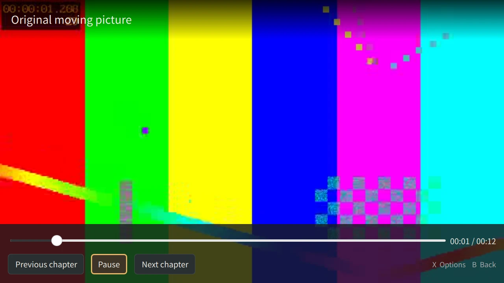

# 原生应用验证记录

日期：2026-11-07。范围：Music、Video、Browser、Reader、Games，以及壳的原生输入路由、翻译、启动器和 Debian 分包。基线为已批准设计 `62c4f53`。以下是原生 Python/Qt 应用的验证，设计原型的 499 项检查没有计入。

## 可重复验证

```sh
rtk proxy .venv/bin/pytest -q -rs
rtk proxy .venv/bin/ruff check src tests tools docs/design/app-suite
rtk proxy .venv/bin/python -m build --wheel --outdir artifacts/apps/wheel
```

本地最终结果：**332 passed, 2 skipped**，94.58 秒，13 条现有 dbus-next 弃用警告。两个跳过项均为 Terminal 原生插件测试，macOS 当前工作树没有构建该 Linux 插件。每次实际引擎测试在独立图形进程中运行；WebEngine、Multimedia 和 PDF 均使用真实模块。

uConsole：Debian trixie arm64、CM4 4 GiB、Qt 6.8.2.1、labwc。使用设备自带 `/usr/bin/python3`，在本任务的 `/tmp/udeck-app-validation/` 中运行同一测试树：**332 passed, 2 skipped**，215.19 秒。随后指定设备已安装的 Terminal 插件补跑两个跳过项，结果 **2 passed**，4.93 秒。因此本次全部 334 个测试在设备上均已执行通过；全量日志和插件补跑日志分别保留，未合并伪造单次结果。

```sh
rtk proxy env UDECK_TERMINAL_PLUGIN_PATH=/usr/lib/udeck-terminal/qml UDECK_REQUIRE_NATIVE=1 \
  QT_QPA_PLATFORM=offscreen QT_QUICK_BACKEND=software PYTHONPATH=src \
  python3 -m pytest -q tests/test_terminal_native.py
```

Ruff、wheel 构建和 Debian 分包构建均通过。Linux 原生插件验证只创建测试自己的 PTY/会话，没有操作已运行 Terminal 内的命令。

独立场景可这样复现，目录由测试生成原创内容：

```sh
rtk proxy env PYTHONPATH=src QT_QPA_PLATFORM=offscreen QT_QUICK_BACKEND=software \
  .venv/bin/python tests/apps_native_probe.py video /tmp/udeck-video-probe zh_CN 960 600
rtk proxy env PYTHONPATH=src WAYLAND_DISPLAY=wayland-0 DISPLAY=:0 \
  XDG_RUNTIME_DIR=/run/user/1000 DBUS_SESSION_BUS_ADDRESS=unix:path=/run/user/1000/bus \
  python3 tests/apps_games_probe.py /tmp/udeck-game-probe
```

游戏探针需要已安装 RetroArch 和 Gambatte；使用测试现场生成的原创 32 KiB GB 程序，不包含商业 ROM、Nintendo logo 或 BIOS。正常应用的 `--isolated --windowed --no-input` 使用临时状态，禁用桌面 IPC、音乐协调和硬件读取；Browser 使用内存 profile。探针所用离屏渲染与实机 Wayland 画面分别记录。

## 已覆盖行为

| 范围 | 实际检查 |
| --- | --- |
| 共享内容库 | 来源设备/inode、全内容指纹、扫描取消与 generation、缓存、来源丢失、项目身份、焦点保持、原子 JSON 与损坏状态保留。 |
| 输入与界面 | 五个应用 × 英文/简体中文的 960×600 QML 冒烟，1280×720 引擎流程；嵌套菜单、跳过禁用项、草稿保持、逐层返回、前台窗口与过期输入 generation。普通 abxy 在真实网页表单中提交为文字。 |
| Music | FLAC/MP3/AAC/WAV 实际播放与位置、seek、曲末队列切换、后台浏览、刷新不重建播放、真实输出设备选择、视频暂停令牌归属。 |
| Video | 有效解码帧和窗口颜色像素断言、内嵌字幕轨、外部 UTF-8 SRT、隐藏控件后保留字幕、seek、暂停保存和确认续播。目标设备另有 Wayland VideoOutput 真画面。 |
| Browser | 真实本地 HTTP、链接点击、第二页和历史返回、标签切换不销毁页面、关闭最后标签、阅读提取、指针、真实表单、书签和历史持久化。 |
| Reader | TXT/EPUB/PDF 实际内容与翻页、CFI/逻辑位置、字号、目录、搜索、书签、PDF 缩放/平移与真实搜索高亮；来源移除关闭文档及所属菜单。恶意 EPUB 脚本被 CSP 拦截，未产生测试标记。 |
| Games | 核心/固件/CUE 轨道预检；实际 RetroArch 的 PLAYING/PAUSED 状态；保存槽 1、自动保存、读取、结束进程后的自动续玩。存档内容/核心哈希、校验和、不完整写入、索引写入失败与损坏元数据拒绝。CUE 身份包含实际轨道内容。 |
| 游戏恢复 | 读档成功后恢复模拟器并收起前端；来源丢失禁用恢复/保存/读取；同一来源和内容返回后重新启用暂停菜单，保持原游戏进程。 |

RetroArch 真实设备探针保存文件为 **26,672 bytes**，返回 `saved:1`、`loaded`、`saved:auto`、`automatic-resume-after-process-restart`，错误列表为空，并生成缩略图。源码测试通过并不证明所有核心的存档格式或物理游戏体验。

## 原生截图

截图使用原创媒体、文档、本地测试网页及原创 GB 测试程序。设备离屏截图用于检查布局和引擎集成；Video 的 Wayland 图另行标明。保持目标桌面原有 720×1280 方向；1280×720 是应用窗口抓图尺寸，没有为测试旋转用户屏幕。

| 截图 | 来源 / 尺寸 |
| --- | --- |
| [Music 内容库](screenshots/music-library.webp)、[正在播放](screenshots/music-playing.webp) | uConsole，离屏 Qt，英文，1280×720。 |
| [Video 实际画面](screenshots/video-wayland.webp) | uConsole，Wayland 标准 VideoOutput，英文，1280×720。 |
| [隐藏控件与中文字幕](screenshots/video-captions-zh.webp) | uConsole，软件 scenegraph，中文，1280×720。 |
| [确认续播](screenshots/video-resume-compact-zh.webp)、[中文设置](screenshots/settings-compact-zh.webp) | macOS，离屏 Qt，中文，960×600。 |
| [Browser 网页与指针](screenshots/browser-pointer.webp) | uConsole，离屏 QtWebEngine，英文，1280×720。 |
| [EPUB 正文](screenshots/reader-epub.webp)、[PDF 搜索高亮](screenshots/reader-pdf-search.webp) | uConsole，离屏 QtWebEngine/QtPdf，英文，1280×720。 |
| [Games 核心预检](screenshots/games-preflight.webp) | uConsole，离屏 Qt，英文，1280×720。 |



## 引擎和依赖

Music/Video 最终选择 QtMultimedia，原因是与 QML 控件、音轨和实际输出状态直接合成；原设计中的 mpv 是待验证候选。标准路径使用 VideoOutput。实机尝试 V4L2 解码器时出现不可用日志，仍可用 FFmpeg 回退得到真实画面，因此不据此宣称硬件解码成功。

软件 scenegraph 下曾出现“帧有效但窗口黑屏”，已增加 CPU 解码帧 ImageProvider 路径并通过窗口像素检查。该路径最高呈现 15 fps，不是高分辨率或满帧率保证。

Browser 是 QtWebEngine 持久 profile；Reader 是独立内存 profile、带随机令牌的回环资源服务和 nonce CSP。foliate-js 固定到 `78914aef4466eb960965702401634c2cb348e9b1`，九份引入模块与上游逐字节核对，MIT LICENSE 随包分发。上游模块未进行完整独立安全审计。

## 安装与会话保护

基础包 `udeck 0.1.7` 与可选包 `udeck-apps 0.1.0` 分离；基础包继续排除 Terminal 和 Apps 子包。设备上已安装这两个版本，原有 `udeck-terminal 0.1.1` 保持。包构建前核对 119 个源/包装文件；包内分别为 34 和 52 个文件，重叠为零；六个可执行启动器、五个桌面入口、上游许可证均核对。安装后 65 个 Python/QML/资源源文件与工作树逐字节相同。

| 产物 | SHA-256 |
| --- | --- |
| `udeck_0.1.7_arm64.deb` | `ee2299c386673586764e51c9f982072908694409d95c6a6bb623cc5a202b06ed` |
| `udeck-apps_0.1.0_arm64.deb` | `5047f60a738a1a886b9d42af425c45049789b38d82b5612948561270d1d8e787` |
| `udeck-0.1.7-py3-none-any.whl` | `088c4d726640cdf48457e6ceb45e8fed40728201cbeafe740db2f6c980f22a34` |

安装命令使用 `apt-get install --no-remove`，仅升级基础包、新增应用包，移除项为零。安装前保留了原 Python 安装目录快照。只重启现有 `udeck-fullscreen.service`，新的运行壳报告 0.1.7、窗口协议及 Wi-Fi/蓝牙/音频/亮度/电池服务可用；没有重启 compositor、登录会话或 Terminal。

安装后的五个实际启动器逐一以真实 Wayland、独立验证数据目录和 `--no-input` 运行：Music/Video 的观察位置前进；Reader 加载 EPUB；Browser 请求本地 HTTP 测试页并取得页面标题；Games 打开原创 GB 的真实核心预检。五个进程均正常退出、QML 错误为空；壳对每个应用的 `NativeInputState` 均为 `available=true, enabled=true`。该 IPC/焦点核对不算实体手柄验收。

目标机的 USB Wi-Fi 是 SSH 路由，全程保持连接；不改变无线配置、登录默认项、屏幕方向和用户媒体/RetroArch 配置。结束时核对现有 Terminal PID **381833** 及原启动时间 **2026-11-06 15:40:10** 均保持；没有遗留测试 RetroArch。已恢复任务开始时的屏幕关闭状态，`wlopm` 返回 `DSI-1 off`。

完整日志及机器可读检查保存在本地忽略目录 `artifacts/apps/release-evidence/`，设备副本在 `/tmp/udeck-app-validation/`；安装包在本地 `artifacts/apps/packages/`。这些是本次验证产物，不作为产品依赖分发。

## 待现场验收

- 实体 ABXY、方向键、全部肩键、Start/Select、轨迹球及外接手柄的实际交接；当前原生输入状态/窗口检查不替代现场按键。
- 音频听感、蓝牙输出切换、视频音画同步、长时间播放、硬件解码和分辨率/帧率性能。
- 中文输入法候选、真实账户网站、上传、下载、权限、证书以及复杂站点的适配。
- 大型或特殊排版 PDF/EPUB、中文竖排、真实 SD 物理拔插、文件系统重挂载和断电恢复。
- GB 以外 GBA/SNES/NES/PS1 的实际游戏帧率、音频、核心差异和全部游戏兼容性。

这些项目保留为现场验收范围，没有用离屏截图、进程存活或 GB 的通过推断完成。
