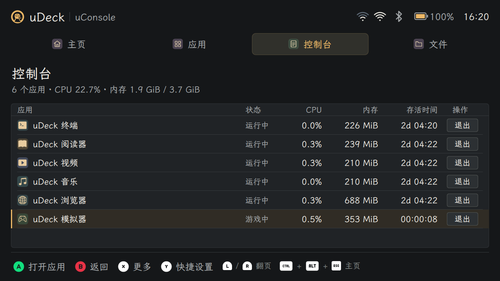

# Console 应用运行面板

Console 取代 Running 页面。中文名称为“控制台”。
每个应用占一行，列出状态、CPU、内存、存活时间和退出操作。
1280×720 窗口显示七个完整应用行。

## 操作

- 上下选择应用。点击应用行或按 A、Enter 打开详情。
- 详情实时显示状态、CPU、内存、存活时间、PID 和进程数。
- 详情提供打开应用、退出、强制终止和关闭。
- 方向键选择详情操作。B 或 Esc 关闭详情并保留应用选择。
- 应用退出后，详情禁用应用操作，保留关闭入口。
- 右方向键移至“退出”。左方向键返回应用入口。
- 列表用箭头离框图标表示退出。悬停或选中时显示提示。
- X 打开菜单，提供退出、窗口列表和强制终止。
- 强制终止单独确认，默认选择取消。
- Ctrl+Shift+Esc 打开原有控制面板。
  其中的 Console 入口进入此页面。

模拟器前台和 RetroArch 游戏窗口归入同一行。
状态区分运行中、游戏中、已暂停和退出中。
正常退出先发送 QUIT，再写回原生 SRAM，最后关闭前台。
这个操作不创建即时存档。
退出或持久化失败时保留前台并显示错误。
终端沿用逐窗口的会话关闭确认。

## 统计与进程边界

`runtime_console` 独立承担身份查询、统计和退出。
桌面控制器只桥接导航与确认菜单。
`ConsoleModel` 增量更新指标，保留选择和滚动位置。

会话 D-Bus 所有者确定应用主进程。
`/proc` 的 PID 与启动时刻共同确定进程身份。
子进程归属最近的独立应用主进程。
多个应用共享主进程时，统计显示“—”，禁用强制终止。
无法验证身份的外部窗口仍支持正常关闭请求。

CPU 按整机总量归一到 0–100%。
内存为进程树 RSS 之和，共享页按进程重复计算。
存活时间从应用主进程启动时刻计算。
页面在前台时每秒刷新一次。
隐藏后停止刷新，丢弃迟到的采样结果。
单次只提交一个采样任务；D-Bus 请求按操作去重并设置超时。
PID 查询失败后等待下一轮刷新，不在失败回调中重试。
模拟模式不连接会话总线。
原生退出等待所有者，优先发送 RequestQuit。
旧版应用缺少接口时，核对原目标后请求关闭窗口。

强制终止再次核对 D-Bus 所有者与确认时的应用身份。
发送信号前用 pidfd 固定全部目标进程。
校验失败时取消操作。信号按子进程到主进程的顺序发送。

详情按应用标识订阅实时指标，不依赖列表行号。
指标刷新保留详情中的操作焦点。
鼠标点击弹窗外部不会穿透到应用列表。
强制终止取消后返回详情，确认前保持应用运行。

## 验证记录 · 2026-11-16

源码位于 `codex/console-runtime-panel` 隔离工作区。
实机使用独立源码目录与测试游戏库。
设备安装包保持 0.2.24；本轮不替换安装包。
测试后恢复原模拟器启动方式和用户游戏库。
机器可读结果见 [verification.json](verification.json)。

本地覆盖进程统计、PID 复用、模型增量、导航与退出失败。
最终关联套件 387 项通过、1 项 Linux 专属测试跳过。
实机新增套件 32 项通过，包含真实 pidfd 进程树终止。
实机关联套件分进程执行，135 项通过。
Ruff 与 `git diff --check` 通过。
QML 覆盖中英文、双主题及 1280×720、960×600 尺寸。
滚动到第九行后刷新指标，选择与滚动位置保持稳定。

uConsole CM4 的真实 Wayland 会话覆盖：

- 六个正在运行的应用及真实资源统计。
- 方向键、左右退出焦点、连续刷新和仅可见期采样。
- 测试应用强制终止的取消、确认与子进程清理。
- 模拟器游戏窗口聚合与游戏中、暂停状态。
- GBA、GB、NES 的打开、暂停、恢复、离开和返回。
- 三个平台的手动存读档、保存退出及不保存退出。
- Console 正常退出写回 8192 字节 SRAM，校验字节 0x5A。
- 正常退出前后即时存档均为空，其他应用进程身份保持一致。

设备混合离屏套件在 `test_i18n.py` 的 `processEvents()`
出现 Qt 原生崩溃或卡住。
未修改基线在同一位置复现卡住。
按文件启动独立 pytest 进程后，关联回归通过。
这些自动化验证不替代人工物理按键验收。

### 详情弹窗补充验证

关联本地回归 104 项通过，实机离屏回归 25 项通过。
QML 矩阵覆盖真实鼠标事件、确认键和返回键。
覆盖实时指标、模态点击隔离和退出按钮独立生效。
应用退出或列表缩短后，详情操作与选择不偏移。

真实 Wayland 会话验证鼠标点击、Enter 打开详情。
验证指标刷新、强制终止默认取消及返回详情。
模拟器 PID、主桌面和其他应用身份保持不变。
本轮实机使用独立预览，安装包保持不变。
预览直接加载应用目录，本轮不覆盖桌面冷启动。

### 审查与图标退出复验

本地关联回归逐文件执行：295 项通过，1 项跳过。
实机新增套件 45 项通过。
修复查询重试、状态加载期间退出和滚动悬停三项问题。
实机验证图标退出、详情操作与模拟器 SRAM 写回。
完整结果见 [审查记录](review-2026-11-16.md)。

[PROTOCOL]: Update this header on change, then check AGENTS.md
