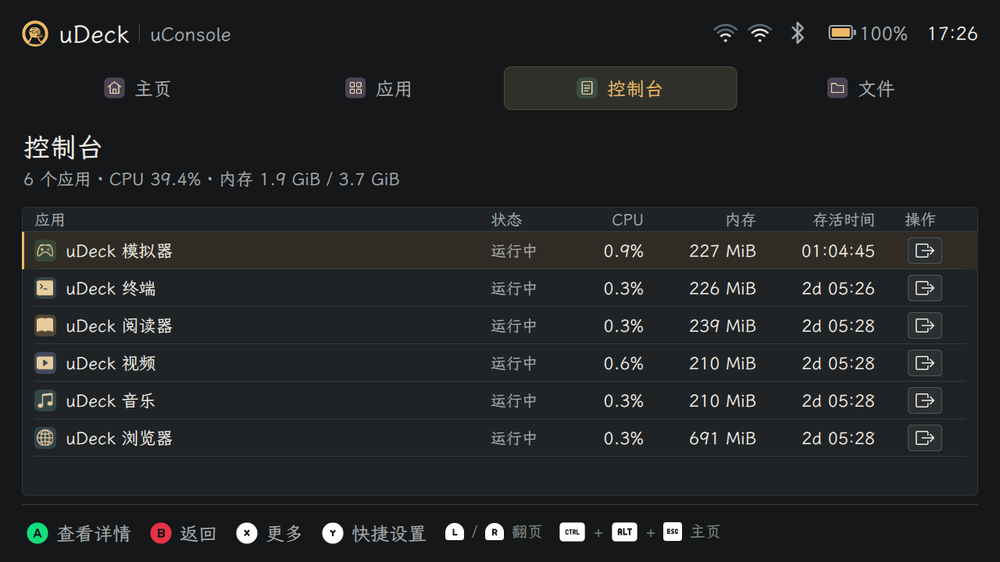
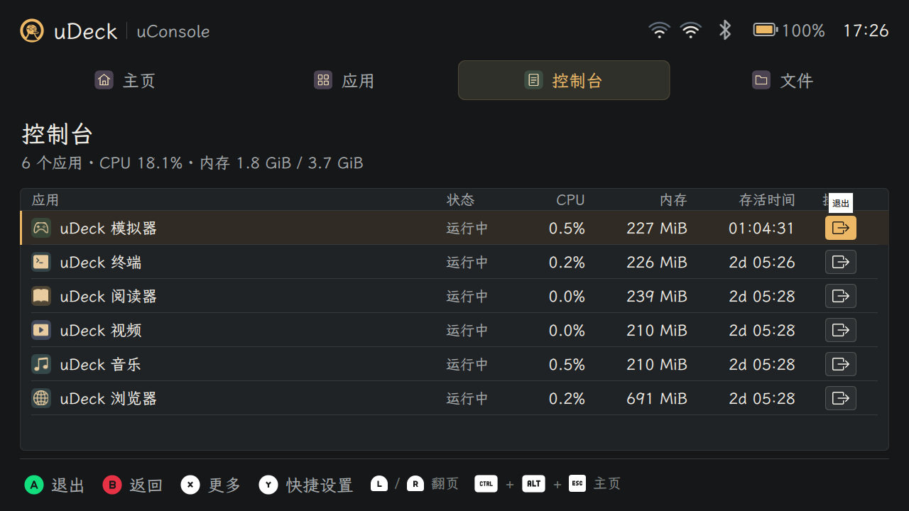

# Console 审查与实机复验

本轮审查覆盖全部待提交 Console 改动。
范围包含运行统计、应用退出、详情弹窗和列表图标。
按项目约定在主线程顺序审查。
复核正确性、身份安全、异步边界、测试和文档。

| 级别 | 已复现问题 | 修复 |
| --- | --- | --- |
| P2 | PID 失败回复立即重新查询 | 下一轮定时刷新再重试 |
| P2 | 原生状态未返回时退出走关闭窗口路径 | 先调用所有者的 RequestQuit，旧接口才回退 |
| P3 | 静止指针的提示未随滚动刷新 | 显式订阅滚动，并检查视口裁剪 |

三项均先观察到回归失败，再提交修复。
旧接口回退再次核对应用身份。
超时不回退；应用重启后不关闭替代窗口。
滚动探针重新查找代理，允许 Qt 回收离屏行。
当前无未解决的确认问题。

## 源码与设备验证

本地关联测试按 21 个文件隔离执行。
295 项通过，1 项 Linux pidfd 测试跳过。
实机新增套件 45 项通过，包含真实 pidfd 终止。
Ruff 与差异空白检查通过。
QML 覆盖中英文、双主题和两个窗口尺寸。

真实 uConsole CM4 Wayland 会话验证：

- 鼠标与确认键打开详情，打开应用复用原进程。
- 指标持续刷新，详情操作焦点保持不变。
- 模态点击隔离、终止默认取消和返回选择。
- 图标悬停提示、键盘焦点和真实点击退出。
- 仅退出隔离窗口；强制终止清理其子进程。
- 隐藏页面停止采样；中英文与双主题正常显示。
- 旧版原生接口回退关闭空闲模拟器。
- 新版模拟器游戏窗口聚合，游戏中与暂停状态正确。
- Console 正常退出写回 8192 字节 SRAM，首字节为 0x5A。
- 正常退出未创建即时存档。

测试后恢复原模拟器命令、源码路径和用户游戏库。
原主桌面与其他五个应用的进程身份保持一致。
安装包保持 0.2.24，未执行包替换。
这些输入为内核虚拟输入，不代表人工物理按键验收。
预览直接加载应用目录，不覆盖桌面冷启动。

## 已隔离的基线问题

扩展混合套件出现 Qt 原生崩溃。
在未修改 6f5034e 源码重跑关联混合套件，
同样在终端激活测试中以 SIGSEGV 结束。
因此本轮采用逐文件独立进程运行。
未删减断言或改变现有终端测试。
设备既有 i18n 混合套件问题仍按先前记录保留。

原 main 工作区的九处差异逐文件核对。
其内容均与已交付的 6f5034e 相同。
集成前保留 Git 恢复备份，避免覆盖独立修改。

结构化发现见 `.context/compound-engineering/ce-review/2026-11-16-console-runtime-panel/review.json`。
测试与恢复数据见 [verification.json](verification.json)。

[PROTOCOL]: Update this header on change, then check AGENTS.md
