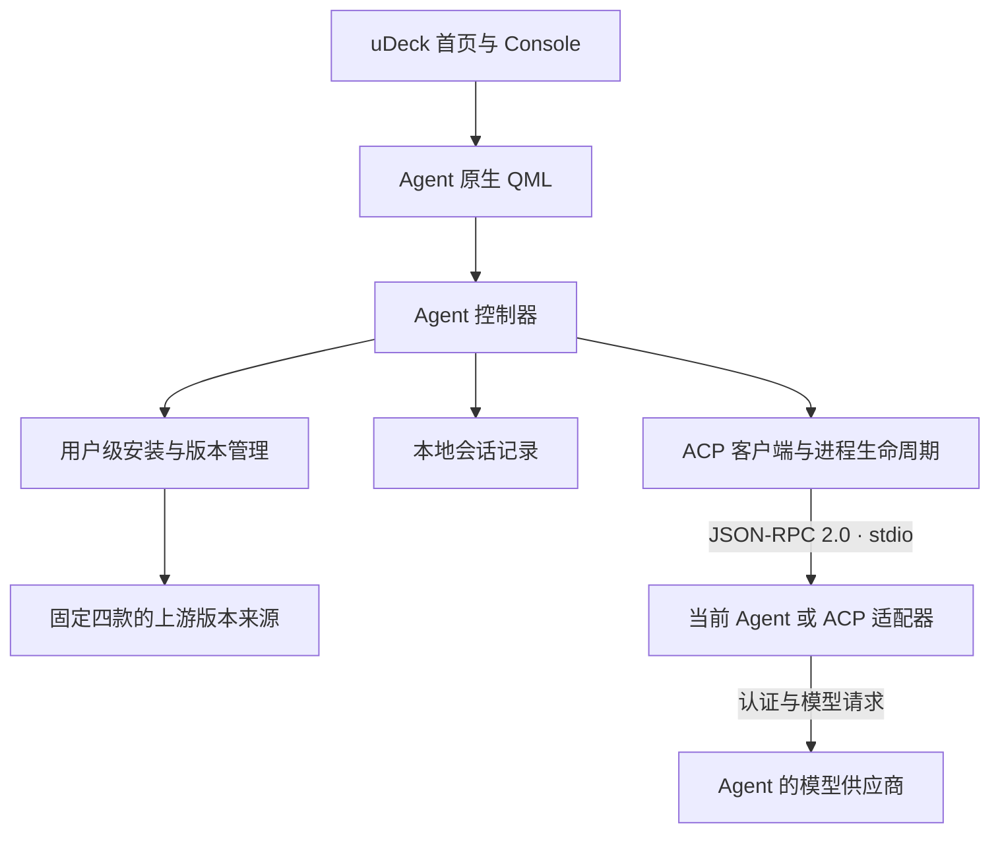

# Agent 设计与实施

状态：实现候选
日期：2026-11-26
目标设备：uConsole CM4，Debian 13 arm64，labwc

## 产品范围

- R1. Agent 是首页第一张卡片，继承内置应用的启动、激活、输入交接与退出流程。
- R2. 首期提供 Codex、Claude Code、OpenCode、Pi Agent。每款都能在应用内安装、检查更新、升级、登录并开始会话。
- R3. 用户选择 Agent 和本地工作目录后，发送提示词、查看流式回复和工具状态、处理 Agent 发出的权限请求，并停止当前轮次。
- R4. 保存本地会话记录，有恢复能力时接回原会话。关闭应用、安装中断或 Agent 异常退出后可继续使用。
- R5. 首页和 Debian 单包提供 Agent 界面。Agent 运行时按需下载。日常安装与升级使用当前用户权限。

首期采用本机 ACP stdio、固定四款 Agent、一个活动会话和多个已保存会话。远程连接、自定义 Agent、并行会话与跨 Agent 上下文迁移列入后续范围。

## 界面与按键

### 会话

打开 Agent 直接进入会话。标题栏和按键栏使用共享窗口。会话占满两栏之间的空间。会话栏显示 Agent、工作目录和连接状态。输入框固定为一行，右侧内嵌发送按钮。按键栏随阅读、编辑和生成状态切换。

会话栏、消息区和输入框共用左右边距。提问和回复共用头像位置、卡片宽度及正文内边距。工具、通知、会话信息和用量的详情默认折叠。同一行显示标题、状态与详情按钮。正常结束的轮次显示一行完成提示。计划逐项显示完成、执行和等待状态。差异使用上下排列的删除和新增面板。

新建流程为「选 Agent → 选目录 → 登录（需要时）→ 开始会话」。选择已保存会话时显示 Agent 与目录，目录失效时提示用户重新选择或处理原路径。换 Agent 或换工作目录会新建会话。历史会话可重命名、删除本地记录。首期支持文本提示词和中文输入法。

### Agent 管理

右上角「设置 → 管理 Agent」打开管理页。尚未安装 Agent 时，新建入口也打开管理页。左侧列出四款 Agent，右侧显示安装状态、版本和主操作。按 A 打开安装、登录、连接测试、升级、重试和回退菜单。会话返回认证要求时显示「需要登录」。按 B 或点右上角「返回」回到原会话，保留草稿与阅读位置。

用户打开「检查更新」后才请求版本元数据。Agent 应用首次打开时允许离线查看已安装版本和本地会话。安装记录区分下载、校验、安装、连接测试和故障原因。

### 输入

| 所在层 | 方向键 | A / Enter | B / Esc | X / F2 | Y / F3 |
| --- | --- | --- | --- | --- | --- |
| 会话阅读 | 上下逐条阅读，左回最新回复，右进入输入 | 展开详情、控制音频或执行当前会话操作 | 返回首页 | 开历史 | 生成时停止，其他时候开会话操作 |
| Agent 管理 | 上下选择 Agent，左回会话 | 打开操作菜单 | 返回会话 | 打开操作菜单 | 打开操作菜单 |
| 输入框 | 光标与输入法候选 | A 发送，Enter 发送或确认候选 | 先关闭候选，再退出编辑 | — | — |
| 权限确认 | 选择 Agent 提供的选项 | 确认当前选项 | 取消或拒绝 | — | — |

键盘使用 Enter 或 Ctrl+Enter 发送。输入法组词期间保留候选键。发送后焦点返回会话。长消息先在本条内滚动，再移动到相邻消息。拖动滚动条时暂停跟随，回到末尾时恢复跟随。轨迹球可选中文本和点击工具详情。返回首页保留草稿及活动会话。后台或锁屏收到权限请求时等待用户回到前台处理。界面适配 1280×720 和 960×600。

待确认请求排在相应回复之后。会话末尾有可操作卡片时，按下方向键选中卡片。双选项请求将拒绝与确认并排放在卡片内。表单继续使用共享弹层和按键提示。

前台跟随最新消息时，正文按帧追加。长段落加速追上已收到的文本。减少动画、退到后台或阅读历史时直接显示已收到的内容。回复完成后排版 Markdown 标题、列表和代码。思考、工具、上下文摘要及子 Agent 的详细内容可展开。计划显示步骤状态，文件差异分别显示修改前和修改后的内容。

图片支持内联预览，内联音频由用户按键或点击播放。资源、终端和关联会话显示引用。网页链接以文本呈现。工具引用保留 Agent 提供的标识。

快捷命令插入单行输入框。模式和配置组件提交 ACP 请求。上下文用量显示 token 和累计费用。正文、思考、计划、工具、摘要和子会话显示在同一时间线。工具、计划、摘要和会话元数据更新原有组件。即时通知和交互请求只显示在活动会话。

会话操作菜单支持添加和移除附件。图片、音频和内嵌文本按 Agent 声明的输入能力发送。文件也可作为资源引用发送。

## 四款 Agent 的接入

| Agent | 安装与 ACP 入口 | 登录路径 |
| --- | --- | --- |
| Codex | 固定版本的 `@agentclientprotocol/codex-acp`。适配器通过包依赖携带兼容的 `@openai/codex`，启动入口为 `codex-acp`。 | 从 uDeck Terminal 启动配套的 `codex login`，支持浏览器或设备码。 |
| Claude Code | 使用 `agentclientprotocol/claude-agent-acp` 提供的 Linux ARM64 glibc 归档。归档包含 ACP 适配器和 Claude CLI。 | 从 uDeck Terminal 启动配套的 `claude auth login`。 |
| OpenCode | 使用 ACP Registry 中 `opencode` 的 Linux ARM64 glibc 归档。启动入口为 `opencode acp`。 | 使用 `opencode acp --login` 进入 OpenCode 的终端登录，由用户选择模型供应商。 |
| Pi Agent | 同一版本目录中安装固定配对的 `pi-acp` 和 `@earendil-works/pi-coding-agent`。适配器调用配对的 `pi --mode rpc`。 | 使用 `pi-acp --terminal-login` 打开 Pi 的供应商设置与登录。 |

截至 2026-11-26，ACP Registry 提供四款的分发条目。具体首发版本及配对由 Debian 13 arm64 兼容测试确定。Debian 13 的 Node.js 包为 20.x，已核对的 Pi Agent npm 包要求至少 22.19.0。方案首选按需下载并校验官方 Linux ARM64 Node.js 24 LTS，供需要 Node.js 的适配器复用。Claude Code 和 OpenCode 走独立二进制路径。运行时最低版本取所选包及依赖的整体要求。

- [ACP Registry](https://cdn.agentclientprotocol.com/registry/v1/latest/registry.json)
- [Codex ACP](https://github.com/agentclientprotocol/codex-acp) · [认证状态](https://github.com/agentclientprotocol/codex-acp/blob/main/docs/auth-status.md)
- [Claude Agent ACP](https://github.com/agentclientprotocol/claude-agent-acp) · [Claude Code 登录](https://code.claude.com/docs/en/authentication)
- [OpenCode ACP](https://opencode.ai/docs/acp/)
- [Pi ACP](https://github.com/svkozak/pi-acp) · [Pi Agent 包元数据](https://registry.npmjs.org/@earendil-works%2fpi-coding-agent/latest)
- [Debian 13 Node.js](https://packages.debian.org/trixie/nodejs) · [Node.js 发布周期](https://nodejs.org/en/about/previous-releases)

## 运行结构

图中展示组件职责和数据流。

### 应用入口

使用 `io.github.zhubby.uDeck.Agent` 和 `udeck-app agent`。沿用 `app_routing.py` 白名单、会话 D-Bus 服务、窗口激活确认和 Console 退出入口。首页前三项为 Agent、模拟器、浏览器。终端紧邻设置之前，沿用横向滚动。Agent 控制器只接受固定应用动作，工作目录由应用内选择器确认。共享运行层需要给 Agent 提供面向会话的界面和输入。文件索引、MIME 关联和媒体栏继续由各内容应用使用。

应用模块位于 `src/udeck/apps/agent/`。控制器连接界面与会话，ACP 客户端处理协议和进程，版本管理器处理下载与安装，会话存储保留本地记录。供应商差异集中在 `catalog.py`。

### ACP 连接与执行权限

1. 用户连接时，以固定程序和参数启动本地子进程。异步解析 stdout 的逐行 JSON-RPC 2.0 消息，stderr 用于受限诊断。分别处理回复、通知和 Agent 发来的请求，并给握手、请求和停止设置各自的超时。
2. 本机客户端以官方 TypeScript SDK 2.12.0 的稳定版 ACP v1 为协议基线。握手后按 Agent 声明提供认证、登出、会话分页、加载、恢复、关闭、删除与配置操作。终端认证复用 uDeck Terminal，使用实际命令退出码判断结果。
3. `session/prompt` 启动一轮。结束组件分别显示正常完成、取消、拒绝、token 上限和请求次数上限。停止发送 `session/cancel`。超时保留部分回复并回收受控进程。
4. Agent 的权限请求显示工具、目标和可选答复。客户端文件操作限制在用户选择的目录内。写文件和启动终端前显示待确认请求。终端组件显示输出、退出状态与截断标记。表单和 URL 交互使用共享菜单。
5. 会话连接选项支持额外目录、系统指令与 MCP 配置。子会话事件标注来源。子会话取消取决于该子会话的能力声明。Agent 自行执行的工具遵循其上游权限模式和系统用户权限。

退出应用时先取消会话，再关闭 stdin，最后回收该 Agent 启动的进程。连接、升级与会话切换带有状态代次，旧进程的事件无法覆盖新会话。Agent 流量和安装任务均在用户操作后启动，分段合并输出以减少 CM4 上的重绘。

- [ACP 协议与版本协商](https://github.com/agentclientprotocol/agent-client-protocol)
- [稳定版 ACP v1 对照版本](https://www.npmjs.com/package/@agentclientprotocol/sdk/v/2.12.0)
- [Pi ACP 执行边界](https://github.com/svkozak/pi-acp#limitations)
- [uDeck 原生应用架构](app-suite/native-integration.md) · [终端启动方式](../udeck/terminal.md)

### 会话事件与组件

| ACP `session/update` | 会话组件 |
| --- | --- |
| `user_message_chunk`、`agent_message_chunk`、`agent_thought_chunk` | 用户消息、流式正文、可展开的思考 |
| `tool_call`、`tool_call_update` | 按工具调用 ID 更新状态和结果 |
| `plan`、`plan_update`、`plan_removed` | 清单或 Markdown 计划，按计划 ID 更新和移除 |
| `available_commands_update`、`current_mode_update`、`config_option_update` | 快捷命令、模式切换、选择项和布尔开关 |
| `session_info_update`、`usage_update`、`notice` | 会话信息、上下文用量与费用、通知 |
| `compaction_update`、`compaction_summary_chunk` | 上下文压缩状态与摘要 |
| `subagent_update`、`session_message`、`session_message_chunk` | 子会话状态、会话间消息和追加内容 |

正文和工具的嵌套内容共享文本、图片、音频、资源链接及内嵌资源组件。工具还能返回差异、终端引用与会话引用。权限、文件确认、终端输出、表单和 URL 交互在会话时间线上显示。URL 经确认后显示处理中，收到 `elicitation/complete` 时更新原组件。

### 安装和升级事务

- 管理器用内置来源白名单和兼容范围筛选四款稳定版本。二进制归档校验来源、哈希和解包路径。npm 在私有暂存目录按精确版本解析并记录依赖锁与包完整性。Node.js 作为独立运行时验证官方发布校验清单并登记版本。启动时使用已落盘的版本及其绑定的 Node.js，不经过 npm 在线解析。
- 下载到用户数据目录下的暂存区。校验通过后解包，使用私有临时 Home 执行 ACP 握手。通过检查后原子切换活动版本，并保留上一份可启动版本。用户可在安装后登录并打开会话。
- 同一用户的安装与升级任务互斥，切换版本前结束对应 Agent 的活动会话。断网、磁盘满、用户取消或握手失败均在版本切换前退出。应用重启时以已提交的版本登记为准，回收未完成的暂存区并允许重试。用户恢复旧版本前同样关闭该 Agent 的活动会话。
- 安装与升级文件写到 `$XDG_DATA_HOME/udeck/apps/agent` 下的运行时目录。认证资料由 Agent 的原生账户机制持有。恢复旧版本只切换启动组件，仍需用该版本实际返回的结果确认原会话能否加载。应用升级与 Agent 升级各有独立版本。

### 会话记录与恢复

SQLite 保存会话索引、工作目录、消息和结束原因。流式消息按批持久化。已有本地记录时优先使用 `session/resume`。收到 `session/load` 回放时，客户端按用户消息对齐轮次并按标识更新结构化记录。首次打开 Agent 端会话时，用回放构造本地历史。中断后的部分回复保留在记录中。

对话文本保留原语言。诊断只记录状态、版本、退出码与去敏后的有限 stderr。权限弹层只展示结构化数据或纯文本。凭据留在上游登录流程或其原生凭据存储。

## 实施与验证

- [x] **阶段 1 · 原生应用入口（R1、R5）**。首页卡片、共享窗口、应用路由、图标和包内资源。首页探针覆盖三种尺寸、双语言、双主题和卡片滚动。
- [x] **阶段 2 · ACP 会话（R3、R4）**。本机子进程、增量消息、权限、取消、历史查看与恢复。`tests/test_agent.py` 用 ACP 模拟进程验证请求与回执、中文消息、工具权限、停止、恢复及原生会话视图。
- [x] **阶段 3 · 分发与版本管理（R2、R4、R5）**。四款分发与固定登录命令，显式检查更新、用户级安装、握手检查、升级与回退。`tests/test_agent.py` 用归档夹具验证升级失败保留原版本，以及升级后回退。
- [x] **阶段 4 · 软件验证（R1–R5）**。源码和离屏回归、Debian 13 ARM64 候选包、包内启动，以及官方分发包在 ARM64 容器中的 ACP v1 握手。
- **ACP v1 协议验证**。稳定版的 19 类会话更新覆盖用户消息、正文、思考、工具、计划、快捷命令、模式、配置、会话信息、用量、通知、上下文摘要、子会话及会话间消息。补充协议测试覆盖出站请求、文件和终端回调、结构化输入、取消及五种结束原因。

## uConsole 验收

目标设备使用独立的测试目录与账户。从首页第一张卡片分别完成四款 Agent 的登录、提示词、停止和会话恢复。使用实体方向键、ABXY、轨迹球和中文输入法核对操作。锁屏或返回首页时观察权限等待和焦点恢复，通过 Console 退出后核对进程清理。记录冷启动、流式输出期间的输入延迟和内存。此项需要设备和供应商账户。

[PROTOCOL]: Update this header on change, then check AGENTS.md
