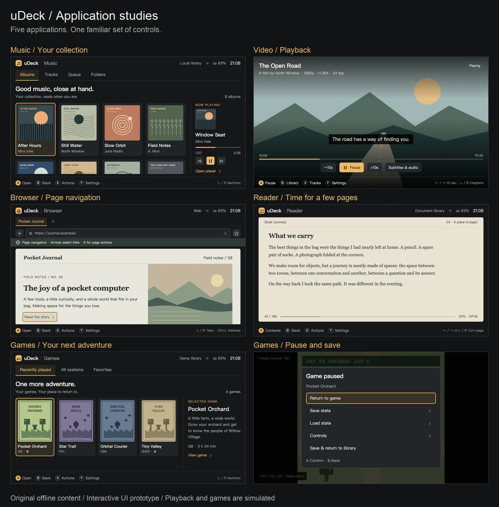

# uDeck 应用套件设计

目标：为当前 uDeck 设计音乐、视频、浏览器、文档阅读器与模拟器前端。五个应用遵循现有的实体按键、视觉与中英切换约定。

本目录包含产品交互规范与可操作设计原型。原型用于核对布局、信息层级、状态与导航；真实解码、网页引擎、PDF/EPUB 排版和模拟器核心由后续原生应用接入。评审工具与场景选择位于产品窗口之外。

## 共同约定

- 暗色基底 `#151719`，内容面 `#202326`，文字 `#f1eee7`，次要文字 `#a8acae`；焦点为 `#edb866` 的 3px 描边和暖灰底。
- 主目标为 1280×720，最小评审尺寸 960×600。内容区正文 24px，元信息 20px，内容标题 34px。文档正文允许独立字号与阅读配色。
- 方向键移动可见焦点；A 进入/确认；B 关闭当前弹层、返回上层；X 打开当前项目操作；Y 打开应用设置。L/R 切换当前层的标签、章节或曲目，底栏明确说明。
- 弹层期间方向键只在弹层内移动，B 返回后恢复原项目。列表按稳定 ID 保存焦点，筛选/刷新不通过位置猜测当前项目。
- 实体键盘保留文字、修饰键与输入法；不把普通 A/B/X/Y 字母当成按钮。浏览器原生网页与游戏进程得到输入后，套件导航停止截获。
- 默认英文，支持简体中文；页面切换、弹层、搜索输入和媒体/阅读位置在语言切换时保留。内容标题、文件名、网址和游戏原名不作翻译。

## 应用设计范围

| 应用 | 起始界面 | 核心内容状态 | 关键延续行为 |
| --- | --- | --- | --- |
| Music | 专辑、曲目、播放队列、文件夹 | 专辑曲目、正在播放、队列编辑 | 返回浏览时播放继续；关闭播放器确认停止；切换输出保留位置 |
| Video | 继续观看、全部视频、文件夹 | 播放、进度定位、字幕/音轨/章节 | 恢复确认；B 回到库并暂停；主界面只在操作时覆盖画面 |
| Browser | 新标签、书签、历史 | 网页、标签管理、地址输入、页面操作 | 导航/阅读/指针/文字四种模式明确区分；B 先离开操作模式再返回 |
| Reader | 最近阅读、书架、文件夹 | EPUB/TXT 阅读、PDF 适宽、目录、书签 | 返回保存位置；排版/缩放保留逻辑位置；搜索下一处与恢复焦点 |
| Games | 最近玩、系统、收藏 | 游戏详情、启动检查、运行菜单、存档槽 | 释放所有手柄给模拟器；运行时普通 B 是游戏键；专用组合键打开菜单 |

## 评审入口



从仓库根目录启动本地预览：

```sh
rtk proxy python3 -m http.server 8876 --bind 127.0.0.1 --directory docs/design/app-suite
```

打开 [交互原型](http://127.0.0.1:8876/prototype/)。窗口外的工具栏选择应用、异常场景和语言；`?app=music&lang=en&capture=1` 只显示产品画面。工具栏用于评审，不是应用界面的一部分。

原型键盘：方向键移动，Enter / Esc 对应 A / B，F2 / F3 对应 X / Y，PageUp / PageDown 对应 L / R；F6 切换语言，F1 选择应用。游戏运行画面使用 `Ctrl+Alt+M` 打开暂停菜单。原型不接管实际手柄，也不注册系统快捷键。

所有示例内容、封面、电影画面和像素画均在本目录原创生成。`.example` 网站使用离线内容，不向外网发送请求；输入网址也只切换示例页面。音乐、视频进度及游戏存档均为交互演示，不包含媒体文件、ROM、固件或运行中的模拟器。

## 文档

| 文件 | 内容 |
| --- | --- |
| [交互规范](interaction-spec.md) | 五个应用的页面、主路径、按键、焦点、异常及恢复行为 |
| [原生接入与参考](native-integration.md) | 成熟 Linux 前端借鉴点、引擎候选、进程与输入边界、CM4 验证顺序 |
| [验证与审查](verification.md) | 浏览器验证、截图、修复记录和实机待验收项 |
| [原型源码](prototype/app.js) | 离线状态与交互，不进入生产包 |
| [验证脚本](verify.py) | Chromium 中英双尺寸操作与布局检查 |

总览图可以用 `make_overview.py` 从验证截图重新生成；该排版脚本可选使用 Pillow，只用于设计评审，不属于应用运行依赖。

## 设计交付与实现顺序

五个应用共享视觉和导航规范，保持独立进程与状态。首页保留“内容库 → 选中内容 → 开始使用”的直接路径，播放、网页交互和游戏运行时把必要空间留给内容。

后续实现建议分三步，五个应用都保留明确的验收范围：

1. 将稳定 ID、焦点栈、弹层、语言和设置接入独立 QML 应用框架；完成内容来源与索引协议。
2. 音乐和视频接 mpv，浏览器接 QtWebEngine，阅读器分别验证 QtPdf 与 EPUB 引擎，游戏前端接外部 RetroArch；逐个验证引擎真实状态，不用固定延时模拟成功。
3. 在 CM4 uConsole 上验证实体键、输入法、音频输出、解码、内存、SD 热拔插与存档，完成每个应用的安装包和真实内容验收。

本次设计原型可独立运行、截图和复查。生产壳、Wi-Fi、Terminal、会话配置与现有依赖没有随本次设计变更。
