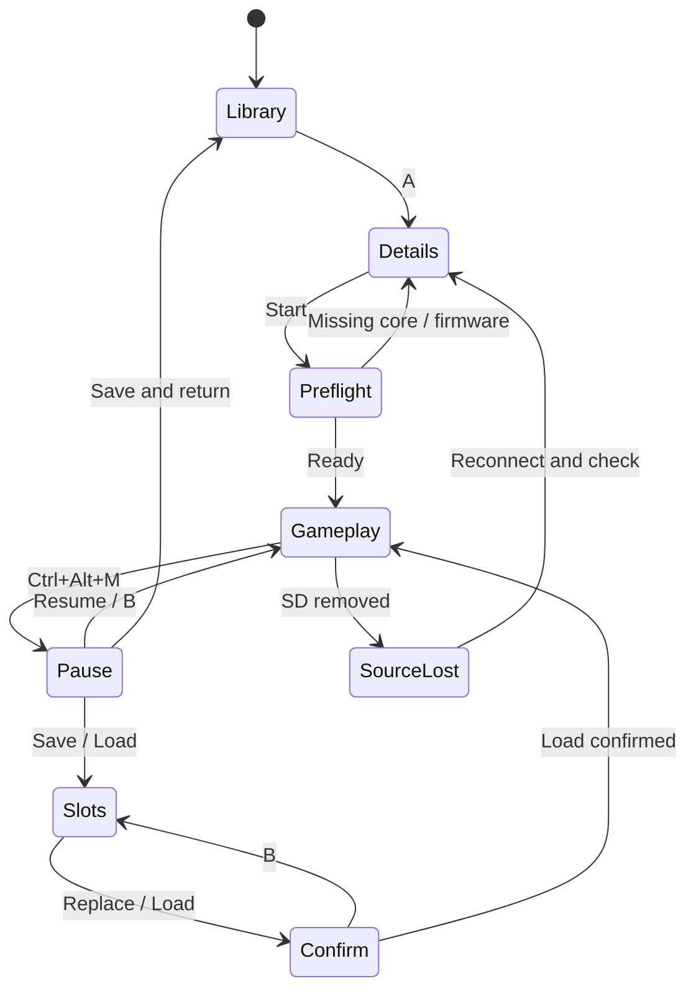

# 五应用交互规范

设计基线：uDeck `08c195d`；1280×720 横屏，960×600 为紧凑窗口；默认英文，可切简体中文。内容标题、作者、URL、目录名、字幕语言和游戏名称保留原文。

按键图标遵循全局 [uDeck 按键图标规范](../input-prompts.md)：GameCube 表示 ABXY / L / R，Keyboard & Mouse 表示键盘与鼠标操作，统一使用 Kenney Input Prompts。动作文字保留中英切换，不能把键盘普通字母当成手柄按钮。

## 共同结构与输入

内容库使用顶部应用标识、分类标签、内容区、底部按键提示。只有选中项绘制暖金 3px 焦点；正在播放和“当前分类”有独立标识，不用播放状态代替焦点。长名称在卡片上省略，在详情或操作弹层内允许换行。列表、网格和长弹层各自滚动，底栏始终可见。

| 所在层 | 方向键 | A | B | X | Y | L / R |
| --- | --- | --- | --- | --- | --- | --- |
| 内容库 | 在实际视觉网格/列表中选择 | 打开选中项 | 应用选择层 | 当前项操作、搜索 | 应用设置 | 相邻分类 |
| 普通菜单 | 只移动菜单焦点，跳过禁用项 | 执行或进入子菜单 | 返回上一层菜单 | 不叠加菜单 | 不叠加菜单 | 不切换后台内容 |
| 文字输入 | 保持光标编辑 | 确认输入 | 取消本次输入 | 不触发内容操作 | 不触发后台设置 | 保持文本编辑 |
| 音乐正在播放 | 左右定位，上下选控件 | 执行选中控件 | 回到浏览层，继续播放 | 队列/随机/循环 | 音频输出、语言 | 前后曲目 |
| 视频播放 | 左右 10 秒定位，上下选控件 | 执行选中控件/唤出控制栏 | 暂停并返回原视频卡片 | 字幕、音轨、章节、速度 | 音频输出、语言 | 前后章节 |
| EPUB / TXT | 左右翻页，上下滚动当前页 | 目录 | 保存位置，回到原书 | 书签、查找、跳转 | 字号、配色、语言 | 翻页 |
| PDF | 平移文档，不改变页码 | 目录 | 保存页面与缩放 | 缩放、目录、书签 | 配色、语言 | 翻页 |
| 游戏运行 | 全部交给模拟器 | 游戏按键 | 游戏按键 | 游戏按键 | 游戏按键 | 游戏按键 |

原生接入不能把字母 A/B/X/Y 改成界面命令。方向空间导航由当前 uDeck 应用实现；网页编辑控件、输入法候选和游戏窗口有输入所有权。所有权变化时先释放已按住的虚拟键，再切换接收方；游戏暂停菜单关闭后不重放造成暂停的按键。

弹层按栈返回。进入前保存稳定项目 ID 和滚动位置；B 每次只退一层；重排和刷新按 ID 寻找原项，删除时选邻项。禁用项写明原因，没有可操作内容的菜单仍有“返回”。语言变化重新渲染文案，保留输入文本、光标、播放位置和弹层归属。

## Music

### 页面与信息层级

| 页面 | 主要信息 | 入口与出口 |
| --- | --- | --- |
| 专辑库 | 封面、专辑名、艺术家；右侧当前曲目、进度和播放控件 | A 进入专辑；R 浏览曲目、队列、文件夹 |
| 专辑详情 | 封面与作者，按曲序的曲名、时长、正在播放标记 | A 播放该曲；B 返回原专辑卡片 |
| 正在播放 | 大封面、曲名、艺术家、格式、位置、前后曲、队列下一首 | B 回到进入前的浏览层；播放继续 |
| 队列 | 当前曲与后续项目，明确顺序 | X 上移、移除；删除后焦点移到邻项 |
| 文件夹 | 本地来源、艺术家/专辑路径和文件数 | 进入专辑；B 返回文件夹/应用层 |

主路径：选择专辑 → 选择曲目 → 正在播放 → B 返回专辑 → B 返回专辑库。队列是播放顺序的唯一来源；插入专辑或单曲不重置正在播放的位置。点击库中的同一曲可明确从头播放；继续/暂停使用播放器控件。移除当前曲时让当前曲播完，再继续队列中的下一项。

随机和循环是可见设置。曲末自动进入下一曲，队列结束时显示暂停/结束，不持续计时。音频输出选择后更新当前输出；原生实现必须等待 PipeWire/mpv 的实际输出结果，失败时保留旧输出和位置。

暂停与退出是不同动作：返回内容库不会停止音乐；关闭原生播放器时若仍在播放，提供“继续后台播放 / 停止并退出 / 取消”。这个窗口关闭流程属于后续原生框架，浏览器原型没有假装管理桌面进程。

## Video

### 页面与播放控制

| 页面 | 主要信息与动作 |
| --- | --- |
| 继续观看 | 仅展示有播放位置的视频，缩略图进度与“从 mm:ss 继续” |
| 全部视频 | 所有视频、时长、格式、作者/集数；长标题省略 |
| 文件夹及文件夹内容 | 按真实文件夹筛选；B 返回原文件夹，保留焦点 |
| 恢复确认 | 显示视频标题，选择从保存位置继续或从头开始；B 取消 |
| 全屏播放 | 画面占满；标题与状态在顶部，字幕位于画面下部，进度与控件在底部 |
| 播放选项 | 字幕开关、内嵌/外置字幕、音轨、章节、0.75–2 倍速、隐藏控件 |

主路径：继续观看 → 恢复确认 → 播放 → X → 字幕/音轨子菜单 → B 回播放选项 → B 回画面。播放时 B 保存实际位置、暂停并回到原卡片；再次打开仍先询问恢复。

隐藏控制栏后不留整行工具栏，A 唤出控制栏，B 仍返回，X 仍打开播放选项。原生版在播放且无操作时自动淡出，暂停或操作时显示；原型用明确的“隐藏控制栏”演示同一状态。字幕不能因为控制栏隐藏而消失。跳转、倍速、音轨选择须以引擎回执为准，加载中与播放失败必须可区分。

## Browser

### 起始页与标签

新标签页显示地址输入、常用站点和最近访问；地址确认在当前标签打开。X 提供新标签、书签、历史、收藏当前页、交互模式和关闭标签。关闭最后一个标签会留下一个新标签。标签用稳定 ID；多标签横向滚动，L/R 切换相邻标签并恢复各自的焦点。

地址、网页正文与应用 UI 是三个边界。应用 UI 随语言切换；URL 与网页内容不被翻译。原生版本解析 URL，区分地址和搜索词；离线原型仅接受 http/https 地址并显示本地示例，不触发真实搜索、账户或下载。

### 四种模式

| 模式 | 行为 | B / Esc |
| --- | --- | --- |
| 链接导航 | 方向选择页面内可操作元素，A 激活；地址、标签、工具仍可选 | 网页历史后退，起始页再返回应用选择 |
| 阅读 | 移除网页导航和插图，正文单列，↑↓滚动，应用字号设置生效 | 回原网页与原链接焦点 |
| 虚拟指针 | 方向移动可见指针，A 点击当前指针位置 | 先退出指针模式，不直接后退网页 |
| 文字输入 | 实体键盘和输入法控制当前输入控件，方向键编辑 | 先离开文字控件，不丢弃当前草稿 |

`Ctrl+L` 直接输入地址；输入期间切换语言保留草稿。网页缩放更新正文，不只改变设置文案。书签支持打开和移除，历史按最近访问排序。空书签有说明和返回项。

原生版需另验收权限请求、下载路径/取消、证书错误、认证弹窗、页面崩溃恢复、视频网页和表单；当前设计的稳定主路径不依赖这些能力。浏览器自身的“网页导航”不能承诺任意网站都提供可靠的空间焦点；必须保留虚拟指针与真实键盘的切换入口。

## Reader

### 内容与阅读

书库显示封面、标题、作者、格式与进度；最近阅读恢复该书的逻辑位置，书架可检索，文件夹展示来源。阅读界面让正文占据中心，顶部只留书名与章节/缩放，底部显示位置与进度。

EPUB/TXT 用单列正文；左右或 L/R 翻页，上下滚动溢出的当前页。字号和夜间配色独立于全局语言。字号变化后原生版本按章节和 CFI/文字偏移锚定，不能用旧页码作为唯一位置。

PDF 保留固定版式，提供适宽和 80–200% 缩放；方向键平移，L/R 翻页。缩放画布要包含实际尺寸，左上区域也可访问。PDF 的正文不受 EPUB 字号设置控制，状态栏显示实际适宽或百分比。

X 菜单含目录、当前页书签、已保存书签、跳转与全文查找。目录跳转后直接返回正文；书签不改动原文件。跳转校验范围，错误时留在输入层并显示原因。查找高亮正文，支持下一个匹配页和清除；没有结果时保留输入。原型的三页原创英文文本循环用于布局验证，不表示真实 EPUB 的搜索完整性。

返回保存位置；语言切换、打开菜单与恢复字号不新建文档会话。SD 拔出关闭所属弹层，记录已知位置到本地，等待重新接入，不声称还能读取已经移除的文件。

## Games

### 游戏库与启动

最近玩、全部平台、收藏是三个真正不同的集合。全部平台提供 All / GB / GBA / SNES / PS1 筛选；收藏按游戏 ID 管理。左侧封面网格选中后，右侧标题、简介、平台、时长和详情入口立即更新。

详情页包括封面、平台、核心、来源、时长、继续和重新开始。启动前检查文件、来源、已安装核心、必需固件和控制器；缺失时显示具体原因与设置入口，保留游戏和存档。PS1 和 GBA 只是设计分类，不代表已测到可接受的 CM4 性能。

### 运行、暂停与存档

运行时 A/B/X/Y、L/R 和方向键都属于游戏；普通 B 不能退出。`Ctrl+Alt+M` 是应用暂停菜单组合键，`Ctrl+Alt+Esc` 沿用现有会话返回桌面的快捷键。后者在原型浏览器中不冒充系统窗口管理。原生进程需要先暂停/释放输入，再把菜单焦点交给前端。

暂停菜单：继续、保存即时存档、读取即时存档、按键说明、保存并返回媒体库。三个手动槽位与自动续玩点分开。空槽不能读取，但空列表仍可返回；覆盖和读取都先确认。读取确认指出会替换上次存档后的进度；B 回到同一个槽位。重新开始不删手动槽，只更新本次结束后的自动续玩点。

原生存档保存在本地用户数据目录，不默认跟随 ROM 存放到可拔出的卡上。状态文件、缩略图、核心版本及内容哈希作为一组元数据；写成功后才显示成功。卡拔出时不能假装完成新存档；进程能否稳定暂停和保存须按核心实测，失败时保留旧存档。原型只保存演示元数据到独立 localStorage。

## 异常与恢复

| 场景 | 本地内容应用 | 浏览器 |
| --- | --- | --- |
| 空内容 | 选择本地目录/SD，说明不移动文件 | 地址入口和书签说明 |
| 加载中 | 可取消扫描；后台索引不阻塞方向导航 | 可停止加载，其余标签可用 |
| 打开失败 | 保留项目与位置，显示格式/文件错误和重试 | 保留 URL、标签与书签，重试 |
| 来源丢失 | 关闭所属弹层，停止读取，提供重新检测/其他来源 | 保留页面，显示连接不可用和重试 |
| 无搜索结果 | 显示查询原文和清除搜索入口 | 不把搜索结果页错误当作“空书库” |

原型场景由评审工具手动触发。原生版本必须按 `sourceId` / `mediaId` / `tabId` / `sessionId` 归属事件；后台扫描、解码错误和设备移除不能关闭其他应用的弹层，也不能把旧异步回执应用到新项目。
