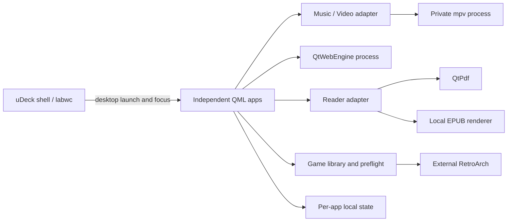

# 原生接入方向与参考来源

这是后续实现的工程设计，当前变更只包含离线原型和文档。未安装新媒体引擎、浏览器或模拟器，不改变 uConsole 的会话、网络、音频路由或 Terminal。

## 应用边界

保持当前 Python / PySide6 / QML 技术路线。每个应用是独立桌面进程，提供自己的 `.desktop` 入口和稳定 app_id；沿用 uDeck 主题、翻译词典和按键约定。壳负责启动、切换与回到主页，应用负责自己的内容焦点、弹层与引擎。浏览器和模拟器崩溃不应连带结束桌面壳。

可共享的部分是主题、翻译、焦点栈、内容 ID、可拔出来源状态、确认菜单和原子持久化工具。音乐队列、网页标签、文档位置与模拟器存档保持各自的数据协议，不把所有引擎状态放进壳的单一快照。

原生实现建议使用 `mediaId = sourceId + relativePath + fingerprint`，来源用设备/挂载身份而不是 `/media` 路径猜测。扫描任务有 generation ID；用户切换目录、关闭文档或拔卡后，过期回执只更新其所属条目。错误对象包含项目 ID、可重试原因和当前状态；翻译只作用于错误消息模板。

## 候选实现决策

| 应用 | 首选验证方向 | 决策依据 | 实现前必须证实 |
| --- | --- | --- | --- |
| Music | QML 内容库 + 独立 mpv 音频进程 | 与视频共享媒体适配器；可观察真实队列、位置、音轨与暂停事件 | FLAC/MP3/AAC、输出切换、后台播放、曲末和设备断开 |
| Video | QML 浏览与控制；先验证 mpv 独立窗口及私有 JSON IPC；嵌入时再比较 libmpv | Celluloid 证明轻量 UI 与 mpv 分离的路线；避免自己写解码器 | CM4 上窗口/overlay 合成、字幕、音画同步、seek、硬件解码和回退 |
| Browser | 独立 PySide6 QtWebEngineQuick 应用 | 与当前 QtQuick 栈相邻；Angelfish 的小屏结构和 Falkon 的引擎路线可参考 | Debian arm64 对应模块、Qt 版本、沙箱、字体/输入法、Wayland、RSS 与进程恢复 |
| Reader PDF | QtPdf / QtQuick PDF 组件 | 官方 Qt for Python 提供文档、书签、搜索及页面渲染相关 API | 系统模块可用性、中文嵌入字体、大 PDF、旋转/缩放与页面缓存 |
| Reader EPUB | 固定版本的 foliate-js + 本地受限 WebEngine 页面，先做引擎样机 | 有重排、CFI、定位、目录、搜索接口；可定制 uDeck 的 QML 外壳 | Qt 6.8 Chromium 版本兼容、脚本内容隔离、ZIP 随机读取、中文竖排与重排定位 |
| Games | QML 库和启动检查 + 外部 RetroArch；按平台配置核心 | Pegasus / ES-DE 的元数据与控制器前端分层；不在壳内运行核心 | 每个核心/系统的实际帧率、音频、原生手柄交接、存档和优雅退出 |

候选代表要进入样机验证的方向，不能据此宣称已支持所有格式或所有网站。浏览器与 EPUB 可复用技术栈，但阅读器必须使用独立 profile / 权限边界；不得把书中的脚本和网页账户放进同一个 profile。

foliate-js 上游说明 API 尚不稳定，并要求用 CSP 禁止书内脚本。必须固定提交版本，明确加载器接口，把书籍内容与应用控制代码隔离；不将它的实验性 PDF 适配器当成已验证的生产 PDF 引擎。若当前 QtWebEngine 无法满足上游浏览器要求，先使用受支持的外部 KOReader 完成功能样机，保留此处的交互规范作为原生目标，不虚构已经完成的统一渲染后端。

## 媒体进程协议

mpv JSON IPC 是本地控制接口。使用 `$XDG_RUNTIME_DIR` 下每会话独立的 Unix socket 和私有目录，不开放 TCP；从结构化参数启动媒体文件，不拼接 shell 命令。命令使用 request_id 对应回执；观察实际 pause、time-pos、duration、playlist-pos、track-list、chapter-list 和 end-file 事件。连接 socket 不等于媒体加载完成。

音乐应用拥有当前队列和正在播放的 sessionId；索引刷新只能改元数据，不能重建播放进程。视频应用在用户确认恢复后再发送 load/seek，退出画面时等待暂停和最后位置；失败保留上次可信位置。字幕选择按引擎 track ID，不能凭列表序号跨文件复用。外置字幕需明确属于当前文件。

视频的 QML 控制栏是否能覆盖独立 mpv 窗口、嵌入是否破坏 CM4 的解码/显示路径，必须用目标会话验证。方案未通过前不在文档承诺“零拷贝”“硬件加速”或某个分辨率帧率。格式 H.265/VP9 的示例卡片只用于布局测试。

音量和输出继续遵守系统音频服务的实际状态。打开视频时若音乐仍在播放，提供明确的暂停音乐策略，并记录由谁暂停；视频结束是否恢复音乐由用户设置控制，避免两个应用互相抢占焦点或输出。

## 浏览器与阅读器

浏览器原生输入模型沿用“导航 → 阅读/指针/文字 → 导航”。QtWebEngine 拥有页面键盘、输入法和安全进程；QML 外壳不能在文字模式截获普通方向与字母。页面上的原生对话框、文件上传、权限、下载和全屏请求需要单独的焦点归属与返回路径。

地址栏显示真实 URL；页面证书错误不能变成普通重试提示。浏览器账户、Cookie、下载和历史遵循独立持久 profile；从阅读器打开外部链接时明确交给 Browser，不能把在线页面当成本地书籍内容继续渲染。

阅读位置分类型保存：PDF 为文件指纹、页索引、缩放/适宽和平移；EPUB 为包标识、章节、CFI/文字偏移和进度；TXT 为编码、字节/文字位置。EPUB 页码是当前版式的显示结果，字号/窗口变化后按逻辑锚点恢复。目录与书签都使用真实文档位置，不能使用原型里的循环示例页。

PDF 按可见页及相邻页缓存；EPUB 按章节加载，查找结果增量产生并可取消。预览图由后台低优先级任务生成，避免每次打开内容库都重新渲染整份文件。移除来源时先停止新的读取；将已知位置写到本地应用状态，保留原文件完整性。

## 模拟器与输入所有权

启动参数按系统、核心和游戏分别配置。游戏目录扫描只建立元数据；核心、ROM 和所需固件分别检查，不能把“库中存在游戏”当作“可运行”。不随应用包附带商业 ROM 或固件；本原型没有这些文件。

沿用当前会话对 RetroArch 的原生输入策略，避免壳、兼容映射和模拟器同时读取并注入同一手柄。进入游戏时释放兼容模式按键，等目标窗口获得焦点再交接；暂停菜单取得输入后游戏不再收到菜单方向键；恢复时释放菜单按键再返回。

`Ctrl+Alt+M` 在设计中是受控暂停入口，需在原生适配器/RetroArch 配置层确认映射，当前壳未新增此系统热键。`Ctrl+Alt+Esc` 已由 labwc 执行 `udeckctl home`，保留现有行为。模拟器启动失败、窗口暂未出现和进程退出要分别处理；不要靠定时 `kill` 实现正常返回。

手动槽位和自动续玩分开。存档保存在本地用户目录，带核心版本、内容哈希和格式版本；临时写入完成并原子替换后再更新元数据和缩略图。载入前核对游戏/核心匹配，覆盖需确认。SD 断开或保存失败时维持旧文件，不显示“已保存”。电源中断恢复和真实核心序列化是实机验收项目。

## CM4 资源与落地顺序

不把 Chromium、libmpv 或模拟器核心加载进桌面壳。应用退出可释放其引擎资源；音乐后台播放进程由 Music 管理。内容库只加载可见封面，缓存用大小上限和版本戳；避免五个内容库开机同时全盘扫描。

先在当前 Debian arm64 + labwc + PySide6 环境做薄样机：验证安装与首次打开、测 RSS/CPU、切到后台及返回、实体按键与中文输入。然后分别测真实媒体 seek/字幕、网页长文与表单、PDF/EPUB 重排、GB/GBA/SNES/PS1 核心。每个系统记录实际帧率/音频，不由 GB 的成功推断 PS1。

预算应由实机样机测量后填写：当前没有新引擎的 RSS、首帧、解码或帧率结果。建议记录 30 秒空闲、连续使用、后台、退出释放与设备温度；报告同时写明 CM4 内存版本、显示后端、文件编码和所用核心。

## 参考来源与具体借鉴

读取日期：2026-11-06–07。下面是设计参考与接口研究，没有复制这些项目的图标、截图、界面代码或主题。

| 来源 | 核对材料 | 在 uDeck 中的借鉴 |
| --- | --- | --- |
| [KDE Elisa](https://github.com/KDE/elisa/blob/master/README.md) | 官方 README，简单音乐播放器定位 | 专辑/曲目/队列分层、浏览与当前播放并存；保留 uDeck 按键焦点 |
| [Celluloid](https://github.com/celluloid-player/celluloid/blob/master/README.md) | README，轻量 GTK/mpv 前端 | 内容显示与解码分离、按需播放控件和轨道选项 |
| [mpv IPC](https://github.com/mpv-player/mpv/blob/master/DOCS/man/ipc.rst) | JSON IPC、事件、request_id、本地 socket 与协议边界 | 异步回执驱动 UI，避免固定延迟和公开网络控制接口 |
| [Angelfish](https://github.com/KDE/angelfish/blob/master/README.md) | 小屏 QtQuick/Kirigami 浏览器介绍 | 地址、标签、历史、书签和页面操作的短路径 |
| [Falkon](https://github.com/KDE/falkon/blob/master/README.md) | QtWebEngine 浏览器定位 | 优先验证现有 Qt 浏览器引擎，不自行制作网页引擎 |
| [KOReader](https://github.com/koreader/koreader/blob/master/README.md) | 多格式、可重排/固定版式、排版配置 | 阅读时隐藏库管理，字号/配色独立，章节与位置可恢复 |
| [Okular](https://github.com/KDE/okular/blob/master/README.md) | 多格式插件结构、PDF 和移动界面 | PDF 与 EPUB 的位置/渲染模型分开，统一阅读外壳 |
| [Qt for Python 6.8 QtPdf](https://doc.qt.io/qtforpython-6.8/PySide6/QtPdf/index.html) | 官方模块和 QML/API 入口 | PDF 页面、搜索和书签候选；目标系统包仍需验证 |
| [foliate-js](https://github.com/johnfactotum/foliate-js/blob/master/README.md) | 格式、重排、CFI、relocate、搜索、CSP 和兼容要求；README 标为 MIT | EPUB 本地渲染候选；固定版本，保留逻辑位置；实验 PDF 不作首选 |
| [Pegasus](https://github.com/mmatyas/pegasus-frontend/blob/master/README.md) | QtQuick、元数据、手柄和可定制前端 | 封面库与系统筛选，前端和实际模拟器分开 |
| [ES-DE 用户指南](https://gitlab.com/es-de/emulationstation-de/-/raw/master/USERGUIDE.md) | 目录、控制器、收藏、系统与模拟器配置 | 最近/平台/收藏的集合模型；启动检查与核心配置分开 |
| [RetroArch 默认配置](https://github.com/libretro/RetroArch/blob/master/retroarch.cfg) | 热键启用、菜单组合键、自动/手动即时存档配置 | 专用暂停入口、游戏按键归属、手动槽与自动续玩分离 |

这些项目的许可证只随真正引入代码/库时纳入依赖清单。本次仅包含原创设计、样例和参考链接；后续代码复用应保留各上游许可及第三方依赖信息。
