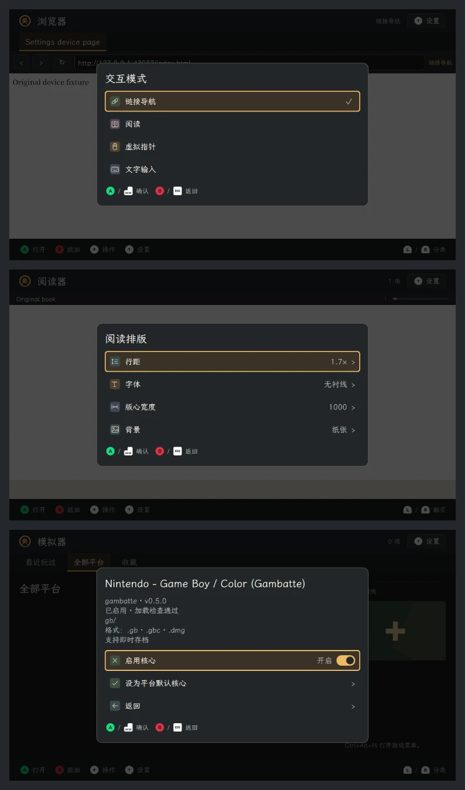
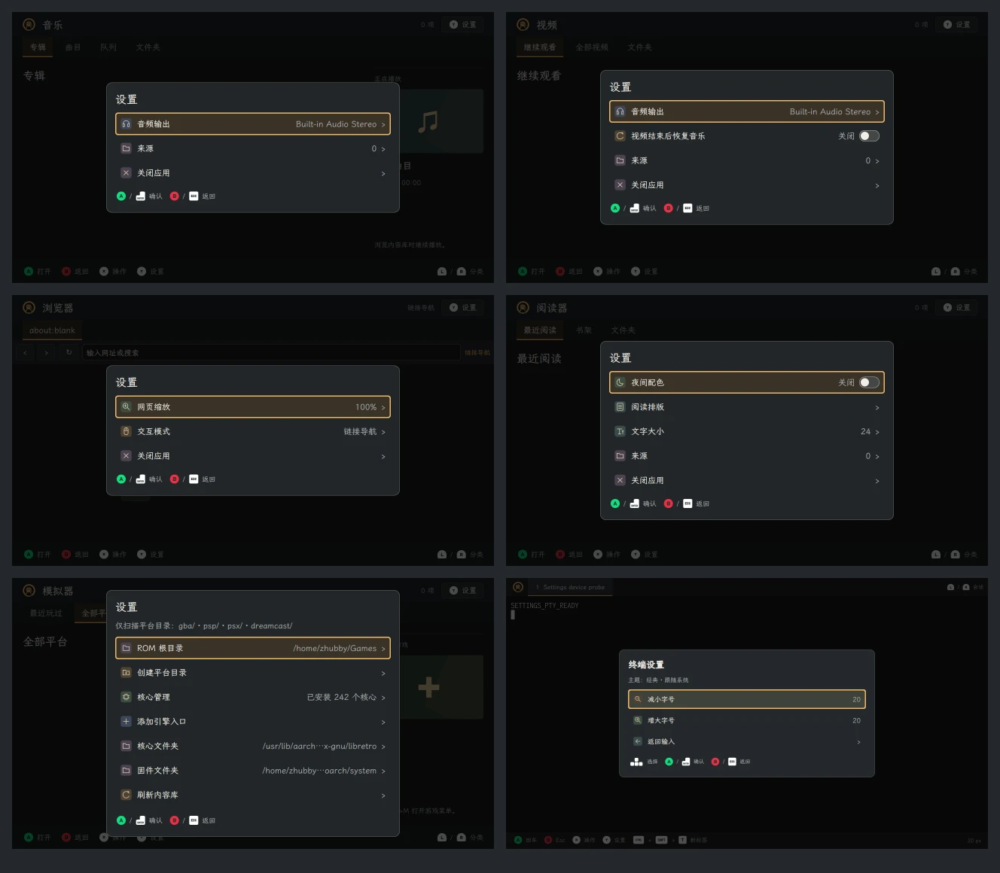

# 子应用设置代码审查与 uConsole 验证

审查范围为 `6b477e3..c04a2ad` 的单行应用设置改动，以及本次修复。按正确性、项目约定、可维护性、测试和菜单状态／回调逐项自审，依照仓库约定在当前线程顺序完成。

## 审查结果与修复

| 级别 | 发现 | 修复与证据 |
| --- | --- | --- |
| P2 | 单行布局只从父设置菜单继承。从模拟器的核心管理快捷入口进入详情时，已启用核心显示“启用核心”，却没有开关；浏览器操作菜单中的交互模式看不到当前项标记，阅读器操作菜单中的排版仍使用旧布局。 | 为可独立进入的交互模式、阅读排版、核心管理和核心详情明确启用设置布局。修复前 4 个新增回归场景失败，修复后通过；三个应用均在 uConsole 上复现并复测。 |

主设置入口、普通操作菜单和返回原菜单的选中位置均有覆盖。动态菜单缩短、变空后的回调更新及 Back 操作也通过验证。修复后未发现本范围内尚未解决的确定代码缺陷。

上图从上至下为浏览器交互模式、阅读器排版、模拟器已启用核心。截图来自设备上的独立测试窗口。

## 本地验证

- **171 passed，0 failed，0 skipped，15.26 秒**，覆盖应用设置、应用核心／路由、既有应用回归、阅读排版、终端控制器与外观、模拟器目录／管理／回归、翻译及主题。13 条既有第三方弃用警告保留。
- 新增 6 个回归用例：三个核心管理入口、浏览器操作菜单、阅读器操作菜单、动态菜单回调清理；修复前为 4 failed、2 passed。修复后针对设置、阅读排版、核心目录刷新的首轮验证为 **30 passed**。
- Ruff 检查 `src tests tools` 与 Git 空白检查通过。
- `uv build` 成功。wheel／sdist 中自原审查基线起变更的全部 **12 个应用源码、QML、翻译文件**与候选源码逐字节一致。

## uConsole 实机验证

设备使用 Python 3.13.5、PySide 6.8.2.1、现有 labwc／Wayland 会话。候选源码放在 `/var/tmp/udeck-settings-review-20261112/candidate/`，全部 **415 个跟踪源码文件**与本地校验一致。使用正式 QML 和原生引擎，测试状态单独存储；浏览器未替换网页组件，终端未使用 MockTerminal。

| 应用 | 验证内容 | 中文／经典／1280×720 | 英文／黑暗／960×600 |
| --- | --- | --- | --- |
| 音乐 | 实际音频设备列表、选择后父行输出名称、单行布局与最后一行 | 通过 | 通过 |
| 视频 | 鼠标与 Enter 往返切换恢复音乐、菜单／选中行保留、音频输出 | 通过 | 通过 |
| 浏览器 | 真实 Qt WebEngine 加载本机 HTTP 页面、125% 实际缩放、操作菜单当前模式标记 | 通过 | 通过 |
| 阅读器 | 真实 TXT 阅读引擎、夜间开关、操作菜单排版、行距父值更新及书籍实例保持 | 通过 | 通过 |
| 模拟器 | 设备已安装 Gambatte 核心的原生加载探测、快捷入口开关往返、长列表滚动 | 通过 | 通过 |
| 终端 | 原生 QMLTermWidget／PTY、字号增减、返回输入后保持同一会话及子进程 PID | 通过 | 通过 |

**12／12 组合通过**，截图尺寸与目标窗口一致，全部 `qmlErrors: []`。几何检查覆盖单行文字、图标加载／行高、垂直居中、左右区域不重叠及当前行可见。使用 Qt 键鼠事件验证交互；终端保持既有禁用鼠标输入的行为，使用键盘验证设置。

上图从左至右、从上至下为音乐、视频、浏览器、阅读器、模拟器、终端。媒体库、书籍和设置使用隔离测试状态；音频设备和核心目录来自实机。模拟器设置在设备原生高度内滚动显示，末行另有自动验证。

初次浏览器探针通过 Python 遍历 Chromium 私有可视子对象时触发了 PySide 段错误；故障栈指向探针的 `childItems()` 调用。探针改为在 QML 内检查页面 URL 和实际缩放值，原始日志保留，随后两种组合均通过。Wayland 的既有零尺寸 configure 警告保留在进程日志中，未作为 QML 错误隐藏或清空。

## 会话与交付范围

测试结束后，原有 Shell、合成器、会话代理及五个子应用进程全部保持，**11 个受保护配置文件哈希未变**。Wi-Fi、蓝牙、音频、亮度、电池五项服务正常，无服务错误；窗口协议与 Raspberry Pi Connect／WayVNC 正常。

本次实机测试采用独立候选源码，未替换设备的 Debian 安装文件，未重启 Shell／合成器。它验证了本次设置改动在实际设备上的软件行为；物理按键／轨迹球、输入法、持续播放与重启验收不在此结果之内。

可复用的设备探针为 `tests/app_settings_device_probe.py`；主机必须提供真实 Wayland 环境及已安装的原生终端插件。原始报告、修复前失败截图、12 组合截图、进程日志、配置／进程守护校验、源码／构建校验均保存在本地忽略目录 `artifacts/app-settings-review-2026-11-12/`，设备副本位于 `/var/tmp/udeck-settings-review-20261112/evidence/`。
