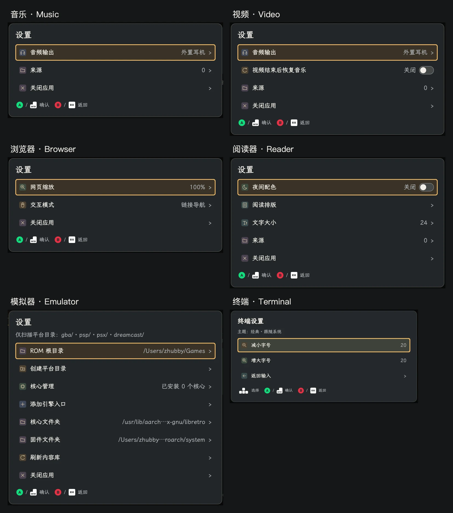

# 子应用设置单行布局

音乐、视频、浏览器、阅读器、模拟器和终端的应用设置统一使用「左侧图标和名称，右侧开关或当前状态」的单行布局。

后续的[代码审查与 uConsole 实机验证](app-settings-review-2026-11-12.md)已完成，并修复了从操作菜单或快捷入口进入设置时布局未启用的问题。下文保留最初的本地预览记录。

图中路径、音频输出、来源数量和核心数量来自本地隔离预览，不代表 uConsole 当前状态。为展示完整列表，模拟器预览使用 1280×840；其他面板为 1280×720。

## 布局与操作

- 六个应用共用 `qml/SettingsRow.qml`。图标高度跟随名称实际行高，名称和状态各自占一列，均不换行；长路径从中间省略，悬停可查看完整文本。
- 视频的「视频结束后恢复音乐」、阅读器的「夜间配色」、模拟器核心的启用状态显示状态文字与开关。A／Enter 或点击整行继续调用原有操作，开关不产生独立的键盘焦点。
- 音频输出、网页缩放、交互模式、字号、排版和目录项在右侧显示当前值；导航入口显示箭头，选择列表在右侧标记当前项。
- 视频和阅读器的开关操作保留设置菜单及选中行。修改字号、行距或缩放后，返回父菜单立即更新右侧数值，保留原菜单的选中位置和回调身份。
- 终端的两条字号操作保留原有语义，在右侧显示当前字号。主题说明继续显示跟随系统的状态。
- 单行布局沿设置菜单向下继承；应用的其他操作菜单保留原来的详细说明。

## 验证

- 相关自动回归：**115 passed，0 failed，0 skipped，9.09 秒**。包含设置状态更新、子菜单返回和焦点、应用路由、翻译、主题及终端会话和字体验证。13 条既有第三方弃用警告保留。
- 六个应用分别以中文／经典／1280×720 和英文／黑暗／960×600 渲染，共 **12 个组合**。检查单行文字、图标加载、图标与文字高度、垂直对齐和左右区域不重叠，并使用原有导航滚动到最后一项；全部 `qmlErrors: []`。
- 额外检查视频和阅读器开关的往返切换、选中行和菜单身份保留，浏览器缩放到 125% 再恢复 100% 后的父行数值，以及阅读排版的单行子菜单。
- Ruff 与 Git 空白检查通过。`uv build` 成功，wheel 和 sdist 中全部 12 个变更的应用源码／QML／翻译文件与工作区逐字节一致，包含新共享组件。

本轮截图在本地 Qt Quick 的 offscreen 环境生成；浏览器预览省略后台网页内容，设置控件使用正式源码。本轮没有进行设备部署或图形会话重载，也没有重跑整仓库或实机的全量测试。

原始报告、逐应用截图、交互预览与构建产物保留在本地忽略目录 `artifacts/app-settings-rows-2026-11-12/`，包括 `regression.xml`、`visual-verification.json` 和 `package-verification.json`。
