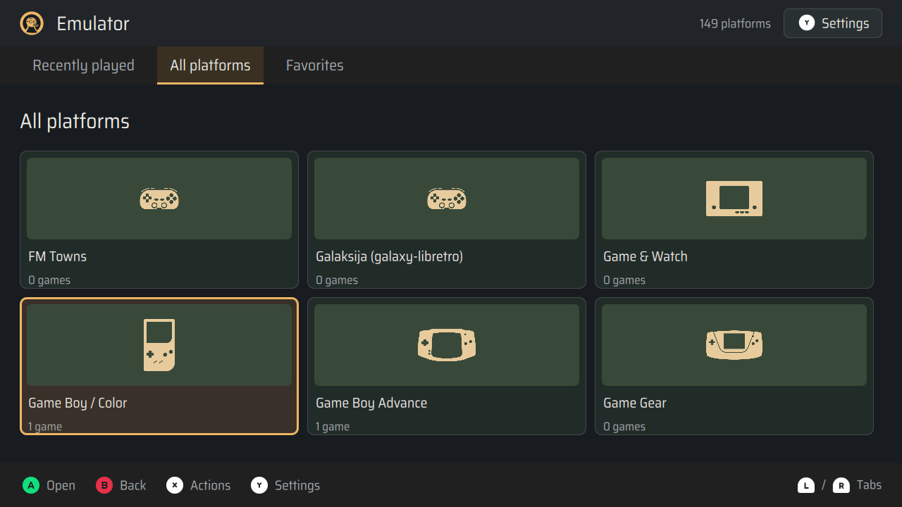
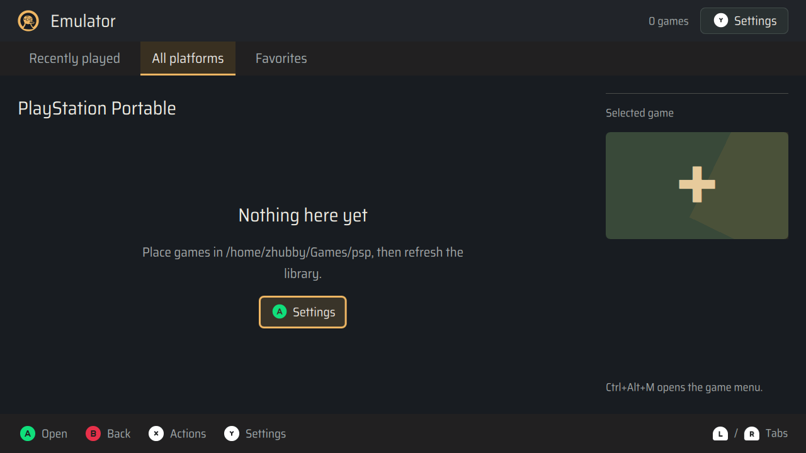
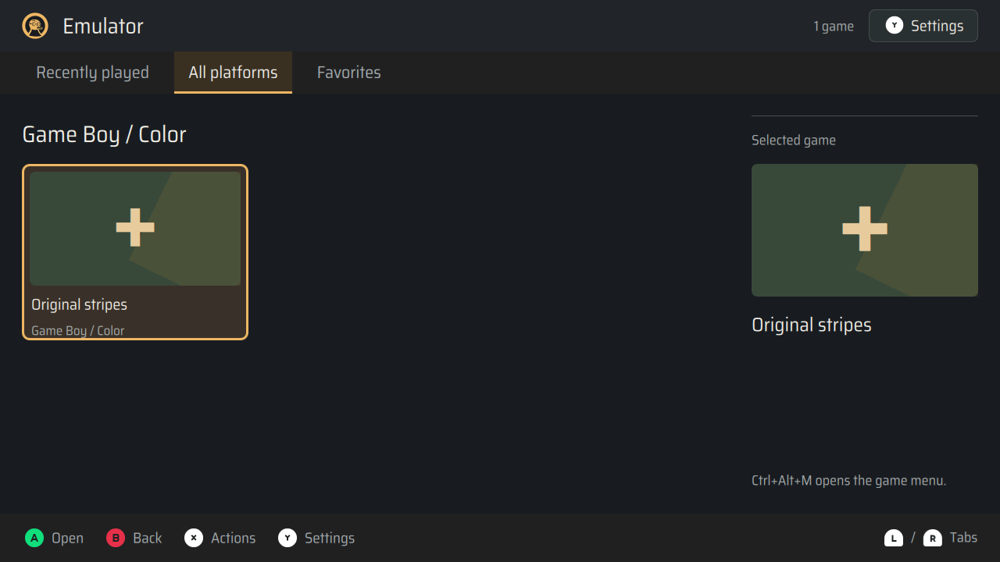

# 模拟器平台导航（0.2.13）

“所有平台”改为平台 → 游戏两层；“最近游玩”和“收藏”直接列出游戏。

平台可见性共用 `CoreCatalog.candidates(platform)` 的启用规则，涵盖默认启用、显式开关和多平台核心。平台是否有游戏不影响入口；空平台标注 0 个游戏并提示 ROM 目录。关闭最后一个启用核心立即隐藏入口，设置菜单保留可重新启用的操作。

浏览器单独保留每个分页和平台的焦点、搜索；B 依次从游戏详情返回游戏列表、平台列表。平台行使用 `kind: platform`、`platformId`、`gameCount`，不会进入游戏启动或收藏操作。核心开关和原地更新的检查结果会失效卡片缓存。

## 图标

使用 `libretro/retroarch-assets` 的 Monochrome，固定上游提交 `8c918e2872482139273374ef4cc6c7aff34d7585`。60 个注册平台均有本地映射；Commodore 128 复用同家族 C64 图案，未知平台使用同套 Libretro Pad。60 个实际 SVG 合计资源约 314 KiB，包含 CC BY 4.0 原文、署名、修改说明及原始/修改后 SHA-256 清单。

只把白色前景替换为首页固定暖金色 `#e8cc9f`，保留原始几何、透明度和比例；Classic／Dark 使用同一文件。Qt 渲染检查确认全部 SVG 可读取，完全不透明像素均为指定金色。

## 回归与代码审查

- 新导航测试先在原实现上复现失败，再实现平台浏览；已有核心、目录和存档基线 50 项通过。
- 73 项定点回归通过，覆盖平台可见性、空平台、别名计数、多核心/多平台默认启用、核心开关、分页隔离、搜索、收藏、启动详情、国际化和发行版本。
- Qt 探针覆盖中英文与 Classic／Dark，验证平台页全宽、图标显示、空平台进入、逐层返回以及设置菜单键盘交互。原探针的游戏条目断言按两层模型更新；GridView 委托通过视觉树查找，避免 QObject 层级和 Qt 枚举转换造成探针误报。
- 正确性审查发现并修复：核心检查移除当前平台时，完整快照可能同时含新平台状态和旧游戏卡片。已补充失败回归，并在生成卡片前统一同步状态。
- 交付复核补充了邻近焦点断言：在平台内关闭最后一个核心或核心检查失败时，保留进入平台前的位置，在剩余平台中就近选择；不会由于旧游戏列表丢失平台位置而跳回首项。两项回归先复现失败后通过。
- 首轮完整 Debian 测试为 1579 通过、1 项已有浏览器探针失败：发送按键后立即读取 WebEngine 文本值，与渲染进程接收按键存在竞态；同组 12 项单独运行通过。探针改为限时等待实际文本等于 `abxy`，保留完整键入及提交断言，不改产品行为。
- 已审查原地核心状态更新、焦点作用域、运行中游戏、平台与游戏操作分离、未知平台图标回退和资源打包路径。无遗留的可复现审查问题。
- 0.2.12 干净 main 构建的完整 Debian 测试 1580 项通过；该包已安装到 uConsole，490 个源码/资源文件与包一致，核心开关及两层导航通过。
- 实机启动回归发现既有退出缺陷：Wayland 下暂停且被完全遮挡的 RetroArch 不能及时消费 QUIT，状态轮询还会在退出时写入关闭的管道。0.2.13 在退出时短暂最小化 uDeck，待前端结束后恢复游戏详情；同时停止轮询，以有界 SIGTERM 兜底，仅排除预期关闭错误，仍报告其他崩溃。
- 新增独立 QProcess 回归覆盖正常 QUIT、不消费 QUIT、同步 close 和异常退出，以及三个退出菜单入口。设备隔离探针使用候选 RetroEngine、真实 mGBA 和 Wayland 会话，后台暂停后 0.21 秒正常退出，无错误；没有修改已安装的源码。
- 实机四种语言/主题组合均使用同一图标资源；截图复核修正了空平台提示强制按字符断行的问题，恢复优先按单词断行并允许长路径折行。
- 返回路径审查补充并修复：在游戏详情页关闭平台最后一个核心时不打断详情，返回游戏列表时重新验证平台作用域，并返回平台首页的邻近焦点；不会由于核心缓存已更新而漏掉返回时的校正。

## 最终构建与安装

- 构建源码提交：`3540063600c1481cd965607783bb933f8318bdc1`，已合并推送 main，并核对本地、跟踪分支和实时远端引用一致。
- 正式版本：`0.2.13`；构建清单 `gitDirty: false`，未跳过 Debian 测试。
- 完整 arm64 Debian 构建成功，`1587 passed, 16 warnings in 754.15s`；警告为既有 dbus-next 弃用提示。77 项定点回归、Ruff 和 uv 锁文件一致性检查通过。
- Debian 包 SHA-256：`4be0a59a25cdd461ff8f4a229e79d84087ce7101ee8d24e78018471eeabab36f`。
- 独立干净 Debian 13 arm64 容器通过无推荐依赖安装、应用 smoke/IPC、原生终端、源码归档一致性、旧包名迁移、安装器、重配置、重装、卸载恢复和再次安装；490 个安装源码/资源文件与源码归档一致。依赖镜像缓存均按 apt 的 SHA-256 验证，未用缓存替代安装流程。
- 同一台 uConsole CM4 已安装正式包并重载正常 labwc 会话；490 个源码/资源文件与构建清单一致，`dpkg --verify` 通过。系统、浏览器、音乐、视频和模拟器均为 0.2.13，没有 QML 错误。
- 输入已验证、全局快捷键已应用；Wi-Fi、蓝牙、音频、亮度和电池服务正常，无服务错误。系统配置哈希保持一致；0.2.12 回滚包与受保护配置备份保留在设备的 `/var/backups/udeck-emulator-platforms-0.2.13-20261113`。

## 实机导航与截图

实机通过临时 evdev 键盘走正常 labwc/Qt 输入路径，未在生产控制器增加测试入口。以下均为已安装的正式 0.2.13：

- 两层进入/返回、空平台焦点恢复、分页清除平台作用域、游戏详情逐层返回通过；最近游玩和收藏直接显示游戏。
- PSP 在 PPSSPP 启用且没有 ROM 时显示 0 个游戏；关闭最后一个核心后入口消失，焦点移到邻近的 PlayStation Vita，设置菜单保留；重新启用后恢复 0 个游戏入口。
- 在 Game Boy 游戏详情中关闭最后一个核心，返回后进入平台首页并选中邻近的 GBA。重新启用后游戏计数恢复，原始默认/显式核心偏好完整还原。
- 从最近游玩和收藏各启动一次真实 mGBA 的 `Original red`，均进入 playing，随后暂停、正常退出、恢复 uDeck 焦点并返回列表；没有关闭管道错误或遗留 RetroArch 进程，临时收藏恢复为空。
- 英文/中文与 Classic/Dark 四种组合通过，149 个入口的图标 URI 映射完全相同，系统配置原始字节已恢复。实机探针对异步焦点、菜单和窗口激活等待可观察状态，避免固定延迟引起误报。
- 四组截图的 24 个可见图标样本前景像素一致：资源为 `#e8cc9f`，该设备截图捕获为 `#e7cb9c`，Classic/Dark 与中英文之间没有改色。所有 60 个 SVG 已另行验证资源前景色和 Qt 可渲染性。
- 最终复查通过：无 QML 错误，490 个源码/资源文件仍匹配，核心偏好、收藏与系统配置均已恢复，设备停留在平台首页。

平台首页：

启用但无游戏的 PSP：

平台内的游戏列表及右侧预览：

完整构建和实机记录保留在本地 `artifacts/emulator-platforms-0.2.13-20261113/`。本记录与截图在验证后单独提交；部署包生产源码与当前 main 一致。本地 Qt 与实机虚拟键盘自动化均不代表人手实体按键验收。
