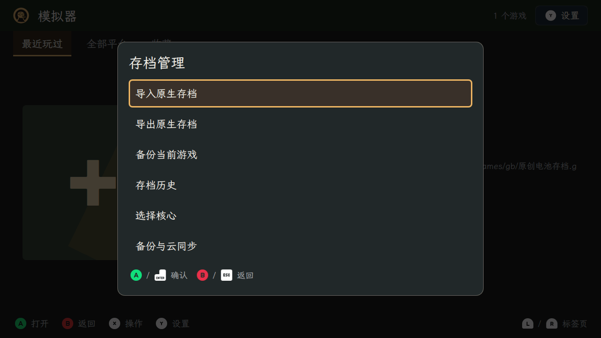
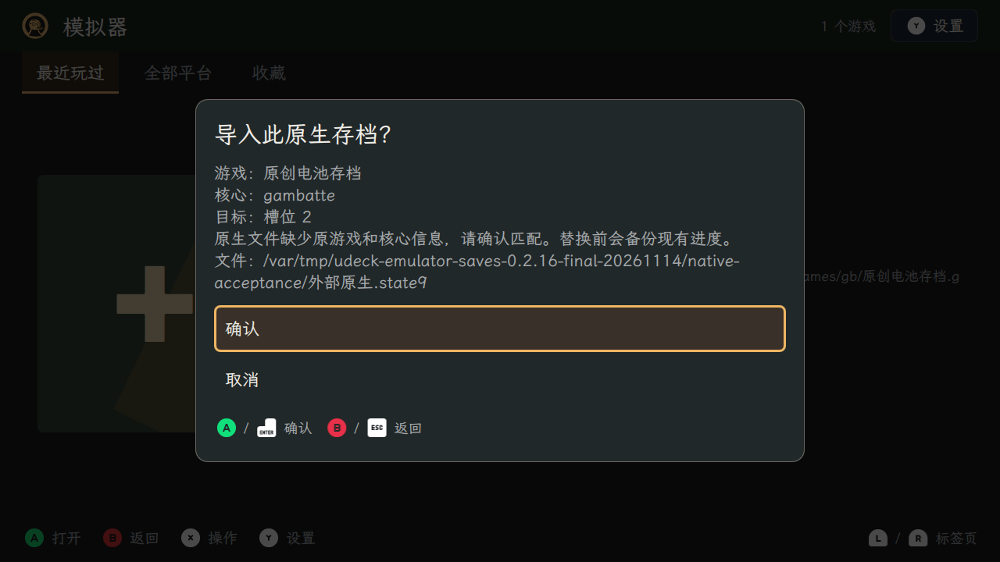
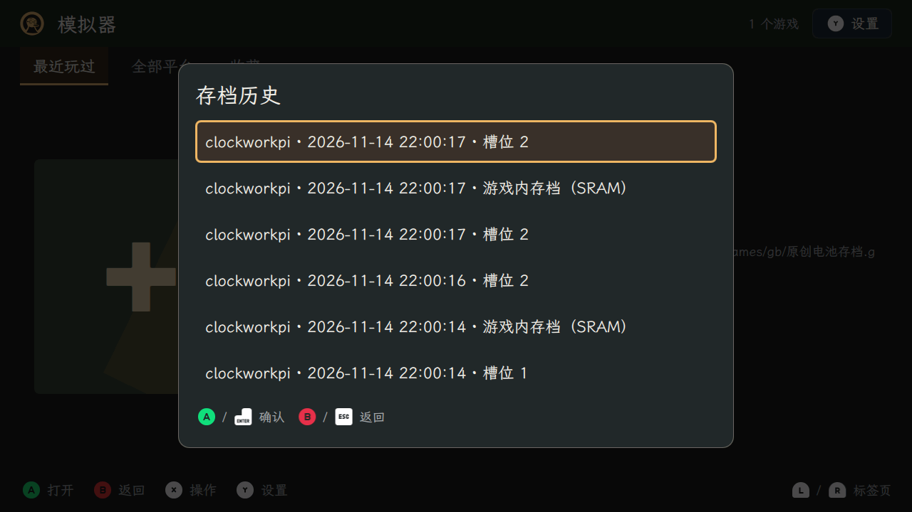
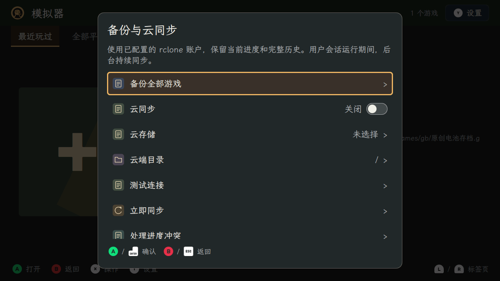
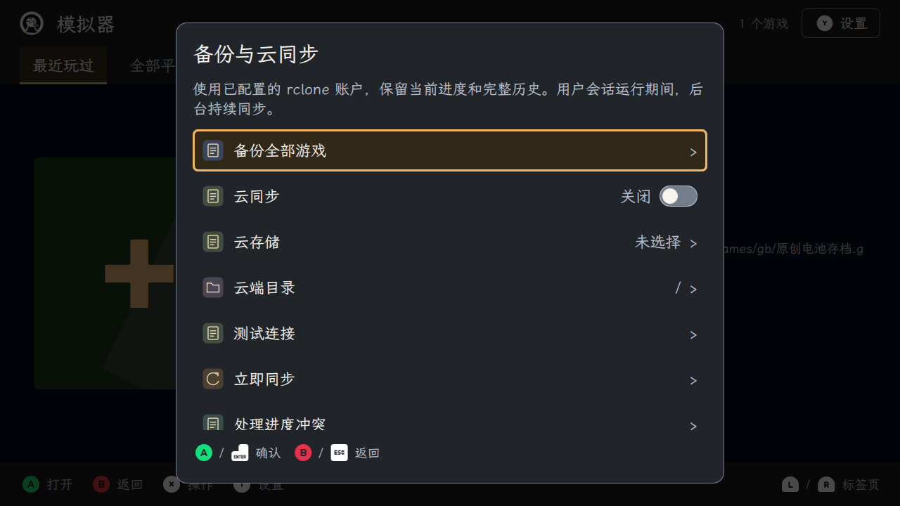
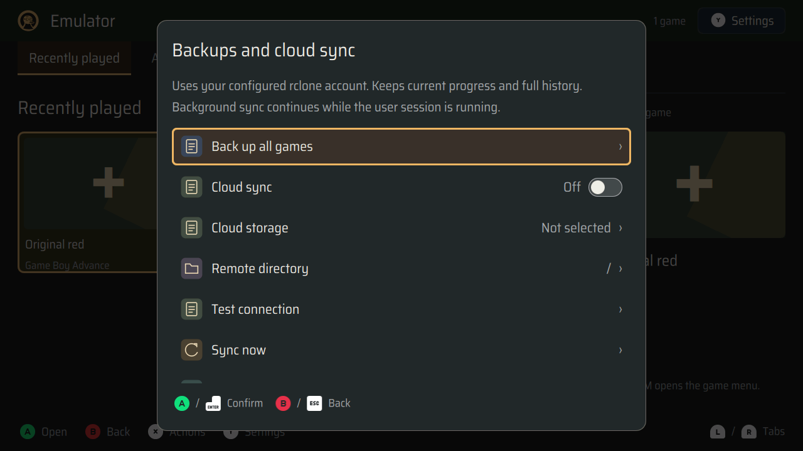

# 模拟器原生存档与 rclone：uConsole 部署验收（2026-11-14）

已在实际 uConsole CM4 / Debian 13 arm64 的 Wayland 会话安装 **uDeck 0.2.16** 和 **rclone 1.75.2**。最终安装包来自 main 的干净提交 `754908e177a21238f0ea8006a967c25f4000b3df`，包含原生存档管理、后台同步及完成状态修正；后续证据提交只更新文档。

## 构建与安装验证

| 验证 | 结果 |
| --- | --- |
| 最终 ARM64 全量测试 | **1661 passed，0 skipped**，16 条既有 dbus-next 弃用警告，924.65 秒 |
| Debian 安装生命周期 | 首次安装、旧版升级、重装、卸载及再次安装通过；逐字节核对 501 个源码与资源文件 |
| 真机安装 | SHA-256、`dpkg --verify`、501 个已安装文件、rclone 命令能力和 preflight 均通过 |
| 真机安装版存档回归 | **45 passed，0 skipped**，从系统安装目录导入；包含真实 rclone、隔离双设备、本机 WebDAV 断线恢复和私有 D-Bus 后台服务 |
| 真实正常会话 | 内核虚拟键盘经过 compositor 操作英文菜单；模拟器关闭后，后台服务继续存活 |
| 原生游戏验收 | 9 项检查通过，使用真实 Gambatte 和原创 GB 程序 |
| 截图 | 6 张实际设备 `grim` 抓图，1280 × 720；中文页额外确认 compositor 与 Qt 的活动窗口身份 |

[验证汇总](evidence/emulator-save-sync-2026-11-14/verification.json)、[构建清单](evidence/emulator-save-sync-2026-11-14/build-manifest.json)、[安装结果](evidence/emulator-save-sync-2026-11-14/install-verification.json)及[最终设备回读](evidence/emulator-save-sync-2026-11-14/final-verification.json)保留对应关系。Debian 包 SHA-256：

```text
5ec7f0aebc82ddc892f9164e178a446b10529beda27919ae87ad713475705e66
```

## 原生存档验收

实际游戏生成 34864 字节的即时存档，并正常退出写出 8192 字节电池 SRAM。确认保存后产生历史；导出与导入即时存档逐字节一致，`.state9` 可明确导入到槽位 2，并在真实 Gambatte 中再次加载。中文路径、确认与取消、导出前备份、历史恢复、SRAM／RTC 伴随文件往返和同内容 ROM 改名后的文件名重建均通过。

运行中的存档所有权保护通过。正常退出提交 SRAM 后，故意终止另一次测试 RetroArch 会话，确认原有持久化 SRAM 与历史保持不变；报告中的 expectedCrashErrors 属于这次预期异常退出。详细结果见[原生游戏报告](evidence/emulator-save-sync-2026-11-14/native-acceptance.json)。

截图复核发现读取历史和导出菜单结束后仍显示“正在处理存档”。新增两项测试先复现，再清除已完成任务的等待提示；ARM64 的 12 项界面测试和上述最终全量测试通过。成功导入、备份等操作仍显示各自的完成提示。

## 设备会话与边界

最终替换包前备份并核对 18 个受保护文件。用户配置和原有存档核验通过，其他桌面应用进程保留，终端仍为 1 个窗口、1 个 shell；只重新打开空闲的模拟器。最终正常模拟器为 0.2.16、空闲、无 QML 错误、无残留 RetroArch。0.2.15 回退包及私有配置备份保留于 `/var/backups/udeck-emulator-saves-0.2.16-20261114/`，最终替换前的 0.2.16 备份位于 `/var/backups/udeck-emulator-saves-0.2.16-final-20261114/`。

云同步保持默认关闭，真实账户 remote 数量为 0，凭据继续由 rclone 管理。实际网盘传输尚未验收；在“备份与云同步”中配置 rclone、选择 remote 和目录后才能启用。后台 Type=dbus 服务已实际启动，前端退出期间保留同一个服务进程；用户会话自动启动仍为禁用状态。

本轮输入为真实 Qt 按键或内核 UInput 事件，未代替真人实按掌机按钮。虚拟键盘测试先确认输入实际到达，再检查逐项导航。中文截图使用独立验收数据和设置，加载系统已安装的源码与 QML，保留用户原来的英文偏好。抓图前明确请求 compositor 激活测试窗口，逐张确认活动身份、主题、语言及 SHA-256；图片未经重绘。

## 真机截图












