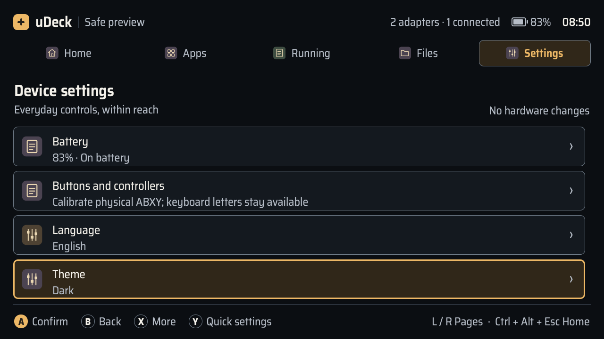
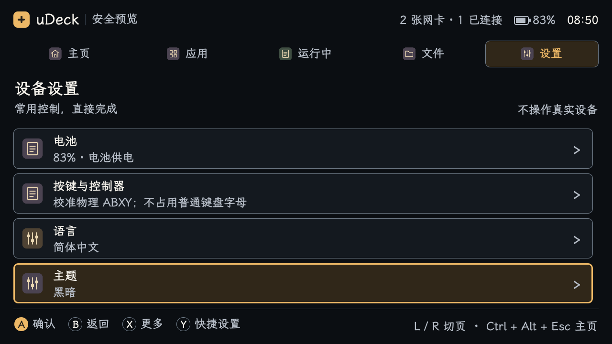

# uDeck 0.1.10 中英文字体

英文界面使用 **Saira Semi Condensed**，中文界面使用 **LXGW WenKai Screen（霞鹜文楷屏幕阅读版）1.530**。在设置中切换语言时，外壳、五个原生应用及全部终端窗口的标题、菜单、按钮、提示和输入框一起更新字体。没有新增字体设置项，英文仍为默认语言。

## 字体与资源

字体原始文件随基础包分发，不依赖设备预装，也不在运行时联网下载。Saira 包含 Regular、Medium、SemiBold、Bold 四种字重；Qt 内部返回的字体族名称是 `Saira SemiCondensed`。中文使用原始屏幕阅读版字体，Qt 字体族为 `LXGW WenKai Screen`。

资源目录 `src/udeck/fonts/` 保留两套字体的完整 SIL Open Font License 1.1、版权信息和校验清单。Saira 固定于 Google Fonts 提交 `f2480dad6f8e7b1f42c023d3542e55eb8c3a2822`，LXGW 固定于上游 `v1.530`；没有修改字体文件。

共享的 `InterfaceFonts.qml` 注册本地字体，并按当前语言选择字体族。组件显式绑定字体，语言切换只修改现有对象的属性，不重建页面或内容。网页、阅读正文以及终端等宽文字保留自己的字体设置。

主程序版本 **0.1.10**，原生应用与终端版本 **0.1.3**；两个独立包均要求 `udeck >= 0.1.10`，避免缺少共享字体资源。

## 审查与验证

主线程完成 correctness-reviewer 和 code-simplicity-reviewer 检查。修复一处实际布局问题：Saira 行高使 960×600 英文界面的双行快捷键从 y=538 延伸至 y=602，越过屏幕 2 像素。快捷键现在按实际文字高度在原有底栏内居中，沿用原字号。

字体校验覆盖原始文件大小、SHA-256 和许可证。QML 回归检查实际字体族及 Qt 字体解析结果，覆盖两个语言、两种主题、1280×720 和 960×600。八窗口联动验证运行中切换、输入框与内容对象身份、草稿、终端会话标识保持。已有原生媒体、浏览器、阅读器与终端探针继续验证真实内容对象和 PTY。

字体检查在 QML 中遍历视觉树，再返回普通 JSON，避免 PySide 6.8 为私有 WebEngine 视觉对象创建 Python 包装时崩溃；产品输入与事件过滤器没有改动。

本地完整测试 **378 passed、2 skipped**，147.41 秒。两项跳过来自本机缺少原生终端插件。Ruff 与 wheel 构建通过，wheel 内 77 个源码和资源文件逐字节匹配工作区，包含 9 个字体资源及说明文件。

### uConsole 安装与显示检查

2026-11-07 在 uConsole 的 Debian / arm64 环境运行完整测试：**378 passed、2 skipped**，293.69 秒。随后指定设备已安装的原生插件，并设置 `UDECK_REQUIRE_NATIVE=1`，补跑两项终端测试：**2 passed**，7.16 秒，覆盖真实 PTY。合计覆盖全部 380 项测试；完整测试与原生终端补测分别留有日志。

三个 arm64 Debian 包构建并安装成功：`udeck 0.1.10`、`udeck-apps 0.1.3`、`udeck-terminal 0.1.3`，升级 3 个包，没有新增或移除包。三个包内共 77 个源码和资源文件与构建源一致，互相没有文件重叠；安装后再核对系统目录中的 77 个文件，逐字节一致。

仅重启 `udeck-fullscreen.service`，服务保持 active，`udeckctl doctor --json` 返回版本 0.1.10、`ready: true`。在设备现有 Wayland 会话上，使用已安装模块和临时配置，分别检查英文和中文，各生成 34 张截图，QML 错误均为空。探针请求 1280×720 窗口，现有桌面将窗口内容约束为 1278×643，截图已按该实际尺寸核对；前述本地截图则分别为完整的 1280×720 和 960×600。每次检查包含外壳、五个原生应用和两个终端窗口，并验证运行中切换字体及主题时保留输入框、草稿和内容对象。

联合窗口探针中的终端使用 Mock，会话标识保持检查与上述原生 PTY 测试分别记录。安装前已经运行的终端进程（PID 381833）未重启，检查后仍存活；该旧进程继续使用原先加载的 QML，正常关闭并重新打开后采用新字体。用户的完整设置文件与升级前一致，屏幕从原有的 `DSI-1 off` 临时开启检查后恢复为关闭。没有重启设备或修改默认桌面、登录与终端配置。

自动化、安装文件核对与 Wayland 截图已完成；本轮没有把远程渲染检查记作人手物理按键或真实中文输入法验收。

| 产物 | SHA-256 |
| --- | --- |
| `udeck-0.1.10-py3-none-any.whl` | `32e730bc2716eb4950eb5dbc055b3e68806161bf6c07844806daebe6145e01fd` |
| `udeck_0.1.10_arm64.deb` | `cc65d5c312e2ea522386b71dd5c690c1f4571d7fefec3ee0eabc20e3d853db6c` |
| `udeck-apps_0.1.3_arm64.deb` | `bceb16bc043ae631d7e3a31a10cb5e4a4ea3e3566797ae770512cce1533dc6d2` |
| `udeck-terminal_0.1.3_arm64.deb` | `32c65813eb0f7a31f507562e577568ee587a36bfd7c7a5103c09b241bfe06817` |

本机 `artifacts/fonts/` 保留完整测试、构建、安装、文件核对、审查和截图记录；`dist/` 保留 wheel 和三个安装包。这些生成文件不提交到仓库。配置备份只留在设备临时目录，权限为 0600。

### 截图

本地两种语言、两种尺寸共保留 136 张主题截图，另有设备 Wayland 的 68 张截图。以下截图使用测试数据，展示实际 QML 渲染结果。

