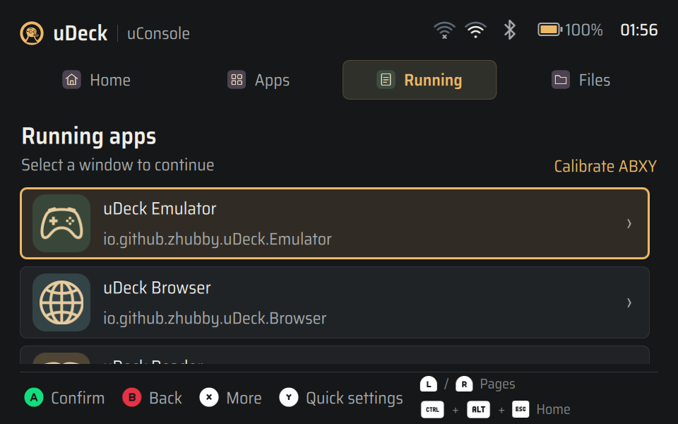
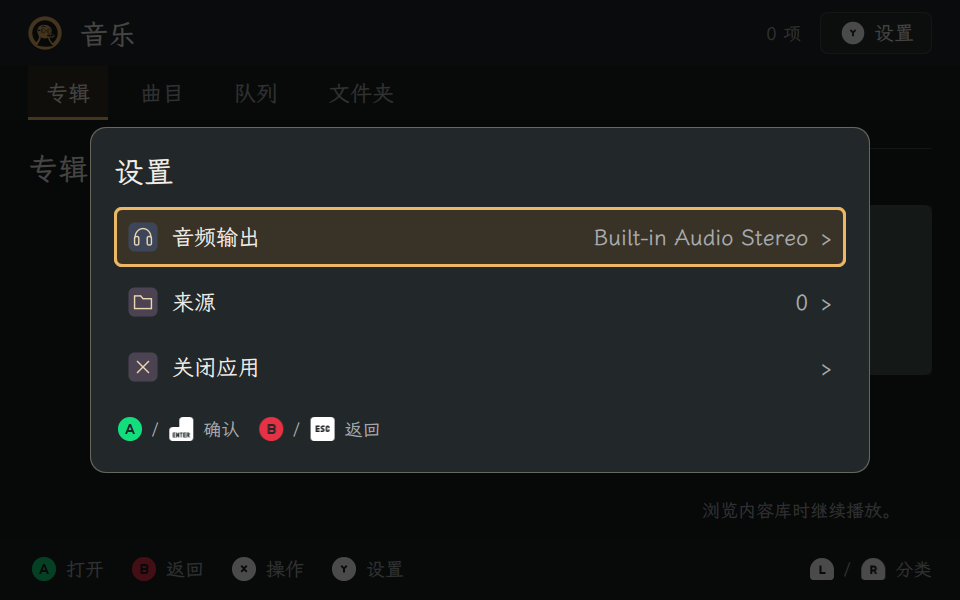

# 全功能实机回归（2026-11-13）

本轮在 uConsole CM4 的已安装 **uDeck 0.2.6** 上扩大验证范围，覆盖系统、文件、音乐、视频、阅读器、浏览器、游戏、终端、Wi-Fi、热点和两种共享协议。生产源码基线为 `c897d24`。最终保留的 30 组 GUI／IPC 场景均通过，另外完成真实 Wi-Fi 配置、热点开启／关闭及 Mac 到 uConsole 的 Web／SMB 操作。

**未发现新的可复现产品缺陷。** 本次改动修正测试设施，增加两个可复用实机探针及验证记录；没有修改生产代码、升级版本或重新安装包。此前视频问题的修复与 0.2.6 安装包验收见[视频字幕与启动修复](video-subtitles-2026-11-13.md)。

## 环境与证据边界

- 设备：Debian 13.5 arm64、PySide6 6.8.2.1、原生 Wayland／labwc、Qt Multimedia、WebEngine、原生 PTY 插件和 libretro 核心。
- 每个 GUI 场景使用独立配置、数据、缓存和私有 D-Bus 会话，顺序运行自己的窗口。系统／文件探针连接真实后端；Home、Settings、Files、Sharing 的布局探针使用 MockBackend。后者证明设备上的 QML 渲染与交互，不单独证明系统操作成功。
- 主要布局组合为中文／经典／960×600、英文／黑暗／1280×720；六子应用设置均覆盖这两组。没有将这两组写成所有语言、主题和尺寸的完整交叉矩阵。
- Wi-Fi／热点写操作以 root 运行真实 SystemBackend，避开承载 SSH 的 `wlan1`，仅使用空闲 `wlan0`；没有据此宣称桌面 Polkit 认证对话框通过。
- 共享使用已安装的管理器和标准 Samba，私有配置与临时目录；SMB 文件操作按本地 `zhubby` 用户权限执行。Mac 上的 `smbclient -N` 和 HTTP 请求是独立客户端，不是服务端自访问。

机器可读结果见 [verification.json](evidence/full-device-2026-11-13/verification.json)、[30 组场景及截图尺寸／哈希](evidence/full-device-2026-11-13/cases.json)、[设备最终检查](evidence/full-device-2026-11-13/health.json)。原始日志、全部截图和临时脚本保留在工作树 `artifacts/full-device/` 与设备 `/var/tmp/udeck-full-validation-20261113/`。

## 覆盖结果

| 范围 | 本轮实际验证 |
| --- | --- |
| Home／Apps／Running | 导航、滚动和焦点；真实桌面应用目录与搜索；真实 Wayland 窗口列表；逐项核对原 Video、Music、Browser、Reader、Emulator 的 Running 图标使用对应内置图形 |
| 系统设置 | 真实 Wi-Fi、蓝牙、PipeWire 输出、亮度、时区、电池状态；12 个设置入口打开／取消及焦点恢复；音量预览取消保留原值；隔离配置的语言／主题往返；注销／重启／关机确认均取消 |
| 子应用设置 | 音乐、视频、阅读器、浏览器、游戏、终端共 12 组；单行图标／文字／右侧状态布局；最后一行可达、返回及上下文清理；原生 WebEngine、媒体和 PTY 在设置操作中保持 |
| 文件 | 中文与特殊字符文件名、重命名及选中项保持、复制和字节校验、重名保留两份、剪切移动并清空剪贴板、文本／图片预览、隐藏项、键盘快捷操作、GIO 回收站及恢复、外部增删 watcher、失败后下一次任务成功 |
| 音乐 | FLAC、MP3、AAC/M4A、WAV 真实播放进度；暂停、跳转、后台浏览、刷新保留播放、队列结束切歌、视频暂停所有权、输出选择、语言与主题切换保留内容和草稿 |
| 视频 | 真实解码并合成画面、内嵌字幕可见及跳转后保持、外部中文 SRT、隐藏控制栏后字幕、暂停保存与确认续播、结束显示控制栏、重播清除旧提示；延续已安装 0.2.6 的修复 |
| 阅读器 | TXT、EPUB、MOBI、PDF 真实内容；搜索、章节／位置、书签、PDF 缩放和高亮、直接打开保留位置、损坏 EPUB 恢复、来源撤销后关闭内容与菜单 |
| 浏览器 | 真实 HTTP 页面、链接和表单、标签页历史、书签、阅读提取、虚拟指针、最后标签替换；下载确认／取消／重名不覆盖；缩放 1.0／1.5 的键鼠输入 |
| 游戏 | GB/gambatte、NES/nestopia、GBA/mGBA、2048、Mr.Boom 五种真实核心；启动、暂停、存档／读档、返回、退出及重开续玩；有内容核心另验证核心禁用后恢复和缩略图 |
| 终端 | 原生 PTY 的 Unicode／空格／引号／空参数及环境隔离、CJK／组合字符选择、IME 事件、剪贴板与 bracketed paste、窗口改变后行列更新、退出回收进程组；独立 CLI／D-Bus 激活、第二窗口、调用方目录／环境及错误路径 |
| Wi-Fi | 临时配置的自动连接开／关、密码保留／更新且不重连、拒绝过期配置、精确删除、真实扫描完成及 SSH 路由保护；本次空闲适配器扫描结果为 0 个网络，未进行真实客户端入网 |
| 热点 | 临时 WPA2/CCMP、设备 MAC 绑定、禁止自动连接、IPv4 shared／never-default、IPv6 关闭；实际开启后 NM 状态 100、无线模式 AP、获得地址；实际关闭并删除临时配置，原连接与设置保持 |
| Web／SMB | 跨设备免密 SMB 列目录、上传、下载字节比对、改名和删除；000 权限文件及目录外符号链接不可访问；Web 上传／下载／改名及 SMB 立即可见；Web 回收任务完成；关闭 Web 使已建立 HTTP 连接 EOF 且 SMB 仍可用；关闭 SMB 后已有连接和新连接均失效 |

协议操作使用 65,792 字节原创内容，SHA-256 为 `120c518a83325c66464701a6ee080302f332bc768ea3f60473b209f1bfb091df`。详见 [protocols.json](evidence/full-device-2026-11-13/protocols.json)、[Wi-Fi](evidence/full-device-2026-11-13/wifi.json) 与[热点](evidence/full-device-2026-11-13/hotspot.json)。

## 修正的测试问题

首轮 30 组有 6 组失败，原因分别为测试设施和运行前提；所有对应场景都有成功复测，未通过修改产品行为或删除断言规避。

| 问题 | 修正与复测 |
| --- | --- |
| Wayland 初次配置覆盖预先设定的文件页尺寸，激活前的按键可能丢失 | 等待窗口暴露和激活后应用目标尺寸；使用 QEventLoop／QTimer 使 Qt 与后台线程均能推进，保留导航／预览断言并校验实际抓图尺寸；两种尺寸实机通过 |
| 设置页在布局 polish 前读取几何，且后续截图可能被初次窗口配置改为 1280×694 | 创建可见窗口前设置初始尺寸，抓取一帧后检查该帧几何；每张抓图均断言真实尺寸。最终中文 11 张均为 960×600，英文 11 张均为 1280×720 |
| CLI 错误断言使用中文，但新配置默认英文 | 仅在临时配置中固定中文；真实 CLI／D-Bus 重跑通过 |
| PTY child 的尺寸 JSON 原地重写，父进程可能读到截断后的空文件 | child 使用临时文件加 `os.replace` 原子发布尺寸、启动与粘贴结果；真实 resize 及其余 PTY 契约全部通过 |
| 首轮设备 runner 的插件根路径及 NetworkManager 权限不正确 | 使用已安装插件根 `/usr/lib/udeck-terminal/qml`；Wi-Fi 实机探针使用获授权的 root 权限执行，单独记录权限边界 |

新增 `tests/system_device_probe.py` 覆盖真实系统与文件流程，匹配生产 Shell 的 QGuiApplication／应用身份，创建前固定 960×600，直接在 QML 中读取 Running 当前委托，避免临时 Python 包装对象影响委托生命周期。新增 `tests/hotspot_device_probe.py` 拒绝 SSH 网卡、非空闲网卡和已有热点配置，按唯一临时 SSID 精确清理自己的配置，并在退出时比对原状态。两者是显式调用的设备工具，不会被普通 pytest 自动激活硬件。

## 回归、代码审查和状态保留

- Debian ARM64 容器完整回归：**1554 passed、0 skipped、16 warnings**，808.74 秒；原生终端插件为必需项。警告来自 dbus-next 的 Python 弃用提示。这是软件回归，独立于上表的物理设备运行，见[原始日志](evidence/full-device-2026-11-13/arm64-full-suite.log)。
- macOS 最终文件／设置探针定向回归：18 passed。随后补充设置页逐张尺寸断言后，该文件再跑 9 passed；对应两个实机场景同时通过。
- 审查覆盖全部改动的错误传播、窗口／线程时序、委托生命周期、临时配置隔离、网络清理及路由保护。Ruff、Python 编译和 `git diff --check` 通过。无生产源码改动，因此继续使用已验收的 0.2.6 安装包。
- 设备 `dpkg --verify udeck` 与 `udeck-preflight --check-installed` 通过。
- 保护快照中的原配置／文件、8 个原进程启动时间、活动网络、已有网络配置、SMB 服务状态均保持一致；另外以 root 确认 `/var/lib/udeck-smb/settings.json` 仍不存在。445／8787 均无监听。
- 原 labwc、SSH agent、Shell、Video、Browser、Music、Reader、Emulator 均未重启。测试只终止自己的应用／共享进程及临时热点。

## 尚需现场或额外设备验收

没有将自动事件注入作为实体 ABXY／键盘／轨迹球／手柄验收；没有现场听音、蓝牙外设配对／音频切换、麦克风录音（设备本次报告 0 个输入）、热点客户端接入／DHCP／上网、真实 Wi-Fi 入网／切换、休眠／注销／重启／关机、长时压力／电池放电测试。其他模拟器平台和 Powder Toy 也未在本轮验证。

共享定时、网络撤销、永久恢复等原有逻辑进入完整回归，但本轮未执行设备重启或真实网络撤销，不能据此重做物理生命周期验收。上述项目是验收边界，没有已确认而被留置的产品缺陷。

