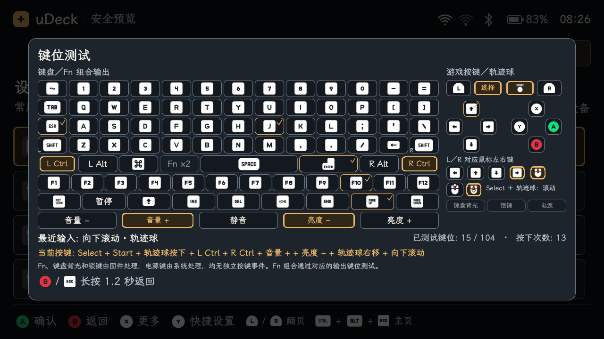
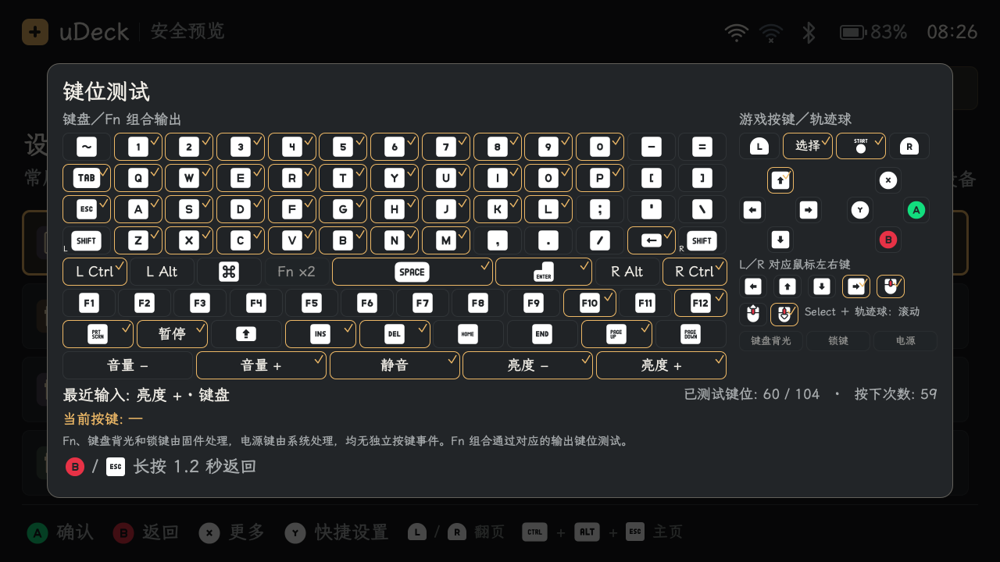
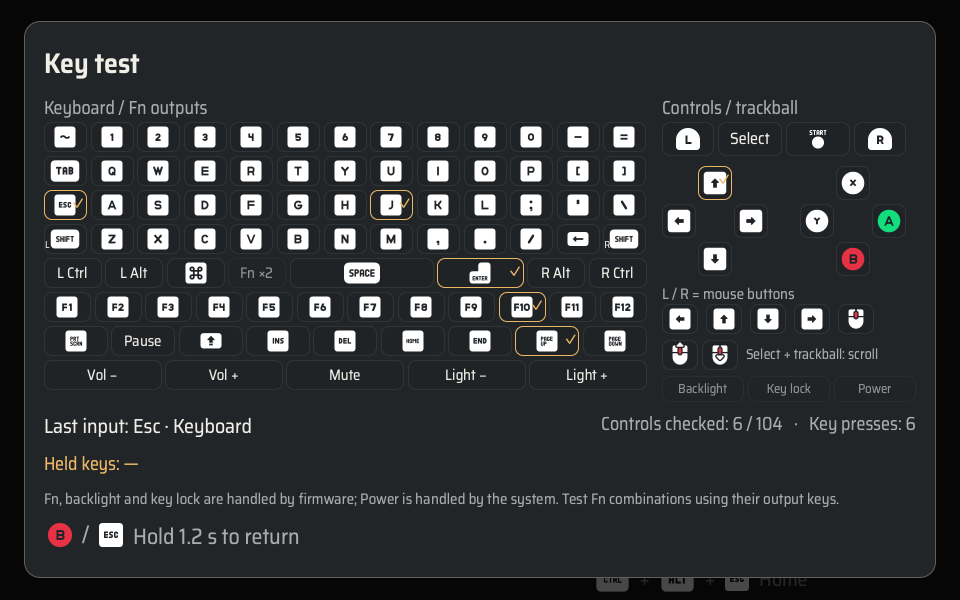

# uConsole 完整键位测试

日期：2026-11-08。主程序 **0.1.18**；应用包与独立终端保持 **0.1.4**。

## 可进入的页面

「设置 → 键位测试」和「Y 快捷设置 → 键位测试」共用完整测试页。保持既有主题、字体和 Kenney Keyboard & Mouse／Nintendo Gamecube 图标；1280×720 与 960×600 均整页显示。

左侧包含字母、数字、标点、左右 Shift／Ctrl／Alt、Cmd、空格、Enter、Tab、Esc、F1–F12、编辑导航、音量及亮度输出；右侧包含方向键、圆形 ABXY、L/R、Select／Start，以及轨迹球按下、四向移动和上下滚动。每项分别保留按下／松开反馈与已测标记。输入次数只统计按键边沿，轨迹球相对移动使用短时活动反馈。

共列出 **104 项可检测输出**，不是 104 个实体按钮。Fn 的两个实体位置、键盘背光、锁键与电源单独标明由固件／系统处理，不进入检测分母，不显示为未通过。Fn 组合以实际输出的键码验证；固件键盘模式下 J/K/U/I 与 Space/Enter 无法区分物理游戏按键，按收到的真实键码显示。

键表依据 ClockworkPi 默认固件的 `DEF_LAYER`、`FN_LAYER`、`keys_maps` 和轨迹球逻辑，参考固定提交 `53a05efca806ca024aab4fbfd28a680688c2541c` 中的 `Code/uconsole_keyboard/keymaps.ino`、`trackball.ino`。设备 HID 描述符宣告的更多能力不代表实体键能产生那些报告，不据此虚增键位。

## 输入和状态

- QQuickWindow 事件过滤器在页面内接收完整键盘；字母键与游戏 ABXY、Enter 与 A、F1 与 Y 等分别记录。左右修饰键使用原生身份，Shift 符号保留原键帽身份。
- 前台诊断期间只读打开内置 Keyboard 和 Consumer Control 接口，补充被桌面提前处理的媒体／系统键。关闭、失焦、被其他弹层打断后停止，不 grab，不修改快捷键。音量、亮度等系统快捷键仍可能由桌面执行。
- 原生与 Qt 报告去重；同一码原生事件接管 Qt 影子事件。原生松键后不等待可能被桌面吞掉的 Qt 松键，避免残留高亮。不同原生来源仍可分别持有状态。
- Select／Start、中键和相对增量通过已有手柄、指针所有者转发。普通游戏和鼠标路由保持原有规则，诊断逻辑不保存校准或映射。
- 方向、确认、主页、窗口切换、搜索和翻页等 uDeck 动作在此页不执行。短按 B／Esc 测试，长按 1.2 秒返回，保留父菜单焦点和原有草稿。
- 键帽实例在快照更新和语言／主题切换时保留，动画不因重复创建而丢失。关闭观察器时设置最终关闭状态，避免退出时的重置通知重新打开设备。

## 代码审查修复

已复现并修复：普通字母没有独立反馈、F1／Enter 等混入游戏动作、Shift 符号释放身份变化、左右修饰键合并、Select／Start 与中键缺失、媒体报告不可见、重复报告计数、Qt 松键被吞后的卡键，以及退出清理重入。相应回归覆盖按下、重复、松开、双来源顺序、事件流失步、拔出、焦点切换和关闭。

界面检查修复了英文小屏长提示挤出底栏的问题：后台提示复用单行说明区。测试基础设施在关闭模拟输入设备后处理 Qt 延迟删除，避免把未清理的 notifier 带入下一组事件循环。

## 验证记录

- 完整测试：**662 passed、2 skipped**；跳过项为 macOS 缺少原生 QMLTermWidget，另有 13 条既有 dbus_next 弃用警告。Ruff 全部通过。
- QML 冒烟通过；中英 × 经典／黑暗 × 1280×720／960×600 共 **8 组、88 张截图**，未捕获到 QML 错误。验证真实 QQuickWindow 键盘事件、边界及切换语言／主题时键帽实例与按住状态保留。
- wheel 的 **187** 个源码／资源文件、arm64 Debian 的 **145** 个基础包文件与最终源码逐字节一致。
- 已安装到 uConsole 并启动主程序 **0.1.18**，应用及终端仍为 **0.1.4**。直接导入安装模块运行诊断测试：**128 passed**。
- 实机只读核对：内置 Keyboard、Consumer Control、Mouse 与手柄接口均可读；诊断观察器可打开两个原生键盘接口，最终关闭后不会重开。启动器有首帧，未捕获到 QML 错误。
- 安装前后配置、6 份网络配置、SSH 路由、音频默认设备及时间设置保持一致，原有终端进程保留，屏幕仍为关闭状态。**未进行实体逐键按压验收**。

交付包 SHA-256：

```text
udeck-0.1.18-py3-none-any.whl
 a75d20e8199077eb68decf19b3f7df4abb5112879d8c0ffbfb58ffe6bd51f100
udeck_0.1.18_arm64.deb
 87ce256031ce9b9ad87ea2750aef232b5288c702b7cfd97b5205bb2bdaf14c50
```

原始日志、JUnit、逐屏布局报告及安装前后校验位于忽略目录 `artifacts/full-key-test-0118/`。

预览截图由 Mock 与合成输入生成，不能证明实体键工作正常：







现场仍需逐个验证实体按键、Fn 组合、轨迹球和系统保留快捷键。固件内部行为、电源动作、键盘背光及锁键不通过模拟事件宣称验收完成。
