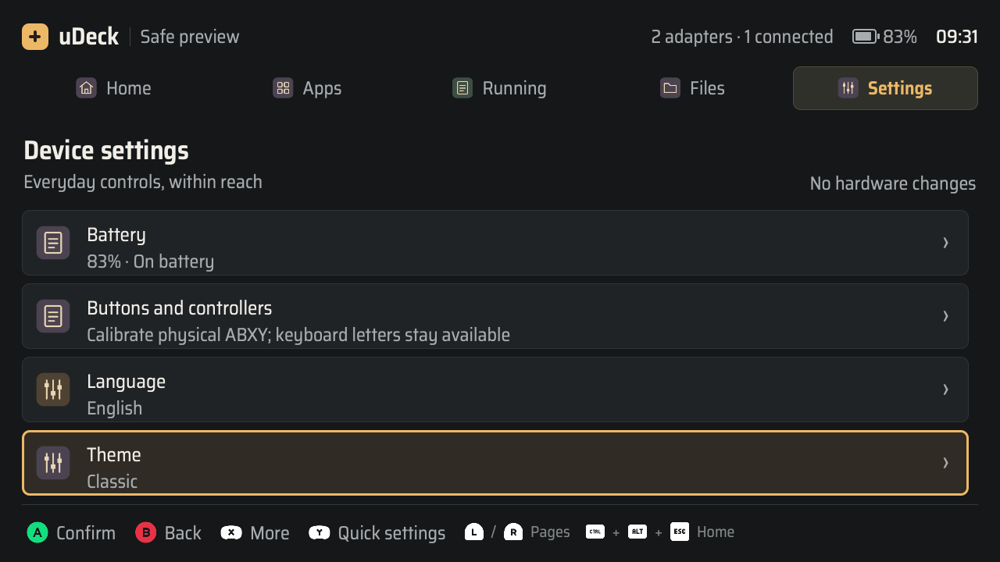
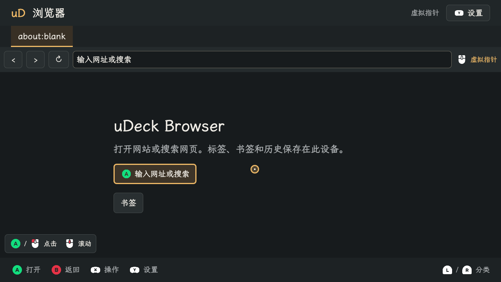

# uDeck 0.1.11 按键图标

启动器、五个原生应用、终端和应用设计原型统一使用 Kenney Input Prompts 的 **Keyboard & Mouse + Nintendo Gamecube**。ABXY / L / R 使用 GameCube 图形；Enter、Esc、方向键、修饰键和鼠标提示使用 Keyboard & Mouse。动作文字继续随中英文切换，保留 Saira Semi Condensed 与 LXGW WenKai Screen 字体以及两套主题。

全局规则已写入 [按键图标规范](../design/input-prompts.md)，并从应用交互规范、设计入口和项目 README 链接。规范明确素材组合、原始配色、逻辑按钮映射、24–36px 图标尺寸、组合键 `+`、可替代键 `/`、换行、无障碍和验收要求。

## 实现与来源

`InputIcon.qml` 加载本地 PNG，`InputPrompt.qml` 组合按键和动作文字，`InputHints.qml` 按完整动作组换行。组件接收界面的语义文字颜色与当前字体；图标的内部字母使用原始素材。终端、网页、阅读正文和游戏内容保持自己的输入与渲染。

选用两组中的 27 个原始 `Double` PNG（128×128），图片合计 16,388 字节。资源在基础包中共享，不增加运行时依赖或联网下载。原型保留逐字节相同的副本，并通过资源测试校验。

上游下载归档为 `kenney_input-prompts_1.5.zip`，原始许可标记 `Input Prompts (1.5A)`、CC0-1.0。保留原始 `License.txt`，Git 禁止对上游许可做换行转换；`manifest.json` 记录来源、归档内路径和 SHA-256。归档校验值为 `ac2fcf599080b0f3ba2d174c9474db6df1a0e96ff0662580e2da79a122ab78a1`。

主程序版本 **0.1.11**，应用与终端版本 **0.1.4**，后两者依赖 `udeck >= 0.1.11`，确保共享组件和资源存在。

## 审查

主线程依照 correctness-reviewer 与 code-simplicity-reviewer 复核。修复了三项问题：

- 紧凑底栏使用 Qt Flow 的统一 16px 间距时，换行后的 `keyboard_ctrl` 图标 y=571、height=32，底边超过 600px 屏幕 3px。现将水平组间距和垂直行间距分开为 16px / 4px，按实际高度居中。
- 浏览器“文字输入”状态旁的 Tab 图形容易被理解为进入该状态的快捷键，现保留文字状态名，仅在实际指针模式显示鼠标图形。
- 设备完整测试暴露了原阅读器检查的采样时序问题：库扫描处理事件时，分页会更新进度比例。实际复现中 CFI 始终为 `epubcfi(/6/2!/4,/10,/14/1:111)`，比例在打开坏书之前从 `0.002726033079218777` 更新为 `0.010012929194822816`，产品保存的是最新值。测试现于扫描后、失败打开前采样，继续严格比较完整位置字典，避免将正常异步更新误报为位置丢失。

输入分发、校准和组合键行为沿用原有实现。共享图标没有重建内容页、播放器、文档或终端会话。

## 自动化与截图

资源测试先确认缺少素材时失败，QML 探针先确认没有 Kenney 图标时失败，再检查所有可见按键图片的实际加载状态、本地来源和窗口边界。运行中的语言与主题切换继续检查页面对象、输入文本、光标与终端会话标识保持。

修复测试采样时序后，本地完整测试 **379 通过、2 跳过、13 条弃用警告**（145.56 秒）；两项跳过是 Mac 未安装原生 QMLTermWidget 插件的真实 PTY 测试。Ruff 与 `git diff --check` 通过。四个 QML 组合覆盖中英文 × 1280×720 / 960×600，每组 36 张，共 **144 张截图**，包括两套主题、启动器、五个应用、终端、确认、文字输入、浏览器指针和终端历史。

设备端启用 `UDECK_REQUIRE_NATIVE=1` 与已安装插件后，完整测试 **381 通过、0 跳过、13 条弃用警告**（309.94 秒），覆盖原生 PTY 和缓冲区集成。最终测试源码的 479 个归档输入逐项校验通过，归档 SHA-256 为 `a2fd21f625b474b3f07e8f57e178c492cffc5a11b8a1f2a1bb2be4a74eb0228e`。警告来自现有 `dbus_next` 对 Python 3.13 弃用装饰器的使用。

网页原型双语言、双尺寸检查 **388 项通过**，生成 **184 张截图**，覆盖五应用及其菜单、输入、运行和异常状态；图片完整，常驻提示组没有重叠。

wheel 已构建，包内 **110 个源码和资源文件** 与工作区逐字节一致，包含 27 张图标、原始许可和清单。SHA-256：`4d653c572de3578878ca22f0b4701b1c01fa49fbb37eb06c828d24407d994412`。

以下为使用测试数据的实际 QML 截图：

## Debian 安装包

在 CM4 / arm64 上构建三个包，复用已安装且通过验证的原生 QMLTermWidget 插件。基础包、应用包、终端包分别包含 68、32、10 个程序与资源文件，合计 **110 个**；逐项校验与源码一致，三个包之间没有文件重叠。应用和终端都声明 `udeck >= 0.1.11`。

| 安装包 | SHA-256 |
| --- | --- |
| `udeck_0.1.11_arm64.deb` | `286212ec129e5884ff26d6dcc2c9ecc197188101ec1441632b0b9436ee973acb` |
| `udeck-apps_0.1.4_arm64.deb` | `370e3023c05e25cb4e38bc2c8f2ccc0d60956d713784c32b806da8c4c166e67b` |
| `udeck-terminal_0.1.4_arm64.deb` | `977d21484736b1be67a7eafc751d3a2901dd201ff74a4d9749f94aa92b7f2590` |

## 安装与窗口化实机验证

2026-11-07 在现有 CM4 上升级上述三个包。安装计划及实际安装均只升级 uDeck 的三个包；本机回传副本的 SHA-256 与设备一致。安装后再次校验 110 个程序与资源文件，全部与最终源码一致。`udeck-fullscreen.service` 为 `active`，`udeckctl doctor --json` 返回 0。

从已安装的模块运行真实 Wayland 探针：英文、中文各 **36 张截图**，共 **72 张**，两组 QML 错误均为 0。请求窗口为 1280×720，现有桌面实际提供的截图尺寸均为 **1278×643**；完整 1280×720 和 960×600 的覆盖来自本地离屏测试。实际检查图标加载、窗口边界、字体、两套主题切换，以及页面、输入草稿和会话标识保持。

仅重启启动器服务。用户配置与安装前私有备份逐字节一致，变更键为空；已有真实终端 PID `381833` 保持运行，命令校验值保持一致。显示电源从原有 `DSI-1 off` 临时开启用于渲染，并在探针结束后恢复为 `DSI-1 off`。

组合窗口探针中的终端采用 Mock；真实 PTY 与缓冲区由设备完整测试单独验证。截图使用测试内容，不代表现场网络、真实媒体库或游戏运行验收。实体 ABXY / L / R、真实中文输入法及人工操作验收尚未进行。本次没有重启原有终端；已打开窗口在正常重新打开后加载新的 QML 操作提示。
