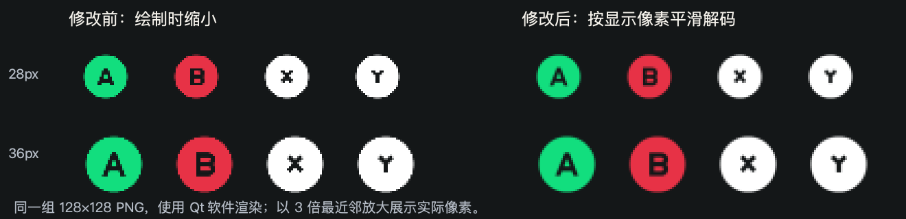
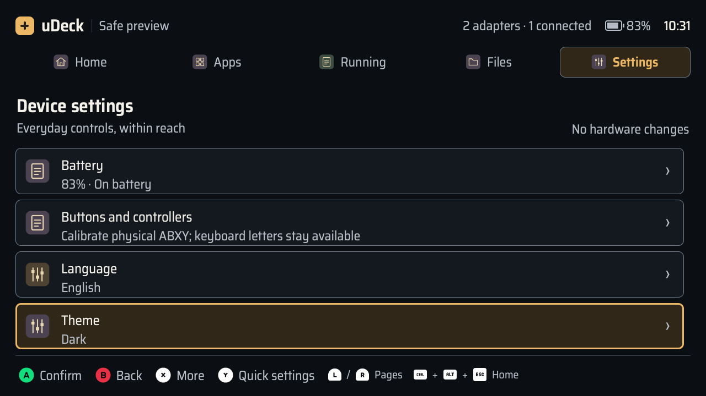
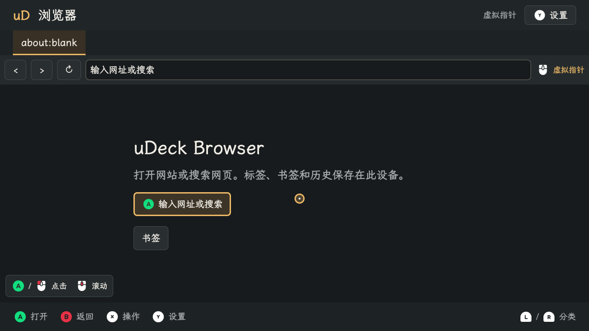

# uDeck 0.1.12 圆形按键与平滑缩放

后续 0.1.13 统一键盘图标的可见高度与组合键间距；见 [键盘按键尺寸统一](input-prompts-sizing-2026-11-07.md)。以下保留 0.1.12 的验证记录。

X/Y 改为圆形，并修正共享按键图标在软件渲染下缩小时的锯齿。启动器、五个原生应用及终端的新窗口使用同一组件；网页原型同步圆形资源。基础包版本为 **0.1.12**，应用包和终端继续使用兼容的 **0.1.4**。

## 原因与修正

旧组件将 PNG 固定解码为 128×128，再绘制到 24–36px。实际使用的软件渲染路径下，即使开启 `smooth` 和 `mipmap`，小尺寸圆边和字母仍出现明显阶梯。使用同一 PNG 对比“绘制时缩小”与“按目标尺寸平滑解码”，后者的边缘明显更平顺。

`InputIcon.qml` 现在按显示尺寸乘以 `Screen.devicePixelRatio` 设置解码尺寸，让软件渲染器直接使用经过平滑重采样的小图；高分屏保留所需的物理像素。没有增加图片依赖，也不需要更大的 PNG。

X/Y 使用 Kenney 同套 GameCube 白色圆形 B 的轮廓，填平 B 字形镂空后应用原始 X/Y 字形镂空，保留字形的原始位置、大小与透明画布。当前 **25 张原图＋2 张圆形适配图**；`manifest.json` 分别记录适配图、上游输入及变换。原始许可保持不变，原型副本逐字节一致。规则已写入 [按键图标规范](../design/input-prompts.md)。

## 自动化验证与审查

- 新增像素回归检查，使用实际共享 QML 组件，覆盖 24 / 28 / 32 / 36px、7 种按键、1× / 1.5× / 2× 像素比，共 84 个渲染样本。与独立的平滑重采样参考图比较。旧实现的三组检查均失败，修正后三组均通过。
- 本地完整测试：**382 通过、2 跳过、13 条弃用警告，199.44 秒**。两项跳过为本机缺少原生 QMLTermWidget 插件的真实 PTY 测试；警告来自现有 `dbus_next`。
- 完整测试包含中英文 × 1280×720 / 960×600 的 QML 检查，每组 36 张，共 **144 张截图**。覆盖两套主题、启动器、五个应用、终端、菜单、确认、文字输入、浏览器指针与终端历史；图标加载和边界检查通过。
- uConsole 图标专项测试：**4 通过，7.14 秒**，包括资源校验和三个像素比下的实际渲染。
- Ruff 与 `git diff --check` 通过。主线程按 correctness-reviewer 和 code-simplicity-reviewer 复核目标尺寸、高分屏、共享引用、来源清单、版本依赖与测试独立性，没有遗留代码问题。

## 打包与 uConsole 安装

wheel 内 **110 个**源码与资源文件逐项校验，与最终工作区一致。CM4 上构建基础 Debian 包，包内 **68 个**程序与资源文件逐项校验一致，架构为 arm64。

| 文件 | SHA-256 |
| --- | --- |
| `udeck-0.1.12-py3-none-any.whl` | `99f418ee84ac102f881ca4fe3bf836f7ac00860bdd0f7248b407f633575f3c7c` |
| `udeck_0.1.12_arm64.deb` | `e605ff3520ef0bd613558e1d7e0e7b2bbc603e00e608e22a1c69a3d545901956` |

2026-11-07 在现有 uConsole 上升级基础包至 **0.1.12**。安装计划与实际安装均只升级 `udeck`，应用和终端保持 **0.1.4**。安装后校验全部 **110 个**共享及应用程序文件，与构建源码一致；启动器服务为 `active`，`udeckctl doctor --json` 返回 0。

从已安装模块运行中英文 Wayland 检查，共 **72 张截图**、QML 错误为 0，页面、草稿和测试会话标识保持。请求 1280×720 时，现有桌面实际截图尺寸为 **1278×643**；完整分辨率检查由本地离屏测试完成。

用户配置与安装前私有备份逐字节一致，原有真实终端 PID `381833` 及命令校验值保持不变。仅重启启动器；显示电源从 `DSI-1 off` 临时开启用于检查，结束后恢复为 `DSI-1 off`。已打开的应用和终端继续使用已经加载的 QML，正常新开窗口后使用本次图标。

本次设备验证是自动化渲染检查。组合窗口中的终端使用 Mock；没有重新运行上一版本的完整原生 PTY 套件，物理屏幕观感、实体按键和人工输入验收仍由现场检查确认。
