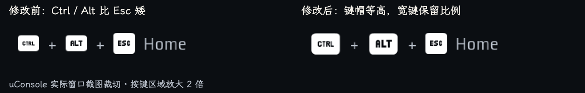
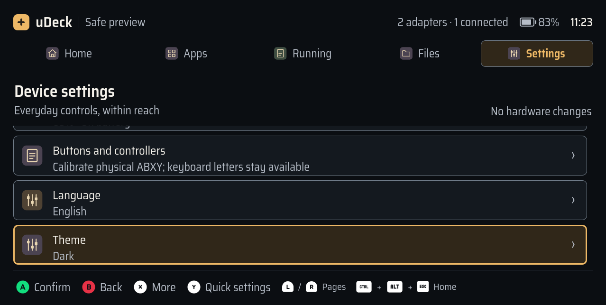

# uDeck 0.1.13 键盘按键尺寸统一

统一启动器、五个原生应用、终端和网页原型中的键盘图标可见高度。Ctrl、Alt、Tab、Shift、Space 与方向键组合按原始比例放大，保留 Kenney 的原始形状与字形；组合快捷键根据图标的实际宽度布局。

## 原因与调整

PNG 画布均为 128×128，但原图中的可见主体不同：Esc / Enter 等方形键为 96px 高，Ctrl / Alt / Tab 为 72px，Shift 为 64px，Space 为 56px，方向键组合为 60px。固定正方形图标框会让这些键显得高矮不一。

共享 `InputIcon` 现在使用固定高度的对齐区域，根据键帽主体高度等比缩放完整画布，并提供相应的布局宽度。同一规格下，键盘图形的可见高度以方形键为基准；32px 规格对应约 24px 可见高度。`InputPrompt` 根据实际宽度安排按键、分隔符和动作文字，`InputHints` 继续按完整动作组换行。位图资源保持不变，ABXY 与鼠标沿用现有规格。

保留上一版的平滑解码，使用整数物理像素计算解码尺寸与垂直位置。审查过程中修复了 1.5× 下浮点减法导致的方向键一像素偏移。网页原型使用相同缩放比例和固定高度、可变宽度的图标容器。

规则已补入 [按键图标规范](../design/input-prompts.md)。下图截取更新前后的 uConsole 设置快捷键并放大两倍，左侧为修改前，右侧为修改后：

## 自动化验证

- 像素检查覆盖 13 种图标 × 24 / 28 / 32 / 36px × 1× / 1.5× / 2×，共 **156 个样本**。参考尺寸从原 PNG 的实际透明度边界独立计算，检查平滑缩放、键帽可见高度偏差不超过 1 个物理像素，以及组合键不重叠。旧实现三组均失败，修正后三组均通过。
- 本地完整测试：**382 通过、2 跳过、13 条弃用警告，158.12 秒**。跳过项是本机缺少原生 QMLTermWidget 插件的真实 PTY 测试；警告来自现有 `dbus_next`。
- QML 中英文 × 1280×720 / 960×600，共 **144 张截图**。两套主题、启动器、五个应用、终端、弹层及输入提示均通过加载和边界检查，页面、输入与测试会话保持。人工复核小屏设置中的快捷键换行，以及终端组合键提示。
- 网页原型双语言、双尺寸矩阵：**388 项检查通过、184 张截图**。复核游戏画面的 Ctrl / Alt / M 提示；图标、焦点与菜单没有越界或重叠。
- uConsole 图标专项测试：**4 通过，20.16 秒**，覆盖素材一致性、三个像素比、实际图标高度、平滑缩放和组合键间距。
- Ruff 与 `git diff --check` 通过。主线程按 correctness-reviewer 和 code-simplicity-reviewer 复核，没有遗留代码问题。

## 打包、安装与设备窗口检查

基础包 **0.1.13**；应用包与终端保持兼容的 **0.1.4**。wheel 内 **110 个**源码和资源文件逐项与工作区一致；arm64 基础 Debian 包内 **68 个**程序与资源文件逐项校验一致。

| 文件 | SHA-256 |
| --- | --- |
| `udeck-0.1.13-py3-none-any.whl` | `9857388f7ff4c19209295f97255356765f794870471536109957569aac39136a` |
| `udeck_0.1.13_arm64.deb` | `fbc21ec0683548f9f765b4e9931276772b1fbec4086b364e178f3aa10724a24d` |

2026-11-07 在现有 uConsole 上仅升级基础包。安装后 **110 个**共享及应用文件均与最终源码一致，启动器服务为 `active`，`udeckctl doctor --json` 返回 0。已安装模块的中英文 Wayland 检查共 **72 张截图**、QML 错误为 0，页面、输入和测试会话标识保持。请求 1280×720 时，桌面实际提供 **1278×643**；完整分辨率由本地离屏测试覆盖。

用户配置与安装前私有备份逐字节一致，原有终端 PID `381833` 及命令校验值保持不变。仅重启启动器；显示电源临时开启用于检查，结束后恢复为原来的 `DSI-1 off`。已打开的应用和终端正常新开窗口后加载更新的共享组件。

本次设备检查使用自动化渲染和测试数据，组合窗口中的终端为 Mock；没有重复运行上一版的设备完整原生 PTY 套件。物理屏幕观感和实体按键的人工验收仍由现场检查确认。
