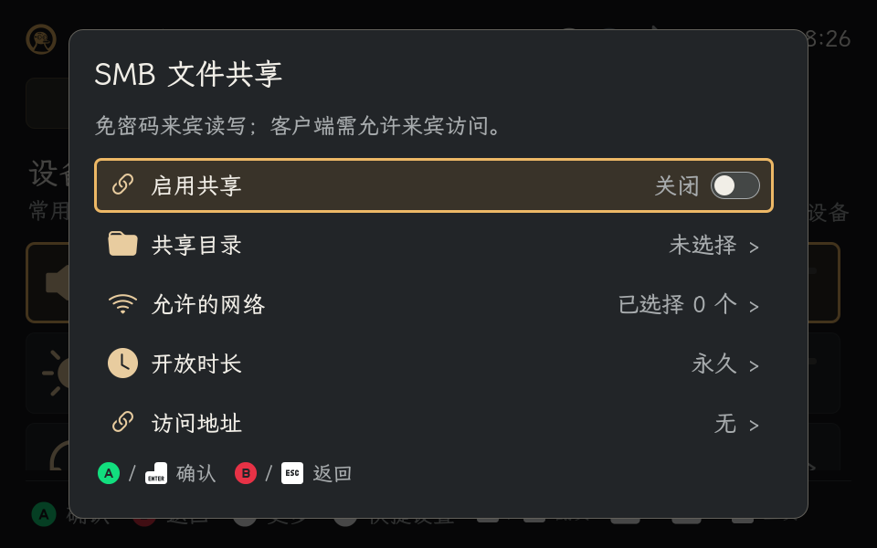
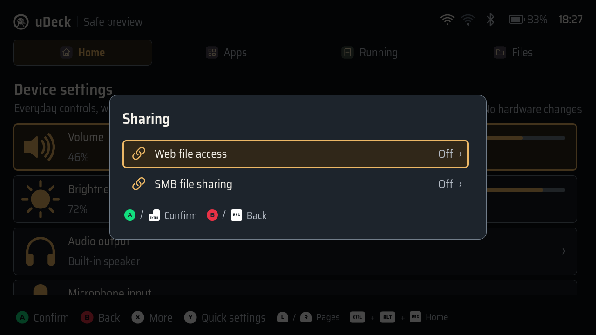

# 系统共享审查与验证（2026-11-12）

本次交付按已批准的[实现计划](../superpowers/plans/2026-11-12-sharing-smb.md)执行。功能与使用方式见[共享说明](sharing.md)。统一版本提升为 0.2.4，使已安装的 0.2.3 能通过 APT 升级。

## 代码审查

依次检查正确性、权限边界、项目约定、测试及可维护性。以下问题已修复并加入回归验证：

| 问题 | 修正 |
| --- | --- |
| 网页监听启动或持久化准备失败可能影响已有共享 | 先准备持久化，再事务保存及启动；失败恢复原有效配置 |
| 启动失败后的第二次配置写入也可能失败 | 保留旧配置 inode，原子恢复，避免回滚需要再次分配或序列化 |
| APT 可能先配置 Samba 依赖，再运行 uDeck 的 preinst | 安装器对完整 APT 事务设置启动保护，只处理新引入的标准服务 |
| 安装中断、服务禁用失败后可能丢失保护 | 保留独立持久 drop-in；下次安装恢复；中断时回收 APT 进程组 |
| deb-systemd-helper 缺少维护脚本环境 | 使用固定 DPKG_MAINTSCRIPT_PACKAGE，并验证标准服务禁用状态 |
| 目录符号链接解析后可能引入配置分隔符 | 再次校验规范路径；绑定固定目标并核对目录 inode |
| BindPaths 的完整元组加引号会误解包含空格的源目录 | 只引用源路径部分；实测中文、空格和百分号目录 |
| dbus-next 的结构体不能使用 tuple | 使用 list；增加真实线协议序列化测试及实机系统总线调用 |
| 拼接文本丢失翻译标记、查询恢复后错误未清除 | 保留标记消息组合；区分操作错误与轮询错误 |
| 停止失败时开关误显示为关闭 | 保留有效状态并允许重试；显式停止保存失败时事务回滚 |
| 后台查询未结束时，排队操作没有进度反馈 | 排队即显示正在应用并禁用操作；保留实际开关和原焦点，增加先失败后通过的回归 |
| 原完整测试套件在后续 processEvents 中随机挂起或崩溃 | 保留会话级 Qt application，在测试间清理关闭 controller 的循环引用及 DeferredDelete；未跳过原测试 |

## 自动化验证

- Ruff 全部源码、测试、安装保护和构建器检查通过。
- 共享、SMB/D-Bus、网页生命周期、安装保护、发布、翻译、设置及 Reader 定向回归：101 项通过。
- 原生 Qt 问题缩小后的前序测试及 Reader 组合：301 项通过。
- 最终完整 ARM64 构建：**1519 passed，16 warnings，无跳过，783.30 秒**；包含实际 Terminal 插件及原有全部测试。
- 排队操作反馈回归：修复前失败，修复后 Sharing 控制器 7 项通过；最终定向回归 51 项通过。
- 最终干净 Debian ARM64 安装生命周期：**通过**。覆盖无推荐依赖的首次安装、完整安装器（含推荐依赖）、旧拆分包迁移、升级、重装、重配置、卸载及重新安装；423 个已安装 Python/QML/资源文件与源码包逐字节一致，独立原生终端插件校验及实际 PTY 检查通过。
- 首次安装后标准 Samba 单元保持禁用；后续各阶段中预置的 Samba 配置和已启用单元均保留。测试同时核对原桌面配置、终端默认项和用户数据。容器验证安装逻辑和文件/启用状态，原生系统服务行为另在 uConsole 上验证。

## uConsole 验证

使用 192.168.11.59 上的临时目录及专用 Samba 服务。另一台物理设备（Mac）的 Debian smbclient 使用无密码来宾执行真实 SMB 请求。验证不改原目录权限；测试的 000 权限文件不可读，指向共享目录外的符号链接不可访问。

手工候选版本已通过 445 冲突回滚、网络撤销与恢复、目录替换和 Samba 异常退出；撤销时已建立客户端连接断开。安装包使用相同后端，已复测真实来宾列表、上传、下载字节比较、重命名、删除，以及网页/SMB 同时开启和分别关闭、显式关闭连接、永久配置在管理服务冷启动后恢复、限时配置不恢复和发起进程退出。

上传及下载内容为 65,536 字节，SHA-256 为 `7daca2095d0438260fa849183dfc67faa459fdf4936e1bc91eec6b281b27e4c2`。保存失败注入后原配置字节不变，原客户端仍能列目录；推进测试截止时间后，真实 Samba 停止且客户端报告 `NT_STATUS_CONNECTION_DISCONNECTED`。这项到期验证使用测试时钟边界，没有等待实际一小时。

最终安装包的中英文 × 经典/黑暗 × 1280×720/960×600 共 8 组独立 Wayland 窗口检查通过，每组 8 个截图；覆盖单行、开关、处理中、错误、返回焦点和长网络列表滚动。界面检查使用隔离的模拟 controller，真实协议及系统总线另行验证。设备存在 lxpolkit；默认策略拒绝未授权 SSH 调用，自动实机管理使用仅限测试进程 PID 和单一 SMB action 的临时 Polkit 规则。

保留原桌面、SSH 和五个原应用进程。安装及首轮安装包测试后，11 个保护文件的 SHA-256、7 个原进程的启动时间以及原网页共享 inactive/disabled 均未改变。临时 Polkit 规则、测试网络连接、转发、共享目录和运行覆盖已清理；网页保留原先无配置、未运行的状态，SMB 恢复默认关闭、目录与网络未选择的状态。最终包重装及复测后再次复核通过，包完整性及安装依赖检测通过，生产管理单元 active/enabled，无运行覆盖，445/8787 均无监听。

未重启设备，永久恢复通过独立服务冷启动验证；登录会话 closing 和 PID 重用使用生命周期回归，实际进程退出、推进截止时间和连接失效另在设备上验证。没有自动输入 GUI 认证密码，未把临时 PID 授权当作 Polkit 密码弹窗验收。运行中的原桌面保留已加载代码，新入口在下次正常启动 uDeck 后生效。

实机安装包的独立 Wayland 窗口截图（隔离模拟 controller，协议请求另行验证）：

## 验证包

最终开发验证包为 0.2.4 arm64；未创建标签或发布 Release。容器构建未读取工作区 Git 元数据，manifest 的 Git 字段为 null；通过源码包逐文件核对，503 个生产源码、打包及构建文件与待提交工作树完全一致。安装后的 14 个共享后端模块与生命周期实测版本逐字节一致。

| 文件 | SHA-256 |
| --- | --- |
| `udeck_0.2.4_arm64.deb` | `df9ed0a665a41ff95f8de38a6908d171e4b9e993a6879baca003cf489c8d8f34` |
| `udeck_0.2.4_arm64.tar.xz` | `d37c599688dfc75ca6075d42079c93edd32be01daa0ecabe9c7349b2cc2c6799` |
| `udeck_0.2.4.tar.xz` | `4f8087c105585e644299a8a3b2fc31a21ec6554a4a06c79441caa2dfe9e69b91` |

原始构建、包生命周期和实机记录保留在本次工作树的 `artifacts/sharing-smb/`，验证包保留在 `dist/sharing-smb-final/`。这些本地产物不纳入 Git。
