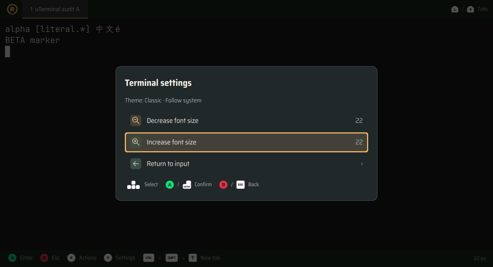
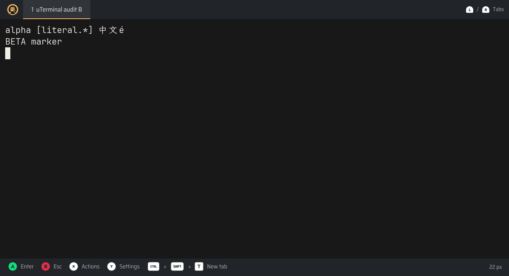

# uTerminal 实机功能测试与修复（2026-11-14）

在 uConsole 的 Debian 13 arm64 / labwc Wayland 会话上，使用真实 Qt 窗口、原生 QMLTermWidget 和 PTY 复现并修复三个问题。基础提交为 `1c7c736e9329f8af2922d5299dab241b76e01754`，安装版为 `0.2.13`；修复从临时候选源码加载，未替换系统安装包，也未提交、合并或推送。

## 问题与修复

| 问题 | 安装版实测 | 修复及复测 |
| --- | --- | --- |
| 多窗口字号不同步 | A 调到 22 px，A/B 实际字号为 `[22, 20]` | 偏好变更通知所有现有窗口；原生字号为 `[22, 22]`，保留原 PTY 和标签 |
| 搜索后菜单键盘失效 | 隐藏搜索框继续持有焦点，多行粘贴确认、字号菜单不响应方向键和 Enter | 离开搜索时清除其局部焦点；Qt 按键和内核按键均可完成搜索、返回及多行粘贴确认 |
| 再次打开终端未回到前台 | 返回主页后调用 CLI 成功，但窗口管理器仍报告桌面处于前台 | Wayland 按 compositor 窗口 ID 记录活动顺序，普通启动恢复最近窗口；实测同名、动态标题和反复切换，并验证真实 CLI/D-Bus 调用 |

字号和焦点修复均先建立失败回归再修复；窗口激活回归在前两个修复存在时仍失败，加入激活修复后通过。关闭窗口后的记录清理、多个窗口的选择和协议失效恢复另有单元回归。

失败证据：[字号和菜单基线](evidence/terminal-audit-2026-11-14/baseline-menus.json)、[CLI 激活基线](evidence/terminal-audit-2026-11-14/baseline-activation.json)。修复后：[Wayland 功能报告](evidence/terminal-audit-2026-11-14/menus-wayland.json)、[CLI/D-Bus 报告](evidence/terminal-audit-2026-11-14/cli-ipc.json)。

## 验证结果

| 验证 | 结果与范围 |
| --- | --- |
| 本地终端相关测试 | 98 passed、4 skipped；跳过项需要 Linux 原生插件 |
| 设备终端相关测试 | **102 passed、0 skipped**；强制要求原生插件，包含 PTY、生命周期、中英文、Classic/Dark、字体、ANSI/Nerd 图标及菜单回归 |
| 最终原生菜单回归 | 1 passed；测试脚本补齐内核设备就绪检查后单独复核离屏执行路径 |
| 最终本地焦点、字号和活动顺序回归 | 11 passed；与上述测试有重叠，不累计为独立总数 |
| 真实 Wayland 功能检查 | 8 项通过：最近窗口、字号同步、菜单隔离、普通文本搜索与复制、多行粘贴、内核按键路径、字号边界与重载、取消关闭保留进程 |
| 实际 CLI/D-Bus | 在独立会话总线上调用实际入口；恢复前台、创建第二窗口、精确 argv/cwd/环境、文件目录启动、错误处理和自然退出均通过 |
| 设备 TUI | Vim 编辑保存、less 翻页搜索、tmux shell/分离、Codex 启动退出、异常退出清理均通过 |
| Ruff / diff 检查 | `ruff check src tests tools`、`git diff --check` 通过 |
| 代码审查 | 审查共享状态通知、Qt 焦点、窗口活动顺序、同名窗口、关闭清理及协议失效路径，最终无待修复项；[审查记录](../../.context/compound-engineering/ce-review/20261114-uterminal-device-audit/review.json) |

内核按键通过临时 `/dev/uinput` 键盘走 compositor、Qt 和原生 PTY，核对普通 `abxy` 字母不被转换为掌机动作，菜单按键不泄漏到 PTY，搜索后多行粘贴保留 bracketed paste。报告记录 udev 的键盘识别、实际就绪字符和接收字节。

首次虚拟键盘尝试超时，未据此认定产品缺陷。产品源码保持不变，补充诊断后复测通过；测试随后改为等待实际输入到达，再检查字符和快捷键，最终复测通过。原始失败报告仍保存在本地原始证据中。

Wayland 下直接抓图的精确 RGB 断言曾受设备颜色量化影响，例如 `(21, 23, 25)` 抓取为 `(24, 24, 24)`。未修改产品配色；按现有测试包装器指定的 offscreen/software 路径运行原生外观测试后通过。真实 Wayland 窗口的字体、布局、菜单和输入另行检查。

## 状态与证据

测试前后，既有安装版主进程、其子进程、1 个窗口和 1 个会话均保留；默认终端仍为 `/usr/bin/udeck-terminal`，安装包仍为 `0.2.13`。`settings.json` 哈希相同，原先不存在的用户终端配置和用户 XDG 终端列表仍不存在。平台页五列的独立工作树改动得到保留，未混入设备候选源码。

[验证汇总与源码哈希](evidence/terminal-audit-2026-11-14/verification.json)记录安装前后状态；[TUI 报告](evidence/terminal-audit-2026-11-14/tui-wayland.json)明确标记候选源码和空的安装构建 ID。Codex 测试只启动界面并按键退出，没有提交模型请求或修改信任配置。原始报告、日志和失败截图保存在工作树 `artifacts/uterminal-audit-20261114/evidence/`，设备端对应 `/var/tmp/udeck-terminal-audit-20261114/`。

以下为真实 Wayland 候选窗口截图，使用临时测试配置 22 px：

本轮是设备上的自动化测试，尚未代替真人实按 ABXY/L/R 或实际中文输入法候选窗验收。字体设置仍提供字号调整；手动选择字体家族属于现有功能边界，本轮未新增字体选择器。
