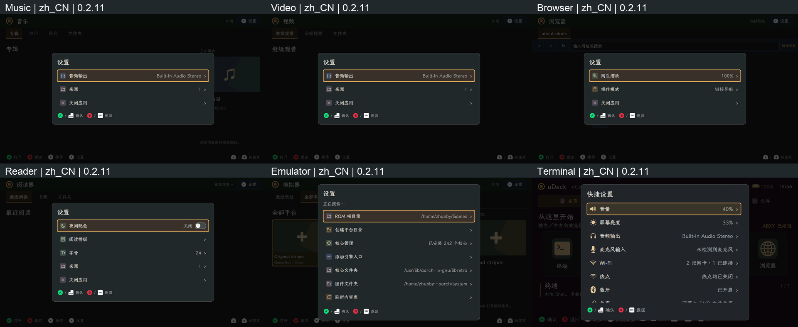

# 系统文案审查与修复（2026-11-13）

审查原有 1,200 组英文／简体中文词条，并检查桌面、设置、文件管理、终端、Music、Video、Browser、Reader、Emulator、网页文件访问及启动器的自有界面文案。修正 107 个原有词条、135 处翻译；新增 31 组稳定消息标识。网页词典从 77 项补齐至 107 项，新增或修正 39 项。

## 统一用词

| 场景 | 英文 | 简体中文 | 修复原因 |
| --- | --- | --- | --- |
| Wi-Fi | Connect / Reconnect / Auto-connect | 连接／重新连接／自动连接 | 同一操作不再混用加入、连接 |
| 标签容器 | Tab | 标签页 | 区分标签页与运行中的终端会话 |
| 浏览器历史 | Back / Forward | 后退／前进 | 不再误指页面编号的上一页、下一页 |
| 图像保存 | Screenshot | 截图 | 统一菜单、快捷键、提示语 |
| 系统配色 | Dark | 深色 | 替换“黑暗”；仅修改显示名称 |
| 硬件输入 | Physical button / Trackball press | 实体按键／轨迹球按下 | 统一物理、按钮、实体等混用 |
| 电源操作 | Shut down / Restart | 关机／重启 | 统一操作与确认标题 |
| 文件操作 | Folder / Reverse order | 文件夹／倒序排列 | 对齐原生文件管理和网页 |
| 阅读显示 | Text size | 字号 | 对齐字号调整操作 |
| 网页任务错误 | Failed | 失败 | 不再将失败显示为未完成 |

修正中文含义不符的“开放的网络”“未连接的网络”和首页方向键说明；移除含糊的首页介绍，修复共享路径提示中的语病。终端缺失组件和应用缺失提示改为当前统一发行的 `udeck` 软件包。

稳定消息标识保持不变，格式字段、转换格式、必要的换行与前后空格保持兼容。SSID、路径、文件名、账户名、书籍内容、终端原始输出及未知外部诊断保持原样。

## 代码审查与行为修复

按 `ce:review` 的正确性、测试、可维护性、项目约定、接口、可靠性、Python 和前端事件处理检查项在主线程串行审查。

| 问题 | 修复 | 回归依据 |
| --- | --- | --- |
| 共享后台异常被 `str()` 展平，中文界面显示英文，已打开提示无法切换语言 | 保留标记消息；在共享 UI 边界识别已有服务的固定诊断，转换为稳定消息标识 | 网页／SMB 工作线程、状态错误、双向切换语言、未知诊断和字面参数保留 |
| 阅读器资源和进程错误直接传英文字符串 | 报告已知错误代码及原始参数，由控制器生成可翻译消息 | 旧阅读会话事件仍被拒绝；EPUB 文件名保持原样；MOBI、进程退出和未知错误 |
| 网页重名弹窗会翻译恰好与词典相同的文件名 | 仅翻译固定说明，动态路径直接显示 | 实际 Chromium 弹窗中的 `Files` 路径原样显示；文件夹仍不提供替换按钮 |
| 网页可访问性名称和部分服务错误缺少中文 | 补齐名称与固定错误翻译 | 实际页面语言切换、缺失文件夹请求、无效文件名请求和任务失败状态 |

共享服务的 D-Bus 错误字段与英文协议文本保持兼容。阅读器仅增加已知错误代码和参数，保留未知错误信息。文件覆盖规则、权限检查、图标资源及主题切换逻辑沿用现有实现。

## 验证记录

- 本地全量首次运行共 1,571 项：1,555 项通过、10 项失败、6 项跳过，耗时 1,833.35 秒。10 项失败为旧共享文案断言、macOS 原生控件样式和固定等待时间；修正后，覆盖所有首次失败的共享、快捷键、启动层 32 项复测全部通过，耗时 125.72 秒。未重复运行完整套件。
- 六项跳过分别需要 Linux 会话总线（2 项）、Linux 真实媒体进程环境（1 项）和本地原生终端插件（3 项）。本轮设备 UI 检查包含真实 PTY，但不将其计为这些自动回归通过。16 条告警来自 `dbus-next` 的 Python 弃用装饰器。
- Chromium 网页翻译场景单独通过，覆盖中英文切换、可访问性名称、实际 API 错误、失败任务和字面文件名。新增的共享与阅读器错误回归包含在全量已通过项中。Ruff 检查通过。
- `ce:review` 在主线程串行完成。复审稳定消息标识、格式字段、已知服务诊断、阅读会话隔离、网页覆盖规则及动态用户数据保留；没有遗留的可操作审查问题。

## 安装包与实机

生产提交为 `de17127975b3d540c4cb61ea6dc766992704e9b1`，版本 **0.2.11**。Debian arm64 完整构建包含原生终端插件，装配清单记录 `gitDirty: false`。后续提交仅补充测试探针和本文证据，已安装的生产源码保持与该提交一致。

- 安装包：`dist/text-review-0.2.11-20261113/udeck_0.2.11_arm64.deb`。
- SHA-256：`3646f77154e83941dab9d24eba66b0a1a307f0e47c5fc9a24e5834b2ed230ffb`。
- 构建使用 `DEB_BUILD_OPTIONS=nocheck parallel=4`；以上测试独立运行，未计入 Debian 构建步骤。
- uConsole CM4 安装后，425 个生产源码／资源文件哈希一致，`dpkg --verify` 和安装预检通过。安装前后及截图检查后，监测的 12 份配置哈希一致。
- 正常 Wayland/labwc 会话已重载，原有桌面、浏览器、模拟器、音乐和视频均恢复到 0.2.11，无 QML 错误；输入可用性、输入验证和全局快捷键应用状态通过。
- 在真实硬件显示会话中切换中英文，检查六个子应用共 12 组菜单；原生终端启动真实 PTY，Y 菜单正确进入系统快捷设置。另检查正常桌面的首页、设备设置、主题和共享菜单，共保存 24 张原始截图，均为 1280 × 720。
- 子应用菜单截图使用已安装源码和独立状态目录。图标请求均加载成功，未发现 QML 错误；语言检查后恢复原语言并核对设置文件字节与配置哈希。24 张截图已逐项查看，未见文本遮挡或新增的混用词问题。

本轮使用 Linux uinput 经合成器发送按键，并检查真实硬件上的 Qt/QML 显示；没有进行人工按实体键的验收。未知第三方诊断及实际设备名称继续显示原始内容。

设备原始证据位于 `/var/tmp/udeck-text-review-20261113/`，0.2.10 回退包和受保护配置备份位于 `/var/backups/udeck-text-review-0.2.11-20261113/`。

## 证据

入库测试日志仅清理行末空白；未经修改的原始日志保存在 `artifacts/text-review-20261113/`。

- [原有词条逐项变更、新增消息和网页词典变更](evidence/text-review-2026-11-13/catalog-review.json)。
- [测试汇总](evidence/text-review-2026-11-13/tests.json)、[首次全量日志](evidence/text-review-2026-11-13/full-local-tests.log)、[32 项复测日志](evidence/text-review-2026-11-13/corrected-probe-rechecks.log)、[代码审查记录](evidence/text-review-2026-11-13/review.json)。
- [安装校验](evidence/text-review-2026-11-13/install-verification.json)、[构建清单](evidence/text-review-2026-11-13/build-manifest.json)、[设备双语报告](evidence/text-review-2026-11-13/device-copy-review.json)、[原始截图索引及哈希](evidence/text-review-2026-11-13/screenshots.json)。
- [中文应用菜单合图](evidence/text-review-2026-11-13/app-menus-zh_CN.png)、[英文应用菜单合图](evidence/text-review-2026-11-13/app-menus-en.png)、[中文系统菜单合图](evidence/text-review-2026-11-13/system-and-extra-zh_CN.png)、[英文系统菜单合图](evidence/text-review-2026-11-13/system-and-extra-en.png)。原图保存在同一证据目录的 `zh_CN/` 和 `en/` 中。

