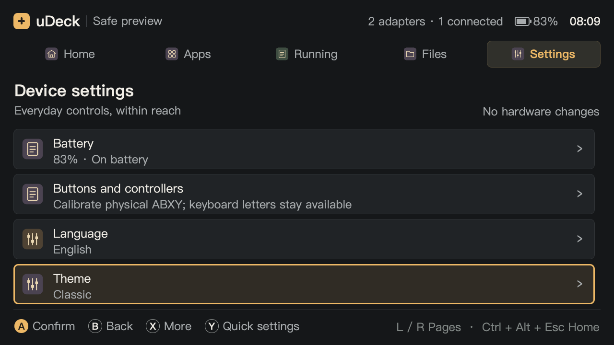
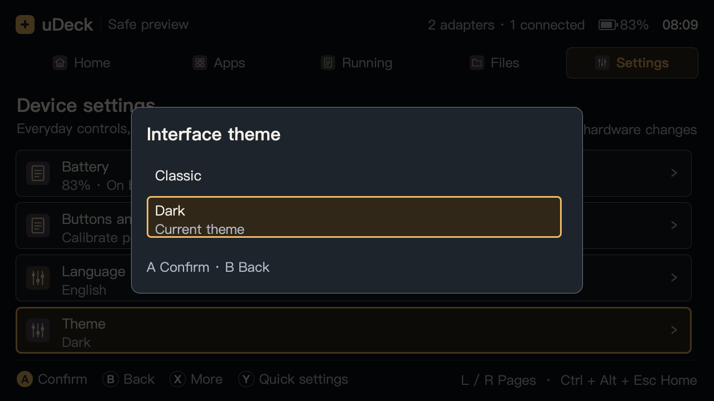
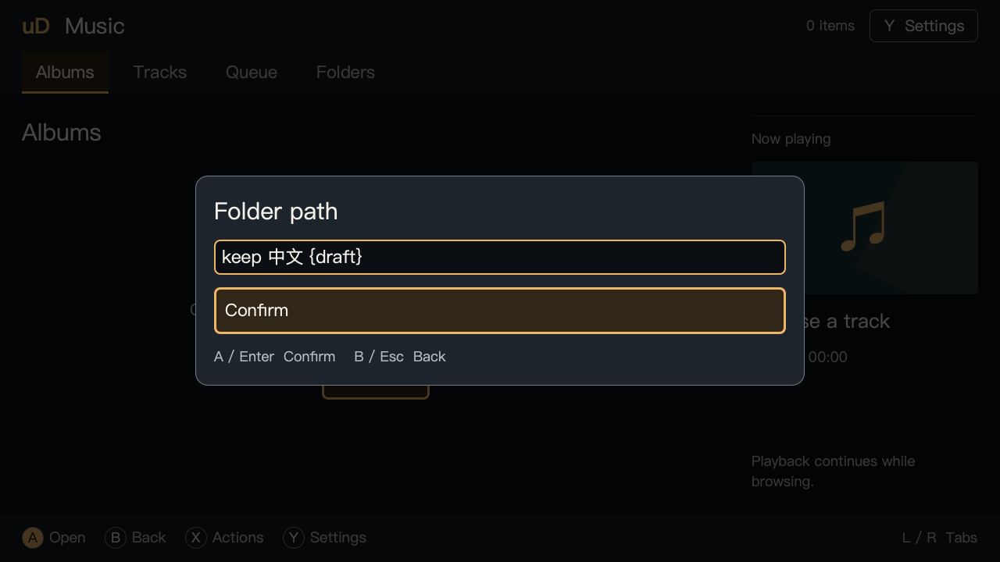

# uDeck 0.1.9 全局主题

系统设置与快捷设置新增 `Theme / 主题`，提供 `Classic / 经典` 和 `Dark / 黑暗`。旧配置默认使用经典主题，界面语言默认仍为英文。

## 使用

方向键选择主题，A / Enter 应用并保存，B / Esc 返回。选择后菜单保持打开，当前主题有文字标记；从快捷设置进入后，B 依次返回快捷设置和原页面。设置页保留原选中项。

原生音乐、视频、浏览器、阅读器、游戏前端及终端窗口通过已有的一秒设置轮询跟随主题。切换保留页面、列表和菜单滚动、输入文字与光标、媒体播放器、浏览页面、阅读文档以及终端 PTY。网页本身、视频和游戏画面、阅读夜间模式、终端 ANSI 配色独立保留。

升级软件包不会重启已运行的应用。升级前的旧进程继续使用已加载的界面；保存工作并正常关闭、重新打开后采用新版本。设备已有的长期 Terminal 会话不为升级而终止。

## 配色与接口

经典主题保留各模块原有暖灰与金色。黑暗主题使用下表颜色，必要边界使用较亮的灰色，选中和焦点沿用暖金色。禁用项目保留原来的禁用逻辑与透明度，错误同时显示文字。

| 角色 | 黑暗主题 |
| --- | --- |
| 页面背景 | `#0B0E12` |
| 面板 | `#14191F` |
| 弹层 | `#1D242C` |
| 正文 / 次要文字 | `#F5F2EB` / `#B6BDC7` |
| 强调 / 选中背景 | `#EDB866` / `#302719` |
| 必要控件边界 / 错误文字 | `#717D8A` / `#FFB4AB` |

共享配置新增 `preferences.theme`，只接受 `classic` 与 `dark`，缺失或非法值回退到 `classic`。配置版本保持为 1。外壳提供 `setTheme(themeId)`，控制器快照增加 `theme`。保存失败保留当前主题和原配置，并显示对应语言的错误信息。

`ThemePalette.qml` 集中管理语义颜色及 Basic Qt Quick Controls 的调色板。窗口按模块保留经典颜色差异，子组件显式接收同一调色板对象。主题更新只修改绑定；未变化的卡片、标签和菜单模型保持原对象。

主程序为 **0.1.9**，原生应用与终端包为 **0.1.2**。两个独立包均要求 `udeck >= 0.1.9`，共享配色与翻译由主程序包提供，没有增加外部依赖。

## 审查与回归

按 correctness-reviewer 与 code-simplicity-reviewer 在主线程审查全部改动。确认并修复一项 P2 问题：外壳每次快照更新会重新创建列表，主题切换使滚动位置从 496 移到 466。回归探针先复现此问题，再验证修复后的滚动值保持。应用的卡片、标签和菜单、终端菜单同样避免因颜色变化重建。

配置写入保留缓存加载后由其他应用更改的语言与主题，覆盖“应用改语言、外壳保存收藏”和“外壳改主题、应用再改语言”两个顺序场景。原有原子替换及失败回退保留。

新增自动化覆盖旧配置、非法主题、两个语言的菜单、即时保存、失败回退、逐层返回、输入与光标保持、长菜单滚动、多窗口同步和对比度。原生内容探针验证播放器对象、网页对象与 URL、阅读文档对象保持；原生终端探针核对切换前后 PTY 对象和 PID。

八窗口联动探针在同一个测试进程加载所有界面。终端的全局指针过滤器仅在该探针中移除，避免 PySide 6.8 为其他应用的 WebEngine 控件创建包装时崩溃；产品中的各应用为独立进程，原有终端输入与指针过滤不变，另有真实 PTY 探针覆盖。

## 验证记录

- 最终源码本地完整测试 **371 passed, 2 skipped**，129.01 秒。两个跳过项为本机缺少原生终端插件；uConsole **373 passed，无跳过**，289.12 秒，包含真实 PTY 与原生内容引擎。
- Ruff、QML 冒烟、wheel 和三个 arm64 Debian 包构建均通过。wheel 内 67 个源码与资源逐字节匹配工作区；设备上的 347 个构建与测试输入匹配本地清单；三个包共同分发 67 个源码与资源文件，文件交集为零。
- 两个语言、1280×720 与 960×600 的 QML 探针各保存 34 张截图，包含外壳设置、主题选择、确认、Wi-Fi、密码、五个应用和两扇终端窗口。
- 文字与背景逐对验证至少 4.5:1；焦点至少 3:1；黑暗主题必要控件边界至少 3:1。黑暗主题次要文字最低 7.76:1、必要边界最低 3.50:1（背景、面板、弹层和选中背景四组）。
- 自动截图与设备上执行的自动化不能替代现场按键与主观屏幕观感验收；本轮不把自动按键事件记为物理 ABXY 实按。

设备已安装 `udeck 0.1.9`、`udeck-apps 0.1.2`、`udeck-terminal 0.1.2`，仅升级这三个包，新增与移除项均为零。安装后的 67 个源码与资源再次匹配最终源码。只重启 `udeck-fullscreen.service`，运行壳报告 0.1.9。

使用已安装的 Python 模块在真实 Wayland 下完成八窗口主题探针，保存 34 张截图，QML 告警为空；该探针中的终端为 Mock，真实 PTY 保持由上述完整测试单独验证。既有 Terminal **PID 381833、启动时间 2026-11-06 15:40:10** 保持；输入配置、应用输入配置、收藏与最近使用均核对保留。屏幕恢复验证前的 `DSI-1 off`，没有重启登录会话或 compositor。

| 交付文件 | SHA-256 |
| --- | --- |
| `udeck_0.1.9_arm64.deb` | `addd8f8c1395a04de2086b26c061d05ba9760dd42199127dd3c906ef54f20ce4` |
| `udeck-apps_0.1.2_arm64.deb` | `deeb40fc7fa0d86bdbbeed175c21838692c70ca533c69be6ddfc91d617ff4b1b` |
| `udeck-terminal_0.1.2_arm64.deb` | `13eb933720dac0a0875e44593e6589cfb6cf713cbc73c6fd7f1de9b2fafb75dc` |
| `udeck-0.1.9-py3-none-any.whl` | `5cd901c9c8b2a2ef749a3b9210fa5f85f3221df368688b7f7fc5d979e6b3ed94` |

完整截图、审查记录、文件清单和日志保存在本地忽略目录 `artifacts/themes/`，设备记录在 `/tmp/udeck-theme-019-final/`。以下为选取的界面截图。

