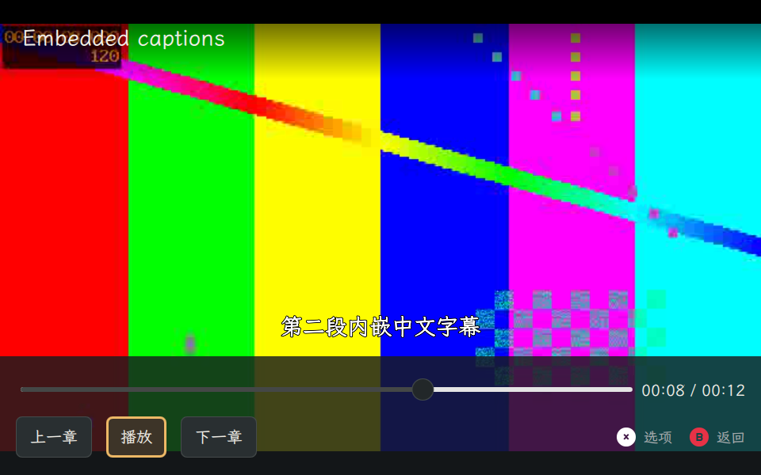
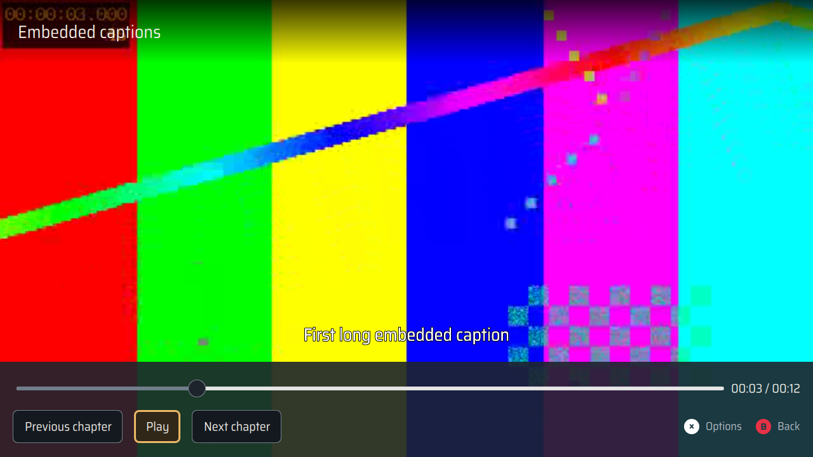

# 视频字幕与启动修复（0.2.6）

本次继续解决 [0.2.5 实机报告](video-validation-2026-11-12.md) 留下的字幕问题：第一个字幕段落覆盖 0–6 秒，在 3 秒处暂停后开启字幕，原来画面没有文字；跳转进已经开始的段落也会丢失字幕。修复后按当前播放位置显示选中的内嵌文字字幕，暂停、跳转、续播及倍速播放使用同一时间轴。同时修复实机复测发现的首帧前偶发锁等待。

## 根因与实现

设备上仅使用 QMediaPlayer、QAudioOutput 和 QVideoSink 的独立程序同样复现问题。Qt 6.8 FFmpeg 后端没有在上述跳转后重新交付当前字幕段落；详见其 [SubtitleRenderer 实现](https://github.com/qt/qtmultimedia/blob/v6.8.2/src/plugins/multimedia/ffmpeg/playbackengine/qffmpegsubtitlerenderer.cpp)。

显式选择内嵌轨道时，用已有 FFmpeg 异步读取该文字字幕轨道，在内存中转换为 SRT，并由现有 QML 字幕层按播放位置显示。视频、音频继续使用原 Qt 播放链路。不会生成旁挂字幕文件或替换设备 Qt 包。外部 SRT 和内嵌字幕互相替换，关闭字幕清除文字并取消正在进行的读取。

后台读取限制为 4 MiB、30 秒；关闭、切换字幕、选择外部字幕、更换媒体、来源撤销和退出时取消旧请求。旧进程的结果不会覆盖新选择。缺少 FFmpeg、解码失败、非法编码、超时及超限会显示错误；重试会清除旧字幕错误，保留其他播放错误。完成后重新核对来源和文件标识，媒体被替换时拒绝采用旧字幕。

代码审查补齐了两项边界修复：重试成功后移除残留错误，以及媒体已经消失时仍可关闭字幕。SRT 解析同时覆盖 CRLF、中英文、多行、标记／实体、重叠及无效时间段，并限制时间字段的匹配范围。

安装后的首轮显示矩阵还暴露出首帧前偶发卡住的问题。GDB 栈显示，主线程在播放开始后绑定 VideoSink 时等待 Qt 对象锁，音频渲染线程在销毁 QObject 时等待 Python GIL。将视频画面组件改为应用初始化时同步创建，使输出在媒体加载前绑定；浏览页面、播放、返回及续播继续使用同一输出对象。新增回归在旧初始化顺序上稳定失败，修复后通过。未修改系统 Qt 库。

## 验收结果

- 修复前的原生 Wayland 探针在“暂停于段落中间再启用”检查失败；修复后 8 项场景通过，包括向前／向后跳转、字幕间隙、语言切换、收起控制栏、关闭、内外字幕替换、2× 播放及确认续播。检查控制器文字、可见 QQuickText、有效视频帧及实际窗口截图。
- 最终代码的 macOS 定向回归 138 项通过；uConsole 定向回归 35 项通过，包括后台响应、取消／旧结果、失败后重试、进程清理、文件替换以及现有播放回归。
- 最终 ARM64 Debian 构建运行完整套件：1554 项通过。构建启用默认测试检查，未使用 `nocheck`。
- SRT、ASS、MP4 mov_text 均通过真实 FFmpeg 提取；MKV 和 MP4 的非零起始时间回归通过。uConsole 原生窗口另外完成 ASS、起始时间偏移 5 秒的 MP4 各 8 项显示检查，QML 错误为空。
- 扩展实机 11 项通过，覆盖 H.264 MP4、VP9 WebM、MPEG-4 MKV、双音轨、实际章节跳转、倍速与字幕组合、鼠标进度条、结束重播、错误恢复、确认续播、隐藏控制栏和来源撤销。
- 最终安装包通过 8 组原生 Wayland 显示矩阵（中英文 × 经典／黑暗 × 960×600／1280×720），每组完成全部 8 个字幕场景，并断言输出预先绑定及播放／续播中的对象保持。QML 错误为空，截图尺寸和实际文字显示均已核对。
- 安装后的常规原生视频探针通过有效帧、尺寸、窗口画面颜色、内嵌／外部字幕、主题切换、续播和结束重播检查。私有 D-Bus 上的真实 Music/Video 实例通过检测音乐、确认暂停、返回后恢复及取消保持播放；原 Music 实例不参与测试。

安装后的 35 项定向回归、11 项扩展播放、ASS、带 5 秒起始时间偏移的 MP4 也全部通过。机器可读结果见 [verification.json](evidence/video-subtitles-2026-11-13/verification.json)。代码审查后的未解决发现为空。

## 安装包与现场状态

最终实机验证包为 `dist/video-subtitles-final/udeck_0.2.6_arm64.deb`，SHA-256：

`4be7901725fb7d839012d77adf2a6918eb08f192979ce5d1e7b9bf6497231570`

源码包中的 424 个生产源码／资源文件与交付工作树逐字节一致，安装后的同一批文件也通过 SHA-256 校验。`dpkg --verify udeck` 和安装预检通过。容器未读取外部工作树的 Git 元数据，构建清单中的 Git 字段为空；本次没有创建发布标签或 GitHub Release。

安装及全部测试后，原 26 项文件／缺失状态、8 个进程启动时间均与原记录一致。另以 root 核对真实 SMB 配置路径 `/var/lib/udeck-smb/settings.json` 仍不存在，SMB 共享未启动，445／8787 无监听，SMB 管理服务正常。原桌面、SSH 及原应用会话均保留。原 Video 进程继续使用已加载代码，退出并重新启动视频应用后使用本次安装版本。

0.2.5 回退包保留于 `/var/backups/udeck-video-0.2.6-20261113/udeck_0.2.5_arm64.deb`。本轮未增加现场听音、实体按键、蓝牙音频路由及长时间播放压力验收。

原始日志和测试脚本保留于工作树 `artifacts/video-subtitles/`，设备证据目录为 `/var/tmp/udeck-video-validation-20261112/`。`release-build-superseded.log` 是审查后主动中止的旧构建，带 `before-sink-fix` 的日志是输出初始化修复前的记录；最终结果以 `release-build.log`、`install.log`、`installed-matrix.json` 及上述机器可读结果为准。早期 macOS 探针的样式初始化故障未记为产品字幕缺陷，字幕修复前失败以设备的 `embedded-red.log` 为据。`install-before-transfer-complete.log` 是传输尚未完成时被 SHA 校验拦截的安装尝试，未修改系统。
