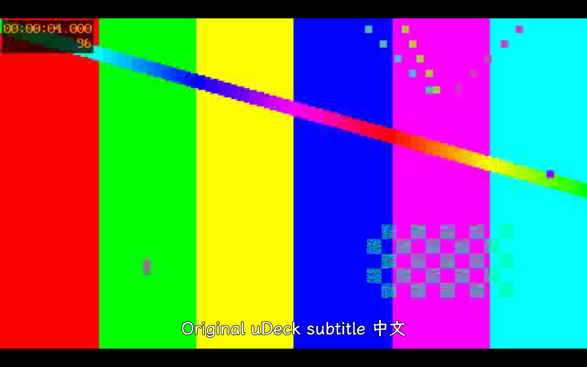

# 视频实机验证与修复（2026-11-12）

在 uConsole CM4（192.168.11.59、Debian 13.5 arm64、PySide6 6.8.2.1、Qt Multimedia / FFmpeg 7.1.3）上测试已安装的视频应用，再将修复构建为 0.2.5 并安装复测。使用独立 Wayland 窗口、临时原创媒体及独立应用状态，保留原桌面、SSH 和已有应用。

## 已修复

| 触发条件 | 原行为 | 修正 |
| --- | --- | --- |
| 控制栏自动隐藏后，视频播放到结束 | 控制栏仍隐藏，重播操作不可见 | 收到结束事件后显示控制栏；续播位置归零 |
| 重播已结束的视频，或通过打开文件请求从损坏视频切换到正常媒体 | 旧的“播放结束／播放失败”提示覆盖正常播放 | 接受新的播放请求后清除旧错误和提示，重播时清除结束提示；新产生的播放错误仍照常显示 |
| 跳转位置输入 `inf`、`1e309` 等值，或极大的有限数值 | 整数转换抛出未处理的 OverflowError | 校验有限数字，在转换前按媒体时长限制范围；无效输入保留输入框和草稿，并显示翻译后的错误 |

位置校验及消息清理位于音乐／视频共用的播放层，因此同时回归音乐。视频结束后的控制栏行为只在视频控制器修改。

## 验证结果

- 新增回归在修复前失败，修复后 10 项通过；原生 QML 探针另外覆盖真实结束事件及重播。修正探针对异步 VideoSink 的等待，保留有效视频帧、尺寸和画面颜色断言。
- macOS 定向回归：64 项通过，包含音乐、视频、浏览器、阅读器、应用设置、IPC 路由和保存行为。
- Debian ARM64 定向回归：71 项通过，增加发布打包验证。安装包在该回归通过后构建，构建时使用 `DEB_BUILD_OPTIONS=nocheck`，没有重复运行全部测试。本轮未重跑此前的 1519 项完整套件。
- uConsole 上修复候选的 H.264 MP4（1280×720）、VP9 WebM、MPEG-4 MKV 均有真实解码帧。暂停、跳转、继续／从头播放、鼠标进度条、隐藏控制栏后的输入、损坏文件恢复及来源撤销通过。
- 双音轨选择、三个实际媒体章节的跳转、2× 播放速度通过；内嵌字幕跳转的限制单列如下，没有将该组合检查记为全部通过。
- 独立私有 D-Bus 上的真实 Music/Video 进程通过播放检测、确认暂停音乐、视频返回后按设置恢复音乐，以及取消后音乐继续播放。原 Music 实例不参与测试。
- 最终 0.2.5 安装包原生 Wayland 探针通过：有效画面、内嵌字幕初次交付、外部中文 SRT、跳转、暂停保存、确认续播、经典／黑暗主题保持、结束显示控制栏及重播清除提示；QML 错误为空。已安装模块的新增回归另为 10 项通过。
- Ruff、差异检查、Debian 构建、安装后 `dpkg --verify udeck` 和 `udeck-preflight --check-installed` 通过。

本轮安装前后核对的 26 个文件或不存在状态及 8 个原进程启动时间均保持一致。原网页共享未运行，SMB 配置仍不存在，445 / 8787 无监听，SMB 管理服务正常。没有重启设备、桌面、原 Video 或其他原应用。正在运行的原 Video 保留其已加载代码，修复在正常重新打开视频应用后生效。

## 当时剩余的 Qt 后端限制（已在 0.2.6 解决）

以下为 0.2.5 的历史验收结论；后续修复及实机结果见 [视频字幕与启动修复（0.2.6）](video-subtitles-2026-11-13.md)。

设备 Qt 6.8 FFmpeg 后端在中途启用内嵌 SRT、或跳转到已有字幕段落中间时，可能不重新交付该段字幕。这在只使用 QMediaPlayer、QAudioOutput 和 QVideoSink 的独立程序中同样复现，未调用 uDeck 控制器：启用字幕和跳转至 4 秒时 `subtitleText` 为空；回到开头后收到字幕，再跳转至 4 秒又变为空。

这项限制本轮仍然存在，没有以音轨编号或单次视频帧代替字幕显示验收。可使用现有“外部字幕（SRT）”入口选择配套 UTF-8 SRT：外部字幕按播放位置显示，实机截图确认中文字幕在收起控制栏后仍可见。没有自动提取整部视频的字幕，也没有替换设备的 Qt 包。

测试没有现场听音和实体按键反馈，不能据此宣称扬声器音质、蓝牙音频、实体 ABXY / L / R 或长时间播放性能通过。

## 安装包与记录

开发验证包为 `dist/video-device-final/udeck_0.2.5_arm64.deb`，SHA-256：

`381434b9e50e7d69657e34098ed69c4be3250995d5e71c524c008348d06b1c9b`

源码包中的 423 个已追踪生产源码／资源文件与交付工作树逐字节一致。容器未读取外部工作树的 Git 元数据，build-manifest 的 Git 字段为空。本次没有创建发布标签或 GitHub Release。设备保留 0.2.4 回退包于 `/var/backups/udeck-video-0.2.5-20261112/`。

原始日志、修复前后报告和设备探针保留在本工作树的 `artifacts/video-device/`；实机记录位于 `/var/tmp/udeck-video-validation-20261112/`。其中 `installed-unit.log` 是缺少 Qt application 夹具的中止运行，最终单测结果以 `installed-unit-final.log` 为准。机器可读结果见 [verification.json](evidence/video-playback-2026-11-12/verification.json)。
