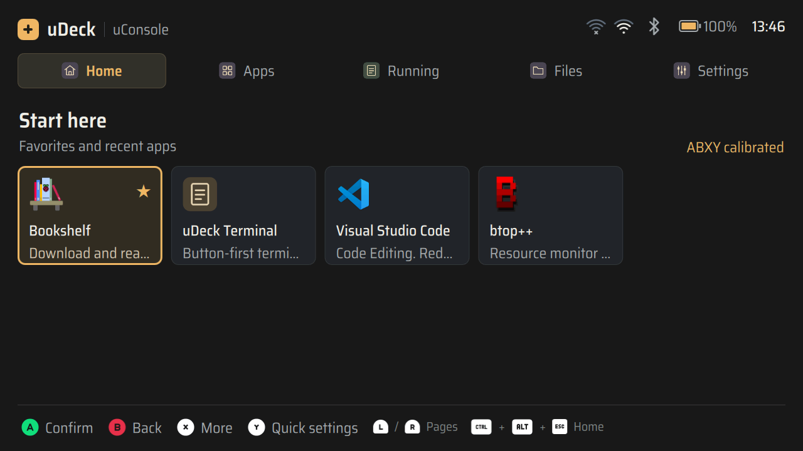
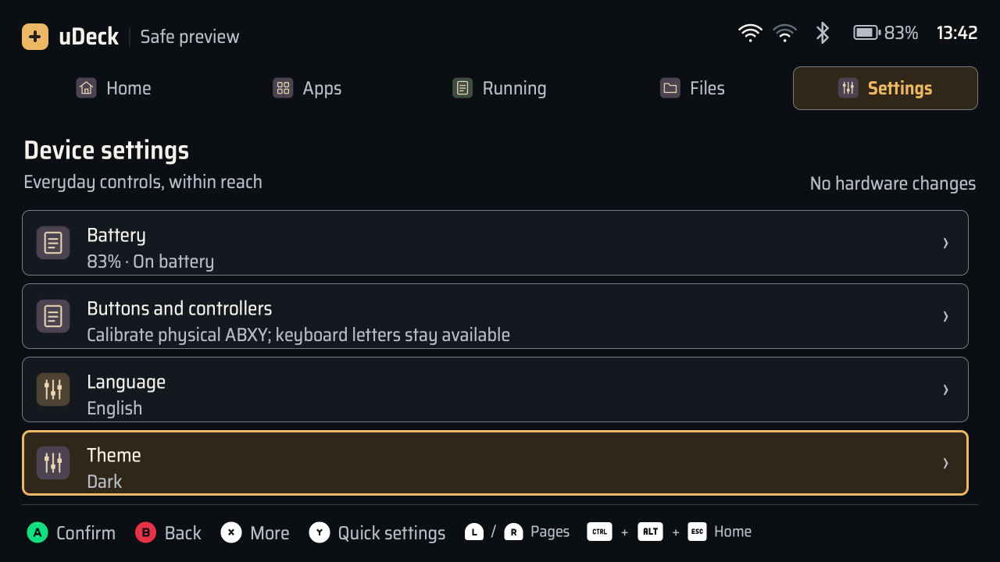

# uDeck 0.1.14 顶部无线状态

启动器顶部现在为每张 Wi-Fi 网卡显示独立的四格信号图标，蓝牙开启时显示蓝牙图标。网卡按内置、USB、其他的顺序固定排列，详细连接与网卡数量摘要保留在设置入口和 Wi-Fi 菜单中。

信号取自各网卡实际连接的 `ActiveAccessPoint`，活动热点不在扫描列表或隐藏 SSID 时也能读取强度；读取失败时清除旧值。未连接、连接中、关闭、未受管理与读取失败分别使用叉号、省略点、斜线、短横线与感叹号，未知强度显示问号。图标按屏幕物理像素绘制，复用两套主题和现有依赖。

中英文悬停提示提供网卡身份、接口、网络与信号百分比，网络名按纯文本呈现。提示观察现有鼠标拦截层的位置，保留按键导航；隐藏图标不会显示弹出提示。任务执行文字根据剩余空间省略，无线图标、电量与时间持续显示。完整约定见 [顶部无线状态图标规范](../design/wireless-status.md)。

## 自动化验证

- 完整测试：**416 通过、2 跳过，193.42 秒**。跳过项为 macOS 缺少原生 QMLTermWidget 插件的真实 PTY 测试；13 条弃用警告来自已有 `dbus_next`。
- 信号测试覆盖四格临界值、活动热点与更强同名热点区分、活动热点不在扫描列表、隐藏 SSID、强度变化事件、热点消失、USB 插拔及断开清空强度。逐网卡操作保留另一张网卡的连接与信号。
- 新增 QML 矩阵：两种语言、两套主题、1280×720／960×600，覆盖 1×／1.5×／2×，共 **8 次运行、152 张截图**。19 个场景包括双网卡、双连接、零至四格、未知强度、连接中、异常、无线关闭、无网卡、蓝牙关闭或不可用、长任务提示、长网络名及输入期间刷新。
- 使用实际像素验证信号格数逐级点亮；检查顶部图标间距、边界、长网络名纯文本提示与输入内容保留。未点亮线条与两套页面背景的对比度分别约 **3.39:1／3.65:1**，点亮线条使用主题正文色。
- Ruff、`git diff --check` 和 QML 冒烟通过。按 correctness-reviewer 与 code-simplicity-reviewer 在主线程复核，未留下待修复问题。

## 安装包与设备核对

基础包版本 **0.1.14**，原生应用包和终端保持兼容的 **0.1.4**。wheel 的 **111 个**运行时与资源文件、arm64 Debian 基础包的 **69 个**文件逐项与源码一致；安装后 **111 个**共享及应用文件均与最终源码一致。

| 文件 | SHA-256 |
| --- | --- |
| `udeck-0.1.14-py3-none-any.whl` | `069c255a18294bd9eefdd1a558f21d0d77317b26f4ec65ad6661a93fe2842edc` |
| `udeck_0.1.14_arm64.deb` | `338965087a1e55434b3229ad6833a6075bd66cb8f8ab29188c6a96ba856c6917` |

2026-11-07 在现有 uConsole 上升级基础包，仅重启启动器。服务恢复为 `active`，`udeckctl doctor --json` 返回就绪。只读读取两张真实网卡：内置 `wlan0` 未连接，USB `wlan1` 已连接，读取时强度为 69%（三格）；蓝牙可用且已开启。

设备通过安装后的 QML 完成英文黑暗、中文经典两组共 **38 张**状态场景截图，没有 QML 错误；实际窗口尺寸分别为 1278×643、960×600。这些场景使用测试数据，另保存运行中启动器的 **1280×720 真实桌面截图**：

下图为双连接的自动化预览，左侧四格、右侧两格，蓝牙已开启：

原用户配置逐字节保持一致，真实终端 PID `381833` 及命令校验值保持。显示电源用于截图后恢复原有 `DSI-1 off`。本次没有执行真实连接切换、断开、无线电源切换或 USB 拔插；相应状态通过 Mock 和 D-Bus 模拟事件验证。人工实屏观感与物理插拔验收仍需现场确认。
