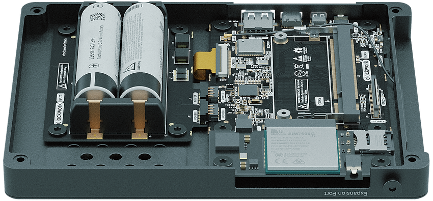

### make --field-programmable --cellular --fantasy uConsole

[Pre-order](https://www.clockworkpi.com/shop)

We sincerely Thank thousands of people from all over the world for your Great support!

### c

### Mainboard

### 6

### Introducing the clockworkPi v3.14 revision 5

The ClockworkPi v3.14 revision 5 has improved the analog circuitry section to increase the stability of the power supply.

CPI v3.14 revision 5 integrates up to 12 interfaces in the ultra-small size of 95x77mm, ensuring sufficient connectivity for your work and entertainment. Following an easy-to-upgrade modular design of CPU and memory, clockworkPi v3.14 revision 5 allows you to freely choose a suitable "Core" for various application scenarios.

CPI v3.14 revision 5 is compatible with the Raspberry Pi CM3 and CM4 series (with an adapter board), which means that your work on the Raspberry Pi can be "teleported" to a "fantasy console" in seconds!

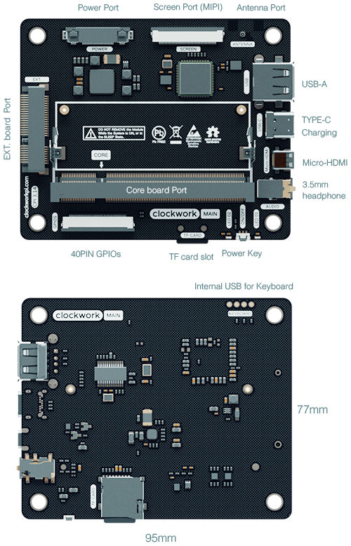

Tech Specs

- CPI v3.14 uses a compact design, the size is reduced to 95x77mm.
- PMU chip which supports reliable and complete lithium battery charge and discharge management
- Integrated 5G-WIFI (802.11ac) + Bluetooth 5.0
- High-gain antenna
- One standard USB 2.0 port, two internal USB 2.0 interfaces, An internal contact interface for the keyboard module
- USB-C\* charging port
- TF card (Micro SD card) slot\*\*
- 40 Pins MIPI screen interface
- Micro-HDMI interface
- 3.5 headphone jack, supports microphone input
- Onboard stereo audio power amplifier chip
- 40 Pins GPIOs expansion interface (using standard 0.5mm FPC connector)
- 52 Pins extension module interface (using standard Mini PCI-E connector) for the “EXT. module”
- Standard DDR2-SODIMM 200 Pins interface: connects CPI v3.14 to the "Core module"

The schematics and related design materials are released under the GPL v3 license, and you can find them on our GitHub.

\* Depends on the "Core Module" features.

\*\* The tested maximum capacity is 256GB.

### c

### Core module

### 5

### Introducing the upgrade-friendly Cores

This time we will introduce three core modules plus Raspberry Pi CM4; you will have four configurations to choose from.

Model

RPI-CM4

A-04

A-06

R-01

CPU Microarchitecture

ARM64-bit Quad-core Cortex-A72

ARM64-bit Quad-core Cortex-A53

ARM64-bit Dual-core Cortex-A72

ARM64-bit Quad-core Cortex-A53

RISC-V 64bit RV64IMAFDCVU

Freq.

1.5GHz

1.8GHZ

1.8GHz

1.4GHz

1.0GHz

Cores

4

4

6

1

GPU

VideoCore 4

Mali-T720

Mali-T864

No GPU

RAM

4GB LPDDR4

2GB DDR3

4GB LPDDR4

1GB DDR3

The RPI-CM4 is suitable for general purposes with longer usage time, such as coding, e-mails, making indie games, running most video game emulators, etc. The rich Raspberry Pi ecosystem provides excellent technical support, whether you are a beginner or an expert.

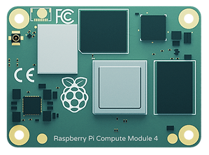

Same as DevTerm, uConsole also supports the RISC-V architecture, and while it is not for beginners, we still leave it to those brave voyagers.

For users who require high performance and computing power, such as for AI/algorithm development and tuning, rapid prototyping of embedded devices, speeding up your compile-time, etc., the A-06 series will provide you with a better solution. The A-04 series is a cost-effective alternative to the Raspberry Pi CM3 with higher performance gains.

We also offer you the "uConsole Kit" option without the "Core Module."

The schematic and related design materials are released under the GPL v3 license, and you can find them on our GitHub.

### c

### Ext. module

### 7

### Introducing the 4G/LTE cellular modem Ext. module

This time a new 4G data communication expansion module is ready for your selection.

The module is compatible with global wireless data communication on LTE CAT4, HSDPA/HSUPA, HSPA+, UMTS, EDGE, and GPRS networks.

Tech Specs:

- 37x77mm size
- Data rates
	- LTE CAT4: Uplink up to 50Mbps, Downlink up to 150Mbps
		- HSDPA/HSUPA: Uplink up to 2.2Mbps, Downlink up to 2.8Mbps
		- HSPA+: Uplink up to 5.76Mbps, Downlink up to 42.0Mbps
		- UMTS: Uplink/Downlink up to 384.0Kbps
		- EDGE: Uplink/Downlink up to 236.8Kbps
		- GPRS: Uplink/Downlink up to 85.6Kbps
- The chip frequency bands
	- LTE-FDD: B1/B2/B3/B4/B5/B7/B8/B12/B13/B18/B19/B20/B25/B26/B28/B66
		- LTE-TDD: B34/B38/B39/B40/B41
		- UMTS/HSDPA/HSPA+: B1/B2/B4/B5/B6/B8/B19
		- GSM/GPRS/EDGE: 850/900/1800/1900MHz
- The chip certifications
	- FCC, CE(RED), GCF, CCC, JATE, PTCRB, RCM, AT&T, Deutsche Telekom, ICASA, KC, REACH, Telec, Telstra, T-mobile, US Cellular, Verizon
- RF (radio frequency) connectors: Primary, Rx-diversity, GNSS
- Standard SIM card slot
- 3.5mm headphone jack for stand-alone analog voice function
- Dual speaker interface
- UART debugging interface
- 52Pin golden fingers to connect to the mainboard

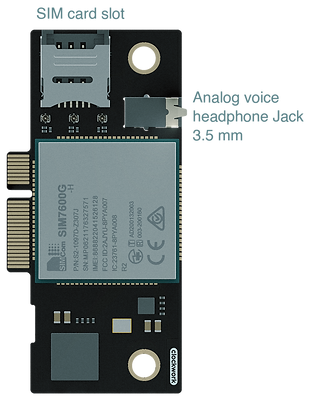

The schematic and related design materials are released based on the GPL v3 license, and you can find them on our GitHub.

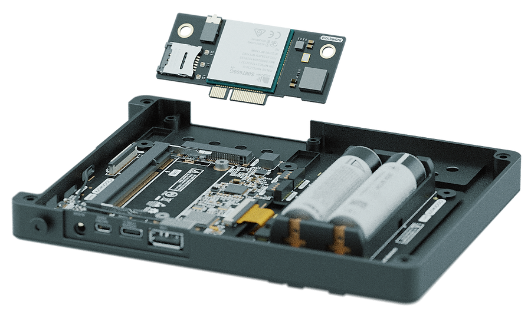

### c

### Screen

### 8

Standard HD 720p 5.0-inch IPS screen

The 1280x720 resolution and 5-inch display area ensure visibility while providing good software adaptability and portability. For most applications, desktop environments and game emulators will run smoothly without special adjustments.

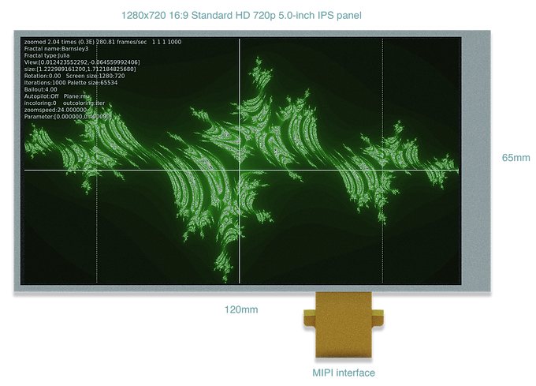

### c

### Keyboard

### ;

### Introducing the ultra-portable QWERTY Backlit keyboard

We are very excited to bring you an ultra-portable QWERTY keyboard with 74 keys and adjustable backlighting. A physical mini trackball with an OK function and two mouse buttons, the trackball uses four high-sensitivity and high-reliability designs based on Hall-effect sensors. A set of retro-style gamepad arrow keys and four game buttons are included; these eight keys all use independent IO design to ensure minimal delay in response.

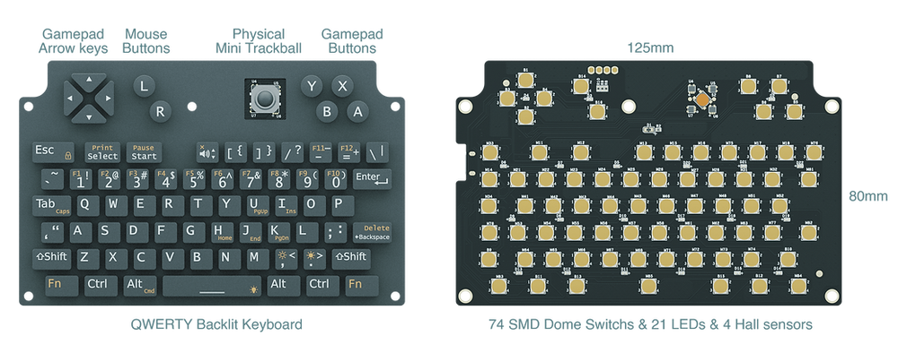

The keyboard central control unit adopts the Arm® Cortex-M3 architecture, fully compatible with the Arduino STM32 development environment. A Micro USB-UART programming port allows you to reprogram and customize the keyboard firmware easily.

  
The USB POGO Pin on the back of the keyboard is naturally connected to the mainboard, saving you the tedious operation of cable connection.

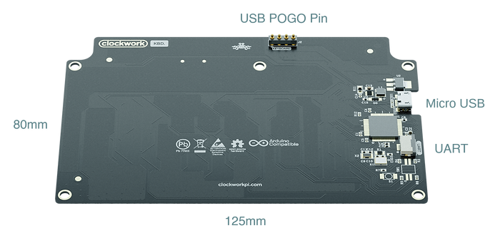

The firmware source code, schematic, and related design materials are released under the GPL v3 license, and you can find them on our GitHub.

### c

### Battery module

### 9

We carefully designed the battery holder to make it more compatible with various 18650 battery sizes: Ø18±0.5mm diameter, 65-69mm length. The battery module has "Short Circuit and Reverse Polarity Protection" features, but you are still advised to purchase\* the batteries from a reliable distributor and install them correctly.

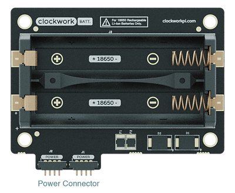

Theoretically, you could use a single 18650 battery to power the system or replace the batteries one by one even when the system is in use. These actions can still cause system instability, and we strongly recommend replacing the batteries after the system is powered down. Please remove the battery if you do not use the device for a long time. Please consult the battery supplier for detailed 18650 safe usage rules, and please strictly follow them.

\* Please note: the 18650 batteries are NOT included in the package due to global logistics complexity for lithium batteries.

### c

### About DIY\*

We are pleased to introduce all-metal construction that will bring beautiful texture and solidity while improving the efficiency of passive heat dissipation.

A well-designed bracket system makes the DIY process smoother and more manageable; no professional tools, skills, or background are required. All you need is a 2.5mm Hex key\*\*. You can mount all modules on the bracket and lock the shells to complete the installation in minutes of fun.

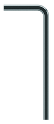 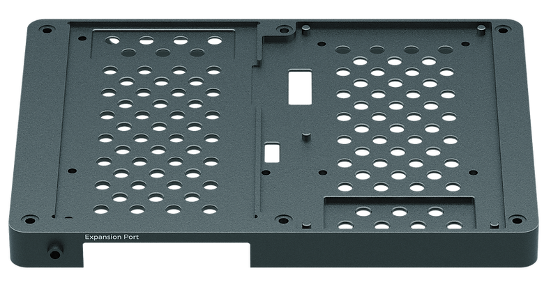

We follow the concept of "Open-Design," the 3D files of all structures and related materials are released under the GPL v3 license. You can find them on our GitHub to customize your own parts through CNC or 3D printing technology.

We also provide you with two color options for the front shell - "Matte Silver" and "Matte Black."

\* Safety reminders:

- The DIY process is ONLY ALLOWED FOR USERS AGED 12 OR ABOVE.
- During the DIY process, please READ the instruction carefully.

\*\* The 2.5mm Hex key is included in the package.

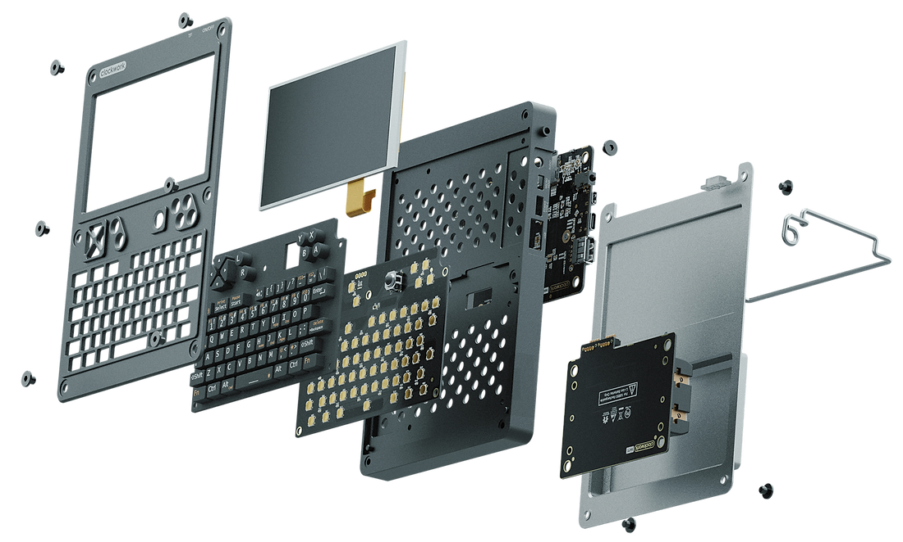

### c

### OS, APPs & Development tools

 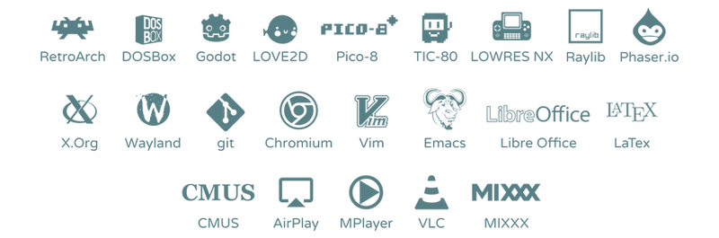 

All of the above have been tested with uConsole. For more supported software lists, please refer to the repositories of Debian 64-bit ARM.

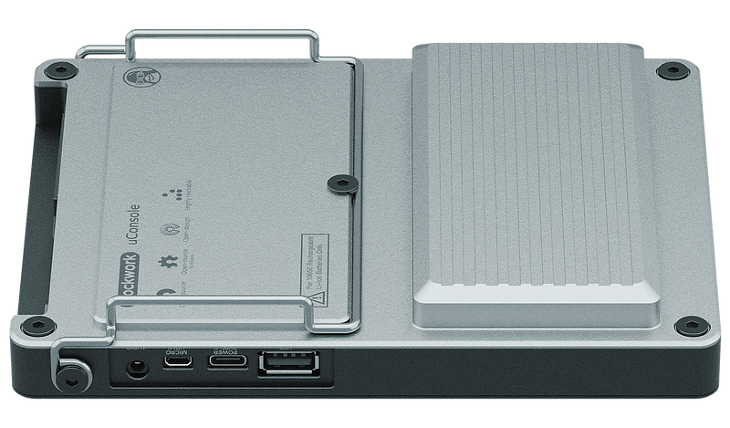

[Pre-order](https://www.clockworkpi.com/shop)

We sincerely Thank thousands of people from all over the world for your Great support!